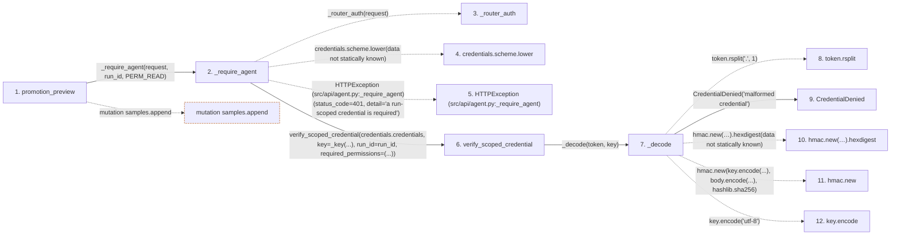

# promotion_preview

**Entry point:** `promotion_preview` (`http`)
**Source:** [agent](../modules/agent.md)
**Modules touched:** [agent](../modules/agent.md), [config](../modules/config.md), [research_kernel](../modules/research_kernel.md), [scoped_credentials](../modules/scoped_credentials.md), [significance](../modules/significance.md)

## Call sequence

> Static overview in presentation order, not runtime execution order. Arrows retain captured callers; representative internal continuations and boundary examples precede repeated helper detail.

```mermaid
sequenceDiagram
    participant p0 as promotion_preview
    participant p1 as _require_agent
    participant p2 as decide_promotion
    participant p3 as verify_scoped_credential
    participant p4 as _key
    participant p5 as _decode
    participant p6 as PromotionDecision
    participant p7 as qualification_status
    participant p8 as _check_rate_limit
    participant p9 as secret_value
    participant p10 as CredentialRevoked
    participant p11 as CredentialExpired
    participant p12 as CredentialDenied
    participant p13 as ScopedPrincipal
    participant p14 as HTTPException (src/api/agent.py:promotion_preview)
    participant p15 as _store.get_iterations
    participant p16 as json.loads(…).get
    participant p17 as json.loads (src/api/agent.py:promotion_preview)
    participant p18 as row.get
    participant p19 as samples.append
    participant p20 as float (src/api/agent.py:promotion_preview)
    participant p21 as list
    participant p22 as _router_auth
    participant p23 as credentials.scheme.lower
    participant p24 as HTTPException (src/api/agent.py:_require_agent)
    participant p25 as bool (src/core/research_kernel.py:decide_promotion)
    participant p26 as status.get
    participant p27 as str (src/core/research_kernel.py:decide_promotion)
    participant p28 as str (src/api/agent.py:_require_agent)
    p0->>p1: _require_agent
    p0->>p2: decide_promotion
    p1->>p3: verify_scoped_credential
    p1->>p4: _key
    p3->>p5: _decode
    p2->>p6: PromotionDecision
    p2->>p7: qualification_status
    p1->>p8: _check_rate_limit
    p4->>p9: secret_value
    p3->>p10: CredentialRevoked
    p3->>p11: CredentialExpired
    p3->>p12: CredentialDenied
    p3->>p13: ScopedPrincipal
    p0-->>p14: HTTPException (src/api/agent.py:promotion_preview)(status_code=503, detail='store is not initialized')
    p0-->>p15: _store.get_iterations(run_id)
    p0-->>p16: json.loads(…).get('primary_metric')
    p0-->>p17: json.loads (src/api/agent.py:promotion_preview)(...)
    p0-->>p18: row.get('metrics_json')
    p0-->>p19: samples.append(float(...))
    p0-->>p20: float (src/api/agent.py:promotion_preview)(value)
    p0-->>p21: list(decision.reasons)
    p1-->>p22: _router_auth(request)
    p1-->>p23: credentials.scheme.lower
    p1-->>p24: HTTPException (src/api/agent.py:_require_agent)(status_code=401, detail='a run-scoped credential is required')
    p2-->>p25: bool (src/core/research_kernel.py:decide_promotion)(status.get(...))
    p2-->>p26: status.get('qualifies')
    p2-->>p26: status.get('status')
    p1-->>p24: HTTPException (src/api/agent.py:_require_agent)(status_code=403, detail=str(...))
    p2-->>p27: str (src/core/research_kernel.py:decide_promotion)(status.get(...))
    p1-->>p28: str (src/api/agent.py:_require_agent)(exc)
```

<!-- Auto-generated from static call edges. Dashed arrows are external or unresolved calls. Reviewed runtime conditions and side effects belong in Behavior. -->

> Call sequence diagram shows 30 of 77 interactions; 47 omitted to keep the visualization within the 30-interaction and generated-diagram limits, with uncertain identities omitted rather than inferred.

> Captured boundary calls: external 9 of 40 (31 omitted); unresolved 8 of 17 (9 omitted). These counts cover the captured static trace.

Omitted captured detail, grouped by actual caller occurrence and target module:

| Caller | Parent step | Target module | Kind | Omitted interactions |
| --- | --- | --- | --- | --- |
| `src/core/scoped_credentials.py:_decode` | 7 | - | unresolved | 4 |
| `src/core/scoped_credentials.py:_decode` | 7 | [src/core/scoped_credentials.py](../modules/scoped_credentials.md) | internal | 4 |
| `src/core/scoped_credentials.py:_decode` | 7 | - | external | 3 |
| `src/core/scoped_credentials.py:verify_scoped_credential` | 6 | - | external | 10 |
| `src/core/scoped_credentials.py:verify_scoped_credential` | 6 | [src/core/scoped_credentials.py](../modules/scoped_credentials.md) | internal | 2 |
| `src/config.py:secret_value` | 36 | - | external | 1 |
| `src/config.py:secret_value` | 36 | - | unresolved | 1 |
| `src/api/agent.py:_check_rate_limit` | 41 | - | external | 3 |
> Omission summary shows 8 of 13 groups; 5 further groups are not expanded here. Counts above include all omitted interactions.
> Detailed flow queries retain their own coverage and limits; omitted paths may execute at runtime.

## Data flow

<!-- Auto-generated static analysis. Treat values and boundaries as best-effort hints, not runtime proof. -->

### Step data

| Step | Inputs | Reads | Writes | Returns |
|---|---|---|---|---|
| `promotion_preview` | `run_id: str`, `request: Request` | `PERM_READ`, `_store`, `json` | - | `{...}` |
| `_require_agent` | `request: Request`, `run_id: Optional[str]`, `permission: str` | `ScopedAuthError` | - | `principal` |
| `_router_auth` | - | - | - | - |
| `credentials.scheme.lower` | - | - | - | - |
| `HTTPException (src/api/agent.py:_require_agent)` | - | - | - | - |
| `verify_scoped_credential` | `token: str`, `key: str`, `run_id: Optional[str]`, `tenant_id: Optional[str]`, `required_permissions: Iterable[str]`, `now: Optional[float]` | `_REVOKED` | - | `ScopedPrincipal(...)` |
| `_decode` | `token: str`, `key: str` | `json` | - | `payload` |
| `token.rsplit` | - | - | - | - |
| `CredentialDenied` | - | - | - | - |
| `hmac.new(…).hexdigest` | - | - | - | - |
| `hmac.new` | - | - | - | - |
| `key.encode` | - | - | - | - |

### Call data

| From | To | Line | Call |
|---|---|---:|---|
| promotion_preview | _require_agent | 339 | `_require_agent(request, run_id, PERM_READ)` |
| _require_agent | _router_auth | 80 | `_router_auth(request)` |
| _require_agent | credentials.scheme.lower | 83 | `credentials.scheme.lower(data not statically known)` |
| _require_agent | HTTPException (src/api/agent.py:_require_agent) | 84 | `HTTPException(status_code=401, detail='a run-scoped credential is required')` |
| _require_agent | verify_scoped_credential | 89 | `scoped.verify_scoped_credential(credentials.credentials, key=_key(...), run_id=run_id, required_permissions=(...))` |
| verify_scoped_credential | _decode | 119 | `_decode(token, key)` |
| _decode | token.rsplit | 154 | `token.rsplit('.', 1)` |
| _decode | CredentialDenied | 156 | `CredentialDenied('malformed credential')` |
| _decode | hmac.new(…).hexdigest | 157 | `hmac.new(key.encode('utf-8'), body.encode('utf-8'), hashlib.sha256).hexdigest(data not statically known)` |
| _decode | hmac.new | 157 | `hmac.new(key.encode(...), body.encode(...), hashlib.sha256)` |
| _decode | key.encode | 158 | `key.encode('utf-8')` |

### Boundary effects

| Kind | Target | Step | Line |
|---|---|---|---:|
| mutation | `samples.append` | `promotion_preview` | 354 |

### Static analysis gaps

| Kind | Step | Target | Line |
|---|---|---|---:|
| unresolved_call | `_require_agent` | `_router_auth` | 80 |
| unresolved_call | `_require_agent` | `credentials.scheme.lower` | 83 |
| external_call | `_require_agent` | `HTTPException` | 84 |
| unresolved_call | `_decode` | `token.rsplit` | 154 |
| unresolved_call | `_decode` | `hmac.new(key.encode('utf-8'), body.encode('utf-8'), hashlib.sha256).hexdigest` | 157 |
| external_call | `_decode` | `hmac.new` | 157 |
| unresolved_call | `_decode` | `key.encode` | 158 |
| step_limit | `promotion_preview` | `first 12 steps` | 0 |

## Behavior

This flow starts at `promotion_preview` and is classified as `http`. The generated call and data-flow sections are bounded static projections; runtime conditions and side effects require source-level confirmation.
