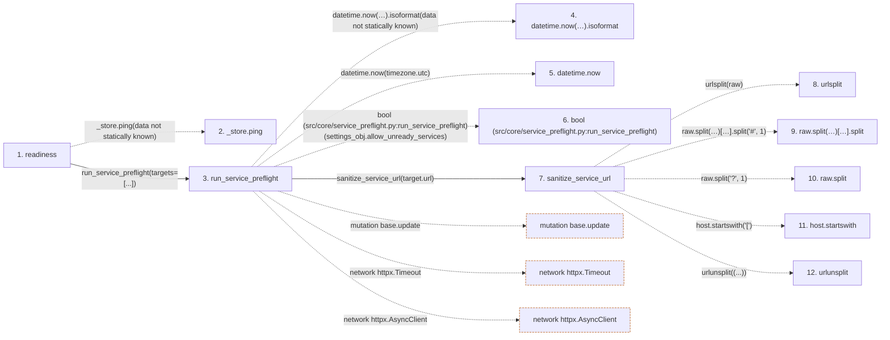

# readiness

**Entry point:** `readiness` (`http`)
**Source:** [src_main](../modules/src_main.md)
**Modules touched:** [preflight](../modules/preflight.md), [service_preflight](../modules/service_preflight.md), [src_main](../modules/src_main.md)

## Call sequence

> Static overview in presentation order, not runtime execution order. Arrows retain captured callers; representative internal continuations and boundary examples precede repeated helper detail.

```mermaid
sequenceDiagram
    participant p0 as readiness
    participant p1 as run_service_preflight
    participant p2 as build_not_run_preflight
    participant p3 as preflight_check_from_target
    participant p4 as sanitize_service_url
    participant p5 as TCPConnectCheck
    participant p6 as HTTPHealthCheck
    participant p7 as str
    participant p8 as _store.ping
    participant p9 as bool (src/main.py:readiness)
    participant p10 as preflight.get
    participant p11 as all
    participant p12 as internal_checks.values
    participant p13 as datetime.now(…).isoformat
    participant p14 as datetime.now
    participant p15 as list (src/core/service_prefligh…py:build_not_run_preflight)
    participant p16 as bool (src/core/service_preflight.py:run_service_preflight)
    participant p17 as list (src/core/service_preflight.py:run_service_preflight)
    participant p18 as base.update
    participant p19 as httpx.Timeout
    participant p20 as min
    participant p21 as httpx.AsyncClient
    participant p22 as asyncio.gather
    participant p23 as pc.check
    participant p24 as active_client.aclose
    participant p25 as services.items
    participant p26 as check.get
    participant p27 as urlsplit
    participant p28 as raw.split(…)[…].split
    p0->>p1: run_service_preflight
    p0->>p2: build_not_run_preflight
    p1->>p3: preflight_check_from_target
    p2->>p4: sanitize_service_url
    p3->>p5: TCPConnectCheck
    p3->>p6: HTTPHealthCheck
    p0-->>p7: str(exc)
    p0-->>p8: _store.ping
    p0-->>p9: bool (src/main.py:readiness)(...)
    p0-->>p10: preflight.get('required_ready')
    p0-->>p11: all(internal_checks.values(...))
    p0-->>p12: internal_checks.values
    p1-->>p13: datetime.now(…).isoformat
    p1-->>p14: datetime.now(timezone.utc)
    p2-->>p15: list (src/core/service_prefligh…py:build_not_run_preflight)(target.health_paths)
    p1-->>p16: bool (src/core/service_preflight.py:run_service_preflight)(settings_obj.allow_unready_services)
    p1-->>p17: list (src/core/service_preflight.py:run_service_preflight)(target.health_paths)
    p1-->>p18: base.update({...})
    p1-->>p17: list (src/core/service_preflight.py:run_service_preflight)(target.health_paths)
    p1-->>p19: httpx.Timeout(settings_obj.preflight_timeout_s, connect=min(...))
    p1-->>p20: min(settings_obj.preflight_timeout_s, 2.0)
    p1-->>p21: httpx.AsyncClient(timeout=timeout, follow_redirects=True)
    p1-->>p22: asyncio.gather(...)
    p1-->>p23: pc.check(active_client)
    p1-->>p24: active_client.aclose
    p1-->>p25: services.items
    p1-->>p26: check.get('required')
    p1-->>p26: check.get('status')
    p4-->>p27: urlsplit(raw)
    p4-->>p28: raw.split(…)[…].split(' ', 1)
```

<!-- Auto-generated from static call edges. Dashed arrows are external or unresolved calls. Reviewed runtime conditions and side effects belong in Behavior. -->

> Call sequence diagram shows 30 of 36 interactions; 6 omitted to keep the visualization within the 30-interaction and generated-diagram limits, with uncertain identities omitted rather than inferred.

> Captured boundary calls: external 13 of 14 (1 omitted); unresolved 11 of 14 (3 omitted). These counts cover the captured static trace.

Omitted captured detail, grouped by actual caller occurrence and target module:

| Caller | Parent step | Target module | Kind | Omitted interactions |
| --- | --- | --- | --- | --- |
| `src/core/service_preflight.py:run_service_preflight` | 3 | [src/core/service_preflight.py](../modules/service_preflight.md) | internal | 2 |
| `src/core/service_preflight.py:sanitize_service_url` | 7 | - | unresolved | 3 |
| `src/core/service_preflight.py:sanitize_service_url` | 7 | - | external | 1 |
> Detailed flow queries retain their own coverage and limits; omitted paths may execute at runtime.

## Data flow

<!-- Auto-generated static analysis. Treat values and boundaries as best-effort hints, not runtime proof. -->

### Step data

| Step | Inputs | Reads | Writes | Returns |
|---|---|---|---|---|
| `readiness` | - | `_session_manager`, `_store`, `_session_manager`, `_store`, `settings`, `settings`, `settings` | `internal_checks[...]` | `{...}` |
| `_store.ping` | - | - | - | - |
| `run_service_preflight` | `targets: 'list[ServicePreflightTarget]'`, `settings_obj`, `client: httpx.AsyncClient \| None` | `SCHEMA_VERSION` | `base[...]`, `base[...]`, `base[...]`, `base[...]`, `base[...]`, `base[...]` | `base`, `base` |
| `datetime.now(…).isoformat` | - | - | - | - |
| `datetime.now` | - | - | - | - |
| `bool (src/core/service_preflight.py:run_service_preflight)` | - | - | - | - |
| `sanitize_service_url` | `raw: str \| None` | - | - | `''`, `...`, `urlunsplit(...)` |
| `urlsplit` | - | - | - | - |
| `raw.split(…)[…].split` | - | - | - | - |
| `raw.split` | - | - | - | - |
| `host.startswith` | - | - | - | - |
| `urlunsplit` | - | - | - | - |

### Call data

| From | To | Line | Call |
|---|---|---:|---|
| readiness | _store.ping | 246 | `_store.ping(data not statically known)` |
| readiness | run_service_preflight | 250 | `run_service_preflight(targets=[...])` |
| run_service_preflight | datetime.now(…).isoformat | 97 | `datetime.now(timezone.utc).isoformat(data not statically known)` |
| run_service_preflight | datetime.now | 97 | `datetime.now(timezone.utc)` |
| run_service_preflight | bool (src/core/service_preflight.py:run_service_preflight) | 99 | `bool(settings_obj.allow_unready_services)` |
| run_service_preflight | sanitize_service_url | 103 | `sanitize_service_url(target.url)` |
| sanitize_service_url | urlsplit | 43 | `urlsplit(raw)` |
| sanitize_service_url | raw.split(…)[…].split | 45 | `raw.split('?', 1)[0].split('#', 1)` |
| sanitize_service_url | raw.split | 45 | `raw.split('?', 1)` |
| sanitize_service_url | host.startswith | 47 | `host.startswith('[')` |
| sanitize_service_url | urlunsplit | 50 | `urlunsplit((...))` |

### Boundary effects

| Kind | Target | Step | Line |
|---|---|---|---:|
| mutation | `base.update` | `run_service_preflight` | 115 |
| network | `httpx.Timeout` | `run_service_preflight` | 133 |
| network | `httpx.AsyncClient` | `run_service_preflight` | 138 |

### Static analysis gaps

| Kind | Step | Target | Line |
|---|---|---|---:|
| unresolved_call | `readiness` | `_store.ping` | 246 |
| unresolved_call | `run_service_preflight` | `datetime.now(timezone.utc).isoformat` | 97 |
| external_call | `run_service_preflight` | `datetime.now` | 97 |
| external_call | `sanitize_service_url` | `urlsplit` | 43 |
| unresolved_call | `sanitize_service_url` | `raw.split('?', 1)[0].split` | 45 |
| unresolved_call | `sanitize_service_url` | `raw.split` | 45 |
| unresolved_call | `sanitize_service_url` | `host.startswith` | 47 |
| external_call | `sanitize_service_url` | `urlunsplit` | 50 |
| step_limit | `readiness` | `first 12 steps` | 0 |

## Behavior

This flow starts at `readiness` and is classified as `http`. The generated call and data-flow sections are bounded static projections; runtime conditions and side effects require source-level confirmation.
