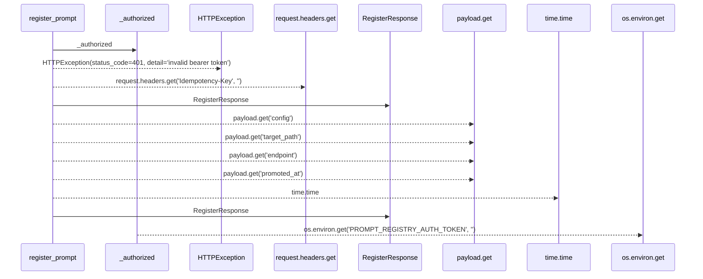
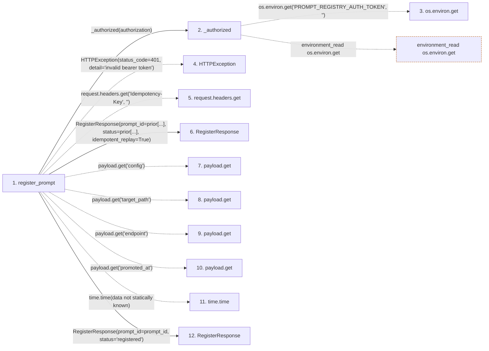

# register_prompt

**Entry point:** `register_prompt` (`http`)
**Source:** [examples_prompt-registry_main](../modules/examples_prompt-registry_main.md)
**Modules touched:** [examples_prompt-registry_main](../modules/examples_prompt-registry_main.md)

## Call sequence

> Static overview in presentation order, not runtime execution order. Arrows retain captured callers; representative internal continuations and boundary examples precede repeated helper detail.

<!-- Auto-generated from static call edges. Dashed arrows are external or unresolved calls. Reviewed runtime conditions and side effects belong in Behavior. -->

> Call sequence diagram shows 11 of 11 interactions; 0 omitted to keep the visualization within the 30-interaction and generated-diagram limits, with uncertain identities omitted rather than inferred.

> Captured boundary calls: external 3 of 3 (0 omitted); unresolved 5 of 5 (0 omitted). These counts cover the captured static trace.
> Detailed flow queries retain their own coverage and limits; omitted paths may execute at runtime.

## Data flow

<!-- Auto-generated static analysis. Treat values and boundaries as best-effort hints, not runtime proof. -->

### Step data

| Step | Inputs | Reads | Writes | Returns |
|---|---|---|---|---|
| `register_prompt` | `payload: dict[str, Any]`, `request: Request`, `authorization: str \| None` | `_BY_IDEMPOTENCY`, `_BY_IDEMPOTENCY`, `_SEQ` | `_SEQ[...]`, `_PROMPTS[...]`, `_BY_IDEMPOTENCY[...]` | `RegisterResponse(...)`, `RegisterResponse(...)` |
| `_authorized` | `authorization: str \| None` | - | - | `True`, `...` |
| `os.environ.get` | - | - | - | - |
| `HTTPException` | - | - | - | - |
| `request.headers.get` | - | - | - | - |
| `RegisterResponse` | - | - | - | - |
| `payload.get` | - | - | - | - |
| `payload.get` | - | - | - | - |
| `payload.get` | - | - | - | - |
| `payload.get` | - | - | - | - |
| `time.time` | - | - | - | - |
| `RegisterResponse` | - | - | - | - |

### Call data

| From | To | Line | Call |
|---|---|---:|---|
| register_prompt | _authorized | 62 | `_authorized(authorization)` |
| _authorized | os.environ.get | 44 | `os.environ.get('PROMPT_REGISTRY_AUTH_TOKEN', '')` |
| register_prompt | HTTPException | 63 | `HTTPException(status_code=401, detail='invalid bearer token')` |
| register_prompt | request.headers.get | 64 | `request.headers.get('Idempotency-Key', '')` |
| register_prompt | RegisterResponse | 67 | `RegisterResponse(prompt_id=prior[...], status=prior[...], idempotent_replay=True)` |
| register_prompt | payload.get | 76 | `payload.get('config')` |
| register_prompt | payload.get | 77 | `payload.get('target_path')` |
| register_prompt | payload.get | 78 | `payload.get('endpoint')` |
| register_prompt | payload.get | 79 | `payload.get('promoted_at')` |
| register_prompt | time.time | 81 | `time.time(data not statically known)` |
| register_prompt | RegisterResponse | 86 | `RegisterResponse(prompt_id=prompt_id, status='registered')` |

### Boundary effects

| Kind | Target | Step | Line |
|---|---|---|---:|
| environment_read | `os.environ.get` | `_authorized` | 44 |

### Static analysis gaps

| Kind | Step | Target | Line |
|---|---|---|---:|
| external_call | `register_prompt` | `HTTPException` | 63 |
| unresolved_call | `register_prompt` | `request.headers.get` | 64 |
| unresolved_call | `register_prompt` | `payload.get` | 76 |
| unresolved_call | `register_prompt` | `payload.get` | 77 |
| unresolved_call | `register_prompt` | `payload.get` | 78 |
| unresolved_call | `register_prompt` | `payload.get` | 79 |
| external_call | `register_prompt` | `time.time` | 81 |

## Behavior

This flow starts at `register_prompt` and is classified as `http`. The generated call and data-flow sections are bounded static projections; runtime conditions and side effects require source-level confirmation.
