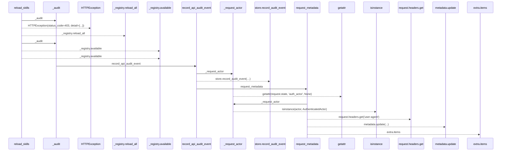
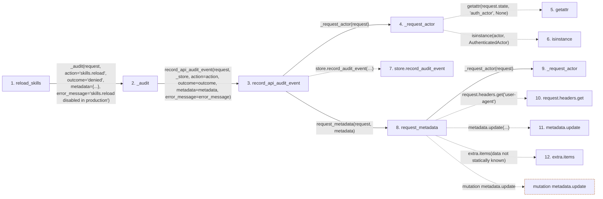

# reload_skills

**Entry point:** `reload_skills` (`http`)
**Source:** [src_api_skills](../modules/src_api_skills.md)
**Modules touched:** [audit](../modules/audit.md), [src_api_skills](../modules/src_api_skills.md)

## Call sequence

> Static overview in presentation order, not runtime execution order. Arrows retain captured callers; representative internal continuations and boundary examples precede repeated helper detail.

<!-- Auto-generated from static call edges. Dashed arrows are external or unresolved calls. Reviewed runtime conditions and side effects belong in Behavior. -->

> Call sequence diagram shows 16 of 16 interactions; 0 omitted to keep the visualization within the 30-interaction and generated-diagram limits, with uncertain identities omitted rather than inferred.

> Captured boundary calls: external 3 of 3 (0 omitted); unresolved 7 of 7 (0 omitted). These counts cover the captured static trace.
> Detailed flow queries retain their own coverage and limits; omitted paths may execute at runtime.

## Data flow

<!-- Auto-generated static analysis. Treat values and boundaries as best-effort hints, not runtime proof. -->

### Step data

| Step | Inputs | Reads | Writes | Returns |
|---|---|---|---|---|
| `reload_skills` | `request: Request` | `settings`, `settings`, `settings` | - | `{...}` |
| `_audit` | `request: Request`, `action: str`, `outcome: str`, `metadata: dict[str, Any] \| None`, `error_message: str \| None` | `_store`, `_store` | - | `None`, `...` |
| `record_api_audit_event` | `request: Request`, `store`, `action: str`, `outcome: str`, `research_id: str \| None`, `pipeline_id: str \| None`, `metadata: dict[str, Any] \| None`, `error_message: str \| None` | - | - | `...` |
| `_request_actor` | `request: Request` | `AuthenticatedActor` | - | `...` |
| `getattr` | - | - | - | - |
| `isinstance` | - | - | - | - |
| `store.record_audit_event` | - | - | - | - |
| `request_metadata` | `request: Request`, `extra: dict[str, Any] \| None` | - | `metadata[...]`, `metadata[...]`, `metadata[...]`, `metadata[...]` | `metadata` |
| `_request_actor` | `request: Request` | `AuthenticatedActor` | - | `...` |
| `request.headers.get` | - | - | - | - |
| `metadata.update` | - | - | - | - |
| `extra.items` | - | - | - | - |

### Call data

| From | To | Line | Call |
|---|---|---:|---|
| reload_skills | _audit | 405 | `_audit(request, action='skills.reload', outcome='denied', metadata={...}, error_message='skills.reload disabled in production')` |
| _audit | record_api_audit_event | 168 | `record_api_audit_event(request, _store, action=action, outcome=outcome, metadata=metadata, error_message=error_message)` |
| record_api_audit_event | _request_actor | 51 | `_request_actor(request)` |
| _request_actor | getattr | 13 | `getattr(request.state, 'auth_actor', None)` |
| _request_actor | isinstance | 14 | `isinstance(actor, AuthenticatedActor)` |
| record_api_audit_event | store.record_audit_event | 52 | `store.record_audit_event(actor_id=..., action=action, research_id=research_id, pipeline_id=pipeline_id, request_metadata=request_metadata(...), outcome=outcome, error_message=error_message)` |
| record_api_audit_event | request_metadata | 57 | `request_metadata(request, metadata)` |
| request_metadata | _request_actor | 20 | `_request_actor(request)` |
| request_metadata | request.headers.get | 27 | `request.headers.get('user-agent')` |
| request_metadata | metadata.update | 34 | `metadata.update(...)` |
| request_metadata | extra.items | 34 | `extra.items(data not statically known)` |

### Boundary effects

| Kind | Target | Step | Line |
|---|---|---|---:|
| mutation | `metadata.update` | `request_metadata` | 34 |

### Static analysis gaps

| Kind | Step | Target | Line |
|---|---|---|---:|
| external_call | `_request_actor` | `getattr` | 13 |
| external_call | `_request_actor` | `isinstance` | 14 |
| unresolved_call | `record_api_audit_event` | `store.record_audit_event` | 52 |
| unresolved_call | `request_metadata` | `request.headers.get` | 27 |
| step_limit | `reload_skills` | `first 12 steps` | 0 |

## Behavior

This flow starts at `reload_skills` and is classified as `http`. The generated call and data-flow sections are bounded static projections; runtime conditions and side effects require source-level confirmation.
