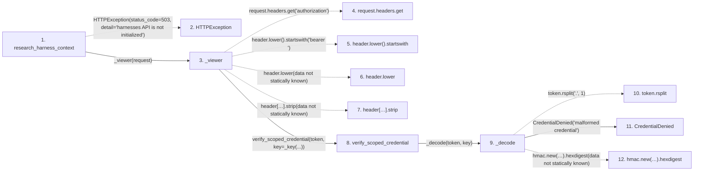

# research_harness_context

**Entry point:** `research_harness_context` (`http`)
**Source:** [harnesses](../modules/harnesses.md)
**Modules touched:** [config](../modules/config.md), [harnesses](../modules/harnesses.md), [scoped_credentials](../modules/scoped_credentials.md)

## Call sequence

> Static overview in presentation order, not runtime execution order. Arrows retain captured callers; representative internal continuations and boundary examples precede repeated helper detail.

```mermaid
sequenceDiagram
    participant p0 as research_harness_context
    participant p1 as _viewer
    participant p2 as _descriptor
    participant p3 as _lifecycle_actions
    participant p4 as verify_scoped_credential
    participant p5 as _key
    participant p6 as _decode
    participant p7 as secret_value
    participant p8 as CredentialRevoked
    participant p9 as CredentialExpired
    participant p10 as CredentialDenied
    participant p11 as ScopedPrincipal
    participant p12 as HTTPException
    participant p13 as _store.list_events
    participant p14 as dict (src/api/harnesses.py:research_harness_context)
    participant p15 as event.get
    participant p16 as payload.get
    participant p17 as str (src/api/harnesses.py:research_harness_context)
    participant p18 as _registry.resolve
    participant p19 as sorted (src/api/harnesses.py:research_harness_context)
    participant p20 as _store.get_iterations
    participant p21 as row.get
    participant p22 as json.loads (src/api/harnesses.py:research_harness_context)
    participant p23 as marker.get
    participant p24 as authority_counts.get
    participant p25 as _store.get_usage_events
    p0->>p1: _viewer
    p0->>p2: _descriptor
    p0->>p3: _lifecycle_actions
    p1->>p4: verify_scoped_credential
    p1->>p5: _key
    p4->>p6: _decode
    p5->>p7: secret_value
    p4->>p8: CredentialRevoked
    p4->>p9: CredentialExpired
    p4->>p10: CredentialDenied
    p4->>p11: ScopedPrincipal
    p0-->>p12: HTTPException(status_code=503, detail='harnesses API is not initialized')
    p0-->>p13: _store.list_events(stream_key=research_id)
    p0-->>p14: dict (src/api/harnesses.py:research_harness_context)(...)
    p0-->>p15: event.get('payload')
    p0-->>p16: payload.get('harness')
    p0-->>p17: str (src/api/harnesses.py:research_harness_context)(payload[...])
    p0-->>p16: payload.get('attach_mode')
    p0-->>p17: str (src/api/harnesses.py:research_harness_context)(payload[...])
    p0-->>p16: payload.get('evaluator')
    p0-->>p16: payload.get('candidate_digest')
    p0-->>p18: _registry.resolve(harness_name)
    p0-->>p19: sorted (src/api/harnesses.py:research_harness_context)(OPTIONAL_CAPABILITIES)
    p0-->>p20: _store.get_iterations(research_id)
    p0-->>p21: row.get('result_authority')
    p0-->>p22: json.loads (src/api/harnesses.py:research_harness_context)(...)
    p0-->>p21: row.get('metrics_json')
    p0-->>p23: marker.get('result_authority')
    p0-->>p24: authority_counts.get(label, 0)
    p0-->>p25: _store.get_usage_events(research_id)
```

<!-- Auto-generated from static call edges. Dashed arrows are external or unresolved calls. Reviewed runtime conditions and side effects belong in Behavior. -->

> Call sequence diagram shows 30 of 91 interactions; 61 omitted to keep the visualization within the 30-interaction and generated-diagram limits, with uncertain identities omitted rather than inferred.

> Captured boundary calls: external 6 of 32 (26 omitted); unresolved 13 of 42 (29 omitted). These counts cover the captured static trace.

Omitted captured detail, grouped by actual caller occurrence and target module:

| Caller | Parent step | Target module | Kind | Omitted interactions |
| --- | --- | --- | --- | --- |
| `src/api/harnesses.py:_viewer` | 3 | - | unresolved | 4 |
| `src/core/scoped_credentials.py:_decode` | 9 | - | unresolved | 4 |
| `src/core/scoped_credentials.py:_decode` | 9 | [src/core/scoped_credentials.py](../modules/scoped_credentials.md) | internal | 4 |
| `src/core/scoped_credentials.py:_decode` | 9 | - | external | 3 |
| `src/core/scoped_credentials.py:verify_scoped_credential` | 8 | - | external | 10 |
| `src/core/scoped_credentials.py:verify_scoped_credential` | 8 | [src/core/scoped_credentials.py](../modules/scoped_credentials.md) | internal | 2 |
| `src/config.py:secret_value` | 38 | - | external | 1 |
| `src/config.py:secret_value` | 38 | - | unresolved | 1 |
> Omission summary shows 8 of 15 groups; 7 further groups are not expanded here. Counts above include all omitted interactions.
> Detailed flow queries retain their own coverage and limits; omitted paths may execute at runtime.

## Data flow

<!-- Auto-generated static analysis. Treat values and boundaries as best-effort hints, not runtime proof. -->

### Step data

| Step | Inputs | Reads | Writes | Returns |
|---|---|---|---|---|
| `research_harness_context` | `research_id: str`, `request: Request` | `_store`, `_registry`, `OPTIONAL_CAPABILITIES` | `candidate_context[...]`, `candidate_context[...]`, `authority_counts[...]` | `{...}` |
| `HTTPException` | - | - | - | - |
| `_viewer` | `request: Request` | - | - | `{...}`, `{...}` |
| `request.headers.get` | - | - | - | - |
| `header.lower().startswith` | - | - | - | - |
| `header.lower` | - | - | - | - |
| `header[…].strip` | - | - | - | - |
| `verify_scoped_credential` | `token: str`, `key: str`, `run_id: Optional[str]`, `tenant_id: Optional[str]`, `required_permissions: Iterable[str]`, `now: Optional[float]` | `_REVOKED` | - | `ScopedPrincipal(...)` |
| `_decode` | `token: str`, `key: str` | `json` | - | `payload` |
| `token.rsplit` | - | - | - | - |
| `CredentialDenied` | - | - | - | - |
| `hmac.new(…).hexdigest` | - | - | - | - |

### Call data

| From | To | Line | Call |
|---|---|---:|---|
| research_harness_context | HTTPException | 199 | `HTTPException(status_code=503, detail='harnesses API is not initialized')` |
| research_harness_context | _viewer | 200 | `_viewer(request)` |
| _viewer | request.headers.get | 132 | `request.headers.get('authorization')` |
| _viewer | header.lower().startswith | 133 | `header.lower().startswith('bearer ')` |
| _viewer | header.lower | 133 | `header.lower(data not statically known)` |
| _viewer | header[…].strip | 133 | `header[7:].strip(data not statically known)` |
| _viewer | verify_scoped_credential | 136 | `verify_scoped_credential(token, key=_key(...))` |
| verify_scoped_credential | _decode | 119 | `_decode(token, key)` |
| _decode | token.rsplit | 154 | `token.rsplit('.', 1)` |
| _decode | CredentialDenied | 156 | `CredentialDenied('malformed credential')` |
| _decode | hmac.new(…).hexdigest | 157 | `hmac.new(key.encode('utf-8'), body.encode('utf-8'), hashlib.sha256).hexdigest(data not statically known)` |

### Boundary effects

*No boundary effects detected.*

### Static analysis gaps

| Kind | Step | Target | Line |
|---|---|---|---:|
| external_call | `research_harness_context` | `HTTPException` | 199 |
| unresolved_call | `_viewer` | `request.headers.get` | 132 |
| unresolved_call | `_viewer` | `header.lower().startswith` | 133 |
| unresolved_call | `_viewer` | `header.lower` | 133 |
| unresolved_call | `_viewer` | `header[7:].strip` | 133 |
| unresolved_call | `_decode` | `token.rsplit` | 154 |
| unresolved_call | `_decode` | `hmac.new(key.encode('utf-8'), body.encode('utf-8'), hashlib.sha256).hexdigest` | 157 |
| step_limit | `research_harness_context` | `first 12 steps` | 0 |

## Behavior

This flow starts at `research_harness_context` and is classified as `http`. The generated call and data-flow sections are bounded static projections; runtime conditions and side effects require source-level confirmation.
