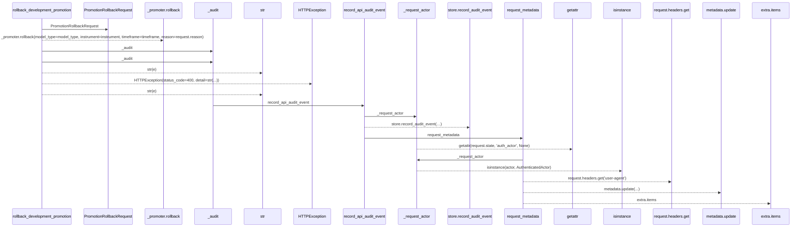
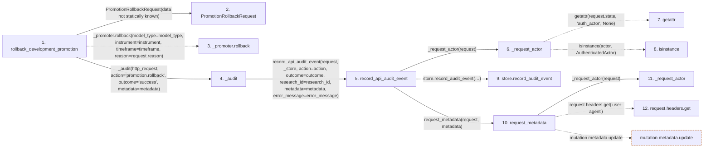

# rollback_development_promotion

**Entry point:** `rollback_development_promotion` (`http`)
**Source:** [promotion](../modules/promotion.md)
**Modules touched:** [audit](../modules/audit.md), [promotion](../modules/promotion.md)

## Call sequence

> Static overview in presentation order, not runtime execution order. Arrows retain captured callers; representative internal continuations and boundary examples precede repeated helper detail.

<!-- Auto-generated from static call edges. Dashed arrows are external or unresolved calls. Reviewed runtime conditions and side effects belong in Behavior. -->

> Call sequence diagram shows 17 of 17 interactions; 0 omitted to keep the visualization within the 30-interaction and generated-diagram limits, with uncertain identities omitted rather than inferred.

> Captured boundary calls: external 5 of 5 (0 omitted); unresolved 5 of 5 (0 omitted). These counts cover the captured static trace.
> Detailed flow queries retain their own coverage and limits; omitted paths may execute at runtime.

## Data flow

<!-- Auto-generated static analysis. Treat values and boundaries as best-effort hints, not runtime proof. -->

### Step data

| Step | Inputs | Reads | Writes | Returns |
|---|---|---|---|---|
| `rollback_development_promotion` | `http_request: Request`, `model_type: str`, `instrument: str`, `timeframe: str`, `request: PromotionRollbackRequest` | - | - | `result` |
| `PromotionRollbackRequest` | - | - | - | - |
| `_promoter.rollback` | - | - | - | - |
| `_audit` | `request: Request`, `action: str`, `outcome: str`, `research_id: str \| None`, `metadata: dict \| None`, `error_message: str \| None` | `_store` | - | `...` |
| `record_api_audit_event` | `request: Request`, `store`, `action: str`, `outcome: str`, `research_id: str \| None`, `pipeline_id: str \| None`, `metadata: dict[str, Any] \| None`, `error_message: str \| None` | - | - | `...` |
| `_request_actor` | `request: Request` | `AuthenticatedActor` | - | `...` |
| `getattr` | - | - | - | - |
| `isinstance` | - | - | - | - |
| `store.record_audit_event` | - | - | - | - |
| `request_metadata` | `request: Request`, `extra: dict[str, Any] \| None` | - | `metadata[...]`, `metadata[...]`, `metadata[...]`, `metadata[...]` | `metadata` |
| `_request_actor` | `request: Request` | `AuthenticatedActor` | - | `...` |
| `request.headers.get` | - | - | - | - |

### Call data

| From | To | Line | Call |
|---|---|---:|---|
| rollback_development_promotion | PromotionRollbackRequest | 436 | `PromotionRollbackRequest(data not statically known)` |
| rollback_development_promotion | _promoter.rollback | 444 | `_promoter.rollback(model_type=model_type, instrument=instrument, timeframe=timeframe, reason=request.reason)` |
| rollback_development_promotion | _audit | 450 | `_audit(http_request, action='promotion.rollback', outcome='success', metadata=metadata)` |
| _audit | record_api_audit_event | 64 | `record_api_audit_event(request, _store, action=action, outcome=outcome, research_id=research_id, metadata=metadata, error_message=error_message)` |
| record_api_audit_event | _request_actor | 51 | `_request_actor(request)` |
| _request_actor | getattr | 13 | `getattr(request.state, 'auth_actor', None)` |
| _request_actor | isinstance | 14 | `isinstance(actor, AuthenticatedActor)` |
| record_api_audit_event | store.record_audit_event | 52 | `store.record_audit_event(actor_id=..., action=action, research_id=research_id, pipeline_id=pipeline_id, request_metadata=request_metadata(...), outcome=outcome, error_message=error_message)` |
| record_api_audit_event | request_metadata | 57 | `request_metadata(request, metadata)` |
| request_metadata | _request_actor | 20 | `_request_actor(request)` |
| request_metadata | request.headers.get | 27 | `request.headers.get('user-agent')` |

### Boundary effects

| Kind | Target | Step | Line |
|---|---|---|---:|
| mutation | `metadata.update` | `request_metadata` | 34 |

### Static analysis gaps

| Kind | Step | Target | Line |
|---|---|---|---:|
| unresolved_call | `rollback_development_promotion` | `_promoter.rollback` | 444 |
| external_call | `_request_actor` | `getattr` | 13 |
| external_call | `_request_actor` | `isinstance` | 14 |
| unresolved_call | `record_api_audit_event` | `store.record_audit_event` | 52 |
| unresolved_call | `request_metadata` | `request.headers.get` | 27 |
| step_limit | `rollback_development_promotion` | `first 12 steps` | 0 |

## Behavior

This flow starts at `rollback_development_promotion` and is classified as `http`. The generated call and data-flow sections are bounded static projections; runtime conditions and side effects require source-level confirmation.
