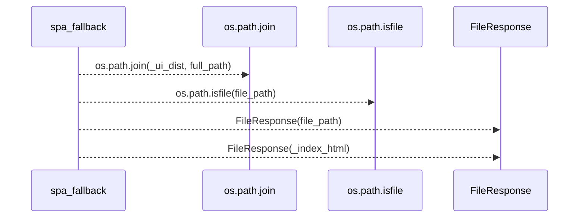
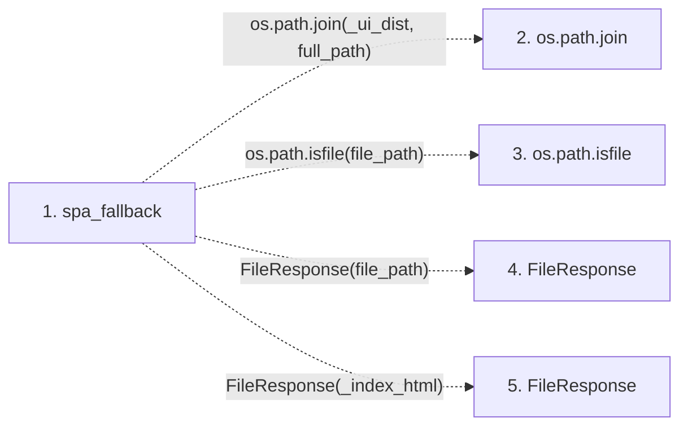

# spa_fallback

**Entry point:** `spa_fallback` (`http`)
**Source:** [src_main](../modules/src_main.md)
**Modules touched:** [src_main](../modules/src_main.md)

## Call sequence

> Static overview in presentation order, not runtime execution order. Arrows retain captured callers; representative internal continuations and boundary examples precede repeated helper detail.

<!-- Auto-generated from static call edges. Dashed arrows are external or unresolved calls. Reviewed runtime conditions and side effects belong in Behavior. -->

> Call sequence diagram shows 4 of 4 interactions; 0 omitted to keep the visualization within the 30-interaction and generated-diagram limits, with uncertain identities omitted rather than inferred.

> Captured boundary calls: external 4 of 4 (0 omitted); unresolved 0 of 0 (0 omitted). These counts cover the captured static trace.
> Detailed flow queries retain their own coverage and limits; omitted paths may execute at runtime.

## Data flow

<!-- Auto-generated static analysis. Treat values and boundaries as best-effort hints, not runtime proof. -->

### Step data

| Step | Inputs | Reads | Writes | Returns |
|---|---|---|---|---|
| `spa_fallback` | `full_path: str` | `_ui_dist` | - | `FileResponse(...)`, `FileResponse(...)` |
| `os.path.join` | - | - | - | - |
| `os.path.isfile` | - | - | - | - |
| `FileResponse` | - | - | - | - |
| `FileResponse` | - | - | - | - |

### Call data

| From | To | Line | Call |
|---|---|---:|---|
| spa_fallback | os.path.join | 449 | `os.path.join(_ui_dist, full_path)` |
| spa_fallback | os.path.isfile | 450 | `os.path.isfile(file_path)` |
| spa_fallback | FileResponse | 451 | `FileResponse(file_path)` |
| spa_fallback | FileResponse | 452 | `FileResponse(_index_html)` |

### Boundary effects

*No boundary effects detected.*

### Static analysis gaps

| Kind | Step | Target | Line |
|---|---|---|---:|
| external_call | `spa_fallback` | `os.path.join` | 449 |
| external_call | `spa_fallback` | `os.path.isfile` | 450 |
| external_call | `spa_fallback` | `FileResponse` | 451 |
| external_call | `spa_fallback` | `FileResponse` | 452 |

## Behavior

This flow starts at `spa_fallback` and is classified as `http`. The generated call and data-flow sections are bounded static projections; runtime conditions and side effects require source-level confirmation.
