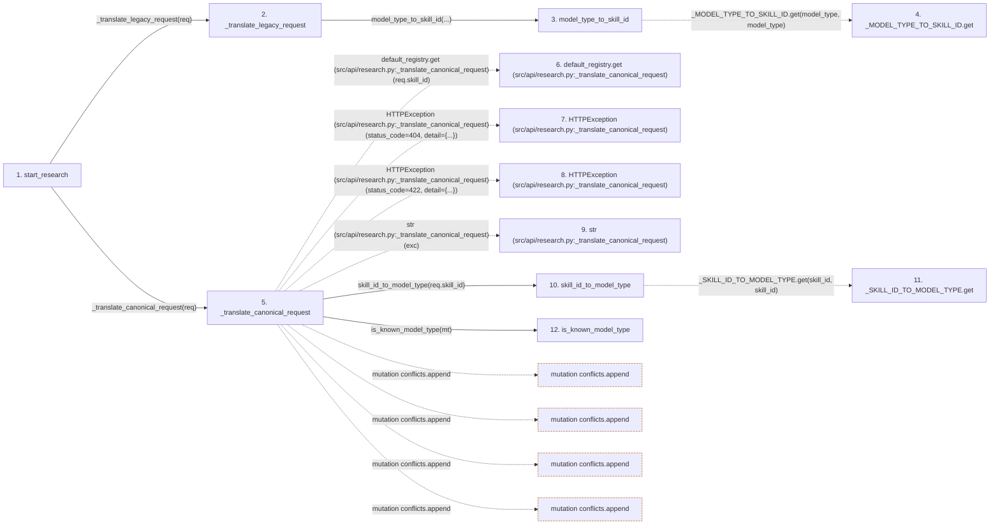

# start_research

**Entry point:** `start_research` (`http`)
**Source:** [research](../modules/research.md)
**Modules touched:** [audit](../modules/audit.md), [compat_legacy_alias](../modules/compat_legacy_alias.md), [research](../modules/research.md), [skill_paths](../modules/skill_paths.md)

## Call sequence

> Static overview in presentation order, not runtime execution order. Arrows retain captured callers; representative internal continuations and boundary examples precede repeated helper detail.

```mermaid
sequenceDiagram
    participant p0 as start_research
    participant p1 as _translate_legacy_request
    participant p2 as _translate_canonical_request
    participant p3 as _audit
    participant p4 as _dual_shape_session
    participant p5 as _validate_skill_params
    participant p6 as _start_metadata
    participant p7 as _skill_config_http_error
    participant p8 as record_api_audit_event
    participant p9 as request_metadata
    participant p10 as model_type_to_skill_id
    participant p11 as skill_id_to_model_type
    participant p12 as is_known_model_type
    participant p13 as sanitize_path_segment
    participant p14 as _request_actor
    participant p15 as str (src/api/research.py:start_research)
    participant p16 as default_registry.get (src/api/research.py:start_research)
    participant p17 as _session_manager.start_session
    participant p18 as session.get (src/api/research.py:start_research)
    participant p19 as HTTPException (src/api/research.py:start_research)
    participant p20 as default_registry.get (src/api/research.py:_translate_canonical_request)
    participant p21 as getattr (src/api/research.py:_validate_skill_params)
    participant p22 as dict
    participant p23 as HTTPException (src/api/research.py:_skill_config_http_error)
    participant p24 as HTTPException (src/api/research.py:_translate_canonical_request)
    participant p25 as violations.append
    participant p26 as session.get (src/api/research.py:_dual_shape_session)
    participant p27 as str (src/api/research.py:_skill_config_http_error)
    p0->>p1: _translate_legacy_request
    p0->>p2: _translate_canonical_request
    p0->>p3: _audit
    p0->>p4: _dual_shape_session
    p0->>p5: _validate_skill_params
    p0->>p6: _start_metadata
    p0->>p7: _skill_config_http_error
    p3->>p8: record_api_audit_event
    p8->>p9: request_metadata
    p1->>p10: model_type_to_skill_id
    p2->>p11: skill_id_to_model_type
    p2->>p12: is_known_model_type
    p2->>p13: sanitize_path_segment
    p8->>p14: _request_actor
    p0-->>p15: str (src/api/research.py:start_research)(e)
    p0-->>p16: default_registry.get (src/api/research.py:start_research)(req.skill_id)
    p0-->>p17: _session_manager.start_session(…)
    p0-->>p18: session.get (src/api/research.py:start_research)('id')
    p0-->>p15: str (src/api/research.py:start_research)(e)
    p0-->>p19: HTTPException (src/api/research.py:start_research)(status_code=409, detail=str(...))
    p0-->>p15: str (src/api/research.py:start_research)(e)
    p2-->>p20: default_registry.get (src/api/research.py:_translate_canonical_request)(req.skill_id)
    p5-->>p21: getattr (src/api/research.py:_validate_skill_params)(schema, 'required', [...])
    p4-->>p22: dict(session)
    p7-->>p23: HTTPException (src/api/research.py:_skill_config_http_error)(status_code=422, detail={...})
    p2-->>p24: HTTPException (src/api/research.py:_translate_canonical_request)(status_code=404, detail={...})
    p5-->>p25: violations.append({...})
    p4-->>p26: session.get (src/api/research.py:_dual_shape_session)('model_type', '')
    p7-->>p27: str (src/api/research.py:_skill_config_http_error)(exc)
    p2-->>p24: HTTPException (src/api/research.py:_translate_canonical_request)(status_code=422, detail={...})
```

<!-- Auto-generated from static call edges. Dashed arrows are external or unresolved calls. Reviewed runtime conditions and side effects belong in Behavior. -->

> Call sequence diagram shows 30 of 85 interactions; 55 omitted to keep the visualization within the 30-interaction and generated-diagram limits, with uncertain identities omitted rather than inferred.

> Captured boundary calls: external 10 of 33 (23 omitted); unresolved 6 of 33 (27 omitted). These counts cover the captured static trace.

Omitted captured detail, grouped by actual caller occurrence and target module:

| Caller | Parent step | Target module | Kind | Omitted interactions |
| --- | --- | --- | --- | --- |
| `src/compat/legacy_alias.py:model_type_to_skill_id` | 3 | - | unresolved | 1 |
| `src/api/research.py:_translate_canonical_request` | 5 | - | external | 8 |
| `src/compat/legacy_alias.py:skill_id_to_model_type` | 10 | - | unresolved | 1 |
| `src/api/research.py:_translate_canonical_request` | 5 | - | unresolved | 5 |
| `src/core/skill_paths.py:sanitize_path_segment` | 21 | - | external | 2 |
| `src/api/audit.py:_request_actor` | 30 | - | external | 2 |
| `src/api/audit.py:record_api_audit_event` | 29 | - | unresolved | 1 |
| `src/api/audit.py:request_metadata` | 34 | [src/api/audit.py](../modules/audit.md) | internal | 1 |
> Omission summary shows 8 of 16 groups; 8 further groups are not expanded here. Counts above include all omitted interactions.
> Detailed flow queries retain their own coverage and limits; omitted paths may execute at runtime.

## Data flow

<!-- Auto-generated static analysis. Treat values and boundaries as best-effort hints, not runtime proof. -->

### Step data

| Step | Inputs | Reads | Writes | Returns |
|---|---|---|---|---|
| `start_research` | `request: Request`, `req: StartResearchRequest` | `SkillConfigError` | - | `_dual_shape_session(...)` |
| `_translate_legacy_request` | `req: 'StartResearchRequest'` | - | `req.skill_id`, `req.subject_id`, `req.variant` | - |
| `model_type_to_skill_id` | `model_type: str` | - | - | `''`, `_MODEL_TYPE_TO_SKILL_ID.get(...)` |
| `_MODEL_TYPE_TO_SKILL_ID.get` | - | - | - | - |
| `_translate_canonical_request` | `req: 'StartResearchRequest'` | `SkillNotRegisteredError`, `ManifestValidationError`, `SkillNotRegisteredError` | `req.model_type`, `req.model_type`, `req.subject_id`, `req.variant`, `req.instrument`, `req.timeframe` | `conflicts`, `conflicts` |
| `default_registry.get (src/api/research.py:_translate_canonical_request)` | - | - | - | - |
| `HTTPException (src/api/research.py:_translate_canonical_request)` | - | - | - | - |
| `HTTPException (src/api/research.py:_translate_canonical_request)` | - | - | - | - |
| `str (src/api/research.py:_translate_canonical_request)` | - | - | - | - |
| `skill_id_to_model_type` | `skill_id: str` | - | - | `''`, `_SKILL_ID_TO_MODEL_TYPE.get(...)` |
| `_SKILL_ID_TO_MODEL_TYPE.get` | - | - | - | - |
| `is_known_model_type` | `model_type: str` | `_MODEL_TYPE_TO_SKILL_ID` | - | `...` |

### Call data

| From | To | Line | Call |
|---|---|---:|---|
| start_research | _translate_legacy_request | 640 | `_translate_legacy_request(req)` |
| _translate_legacy_request | model_type_to_skill_id | 182 | `model_type_to_skill_id(...)` |
| model_type_to_skill_id | _MODEL_TYPE_TO_SKILL_ID.get | 45 | `_MODEL_TYPE_TO_SKILL_ID.get(model_type, model_type)` |
| start_research | _translate_canonical_request | 644 | `_translate_canonical_request(req)` |
| _translate_canonical_request | default_registry.get (src/api/research.py:_translate_canonical_request) | 250 | `default_registry.get(req.skill_id)` |
| _translate_canonical_request | HTTPException (src/api/research.py:_translate_canonical_request) | 252 | `HTTPException(status_code=404, detail={...})` |
| _translate_canonical_request | HTTPException (src/api/research.py:_translate_canonical_request) | 262 | `HTTPException(status_code=422, detail={...})` |
| _translate_canonical_request | str (src/api/research.py:_translate_canonical_request) | 267 | `str(exc)` |
| _translate_canonical_request | skill_id_to_model_type | 281 | `skill_id_to_model_type(req.skill_id)` |
| skill_id_to_model_type | _SKILL_ID_TO_MODEL_TYPE.get | 56 | `_SKILL_ID_TO_MODEL_TYPE.get(skill_id, skill_id)` |
| _translate_canonical_request | is_known_model_type | 282 | `is_known_model_type(mt)` |

### Boundary effects

| Kind | Target | Step | Line |
|---|---|---|---:|
| mutation | `conflicts.append` | `_translate_canonical_request` | 284 |
| mutation | `conflicts.append` | `_translate_canonical_request` | 290 |
| mutation | `conflicts.append` | `_translate_canonical_request` | 338 |
| mutation | `conflicts.append` | `_translate_canonical_request` | 349 |

### Static analysis gaps

| Kind | Step | Target | Line |
|---|---|---|---:|
| unresolved_call | `model_type_to_skill_id` | `_MODEL_TYPE_TO_SKILL_ID.get` | 45 |
| unresolved_call | `_translate_canonical_request` | `default_registry.get` | 250 |
| external_call | `_translate_canonical_request` | `HTTPException` | 252 |
| external_call | `_translate_canonical_request` | `HTTPException` | 262 |
| unresolved_call | `skill_id_to_model_type` | `_SKILL_ID_TO_MODEL_TYPE.get` | 56 |
| step_limit | `start_research` | `first 12 steps` | 0 |

## Behavior

This flow starts at `start_research` and is classified as `http`. The generated call and data-flow sections are bounded static projections; runtime conditions and side effects require source-level confirmation.
