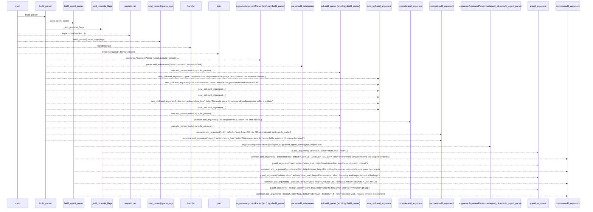
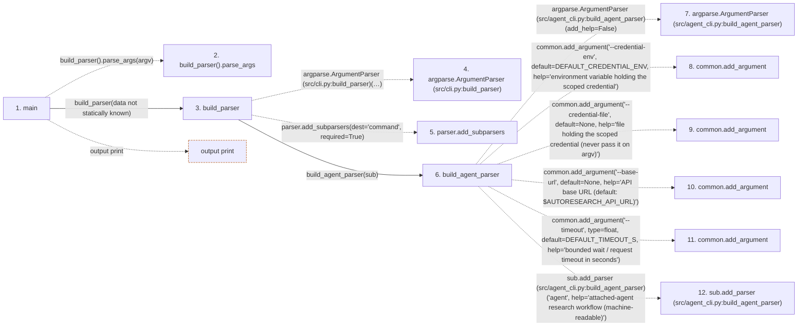

# autoresearch

**Entry point:** `main` (`process`)
**Source:** [cli](../modules/cli.md)
**Modules touched:** [agent_cli](../modules/agent_cli.md), [cli](../modules/cli.md)

**Related modules:** [agent_cli](../modules/agent_cli.md), [config](../modules/config.md), [llm_provider](../modules/llm_provider.md), [objective_comparator](../modules/objective_comparator.md), and 6 more

**Complete related modules:**

- [agent_cli](../modules/agent_cli.md)
- [config](../modules/config.md)
- [llm_provider](../modules/llm_provider.md)
- [objective_comparator](../modules/objective_comparator.md)
- [plugin_runner](../modules/plugin_runner.md)
- [promotion_target](../modules/promotion_target.md)
- [results_store](../modules/results_store.md)
- [skill_generator](../modules/skill_generator.md)
- [skill_loader](../modules/skill_loader.md)
- [skill_manifest](../modules/skill_manifest.md)

## Call sequence

> Static overview in presentation order, not runtime execution order. Arrows retain captured callers; representative internal continuations and boundary examples precede repeated helper detail.

<!-- Auto-generated from static call edges. Dashed arrows are external or unresolved calls. Reviewed runtime conditions and side effects belong in Behavior. -->

> Call sequence diagram shows 30 of 59 interactions; 29 omitted to keep the visualization within the 30-interaction and generated-diagram limits, with uncertain identities omitted rather than inferred.

> Captured boundary calls: external 4 of 4 (0 omitted); unresolved 23 of 51 (28 omitted). These counts cover the captured static trace.

Omitted captured detail, grouped by actual caller occurrence and target module:

| Caller | Parent step | Target module | Kind | Omitted interactions |
| --- | --- | --- | --- | --- |
| `src/agent_cli.py:build_agent_parser` | 6 | - | unresolved | 27 |
| `src/cli.py:_add_promote_flags` | 46 | - | unresolved | 1 |
| `src/cli.py:build_parser` | 3 | [src/cli.py](../modules/cli.md) | internal | 1 |
> Detailed flow queries retain their own coverage and limits; omitted paths may execute at runtime.

## Data flow

<!-- Auto-generated static analysis. Treat values and boundaries as best-effort hints, not runtime proof. -->

### Step data

| Step | Inputs | Reads | Writes | Returns |
|---|---|---|---|---|
| `main` | `argv: Optional[list[str]]` | `_COMMANDS`, `sys` | - | `asyncio.run(...)`, `130` |
| `build_parser().parse_args` | - | - | - | - |
| `build_parser` | - | - | - | `parser` |
| `argparse.ArgumentParser (src/cli.py:build_parser)` | - | - | - | - |
| `parser.add_subparsers` | - | - | - | - |
| `build_agent_parser` | `sub: Any` | `DEFAULT_CREDENTIAL_ENV`, `DEFAULT_TIMEOUT_S` | - | - |
| `argparse.ArgumentParser (src/agent_cli.py:build_agent_parser)` | - | - | - | - |
| `common.add_argument` | - | - | - | - |
| `common.add_argument` | - | - | - | - |
| `common.add_argument` | - | - | - | - |
| `common.add_argument` | - | - | - | - |
| `sub.add_parser (src/agent_cli.py:build_agent_parser)` | - | - | - | - |

### Call data

| From | To | Line | Call |
|---|---|---:|---|
| main | build_parser().parse_args | 535 | `build_parser().parse_args(argv)` |
| main | build_parser | 535 | `build_parser(data not statically known)` |
| build_parser | argparse.ArgumentParser (src/cli.py:build_parser) | 53 | `argparse.ArgumentParser(prog='autoresearch', description='autoresearch-agent operator CLI. Today: the Skill SDK (new-skill / promote-skill).')` |
| build_parser | parser.add_subparsers | 60 | `parser.add_subparsers(dest='command', required=True)` |
| build_parser | build_agent_parser | 64 | `build_agent_parser(sub)` |
| build_agent_parser | argparse.ArgumentParser (src/agent_cli.py:build_agent_parser) | 106 | `argparse.ArgumentParser(add_help=False)` |
| build_agent_parser | common.add_argument | 107 | `common.add_argument('--credential-env', default=DEFAULT_CREDENTIAL_ENV, help='environment variable holding the scoped credential')` |
| build_agent_parser | common.add_argument | 112 | `common.add_argument('--credential-file', default=None, help='file holding the scoped credential (never pass it on argv)')` |
| build_agent_parser | common.add_argument | 117 | `common.add_argument('--base-url', default=None, help='API base URL (default: $AUTORESEARCH_API_URL)')` |
| build_agent_parser | common.add_argument | 122 | `common.add_argument('--timeout', type=float, default=DEFAULT_TIMEOUT_S, help='bounded wait / request timeout in seconds')` |
| build_agent_parser | sub.add_parser (src/agent_cli.py:build_agent_parser) | 128 | `sub.add_parser('agent', help='attached-agent research workflow (machine-readable)')` |

### Boundary effects

| Kind | Target | Step | Line |
|---|---|---|---:|
| output | `print` | `main` | 540 |

### Static analysis gaps

| Kind | Step | Target | Line |
|---|---|---|---:|
| unresolved_call | `main` | `build_parser().parse_args` | 535 |
| external_call | `build_parser` | `argparse.ArgumentParser` | 53 |
| unresolved_call | `build_parser` | `parser.add_subparsers` | 60 |
| external_call | `build_agent_parser` | `argparse.ArgumentParser` | 106 |
| unresolved_call | `build_agent_parser` | `common.add_argument` | 107 |
| unresolved_call | `build_agent_parser` | `common.add_argument` | 112 |
| unresolved_call | `build_agent_parser` | `common.add_argument` | 117 |
| unresolved_call | `build_agent_parser` | `common.add_argument` | 122 |
| unresolved_call | `build_agent_parser` | `sub.add_parser` | 128 |
| step_limit | `main` | `first 12 steps` | 0 |

## Behavior

This flow starts at `main` and is classified as `process`. The generated call and data-flow sections are bounded static projections; runtime conditions and side effects require source-level confirmation.
