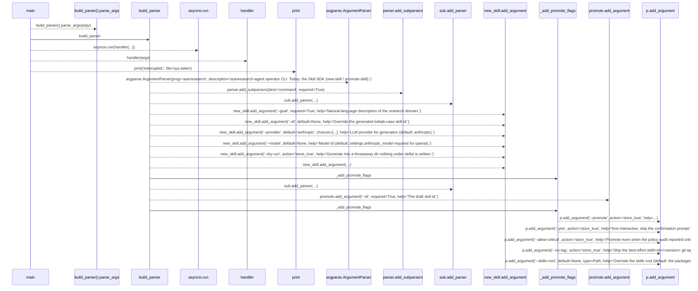
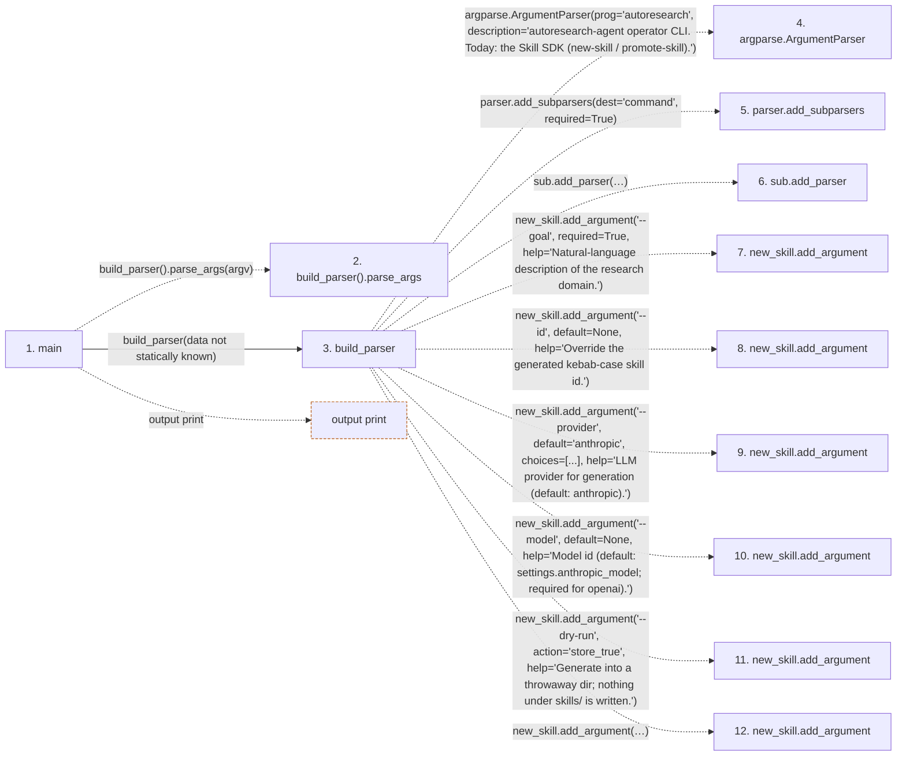

# autoresearch

**Entry point:** `main` (`process`)
**Source:** [cli](../modules/cli.md)
**Modules touched:** [cli](../modules/cli.md)

**Related modules:** [config](../modules/config.md), [llm_provider](../modules/llm_provider.md), [plugin_runner](../modules/plugin_runner.md), [promotion_target](../modules/promotion_target.md), and 3 more

**Complete related modules:**

- [config](../modules/config.md)
- [llm_provider](../modules/llm_provider.md)
- [plugin_runner](../modules/plugin_runner.md)
- [promotion_target](../modules/promotion_target.md)
- [skill_generator](../modules/skill_generator.md)
- [skill_loader](../modules/skill_loader.md)
- [skill_manifest](../modules/skill_manifest.md)

## Call sequence

> Static overview in presentation order, not runtime execution order. Arrows retain captured callers; representative internal continuations and boundary examples precede repeated helper detail.

<!-- Auto-generated from static call edges. Dashed arrows are external or unresolved calls. Reviewed runtime conditions and side effects belong in Behavior. -->

> Call sequence diagram shows 23 of 23 interactions; 0 omitted to keep the visualization within the 30-interaction and generated-diagram limits, with uncertain identities omitted rather than inferred.

> Captured boundary calls: external 3 of 3 (0 omitted); unresolved 17 of 17 (0 omitted). These counts cover the captured static trace.
> Detailed flow queries retain their own coverage and limits; omitted paths may execute at runtime.

## Data flow

<!-- Auto-generated static analysis. Treat values and boundaries as best-effort hints, not runtime proof. -->

### Step data

| Step | Inputs | Reads | Writes | Returns |
|---|---|---|---|---|
| `main` | `argv: Optional[list[str]]` | `_COMMANDS`, `sys` | - | `asyncio.run(...)`, `130` |
| `build_parser().parse_args` | - | - | - | - |
| `build_parser` | - | - | - | `parser` |
| `argparse.ArgumentParser` | - | - | - | - |
| `parser.add_subparsers` | - | - | - | - |
| `sub.add_parser` | - | - | - | - |
| `new_skill.add_argument` | - | - | - | - |
| `new_skill.add_argument` | - | - | - | - |
| `new_skill.add_argument` | - | - | - | - |
| `new_skill.add_argument` | - | - | - | - |
| `new_skill.add_argument` | - | - | - | - |
| `new_skill.add_argument` | - | - | - | - |

### Call data

| From | To | Line | Call |
|---|---|---:|---|
| main | build_parser().parse_args | 436 | `build_parser().parse_args(argv)` |
| main | build_parser | 436 | `build_parser(data not statically known)` |
| build_parser | argparse.ArgumentParser | 53 | `argparse.ArgumentParser(prog='autoresearch', description='autoresearch-agent operator CLI. Today: the Skill SDK (new-skill / promote-skill).')` |
| build_parser | parser.add_subparsers | 60 | `parser.add_subparsers(dest='command', required=True)` |
| build_parser | sub.add_parser | 62 | `sub.add_parser('new-skill', help='Draft a new skill package from a natural-language goal (LLM).', description='Generate a research_skill.v1 draft (manifest + bootstrap + eval + primer) into skills/_drafts/<id>/ from a goal description. The draft is validated, linted, and policy-audited before it is written; it is NOT selectable for production until promoted.')` |
| build_parser | new_skill.add_argument | 72 | `new_skill.add_argument('--goal', required=True, help='Natural-language description of the research domain.')` |
| build_parser | new_skill.add_argument | 76 | `new_skill.add_argument('--id', default=None, help='Override the generated kebab-case skill id.')` |
| build_parser | new_skill.add_argument | 80 | `new_skill.add_argument('--provider', default='anthropic', choices=[...], help='LLM provider for generation (default: anthropic).')` |
| build_parser | new_skill.add_argument | 84 | `new_skill.add_argument('--model', default=None, help='Model id (default: settings.anthropic_model; required for openai).')` |
| build_parser | new_skill.add_argument | 88 | `new_skill.add_argument('--dry-run', action='store_true', help='Generate into a throwaway dir; nothing under skills/ is written.')` |
| build_parser | new_skill.add_argument | 92 | `new_skill.add_argument('--dry-bootstrap', action='store_true', help='Execute the generated bootstrap.py under strict plugin caps in a temp workspace and print the rendered file tree (preview only).')` |

### Boundary effects

| Kind | Target | Step | Line |
|---|---|---|---:|
| output | `print` | `main` | 441 |

### Static analysis gaps

| Kind | Step | Target | Line |
|---|---|---|---:|
| unresolved_call | `main` | `build_parser().parse_args` | 436 |
| external_call | `build_parser` | `argparse.ArgumentParser` | 53 |
| unresolved_call | `build_parser` | `parser.add_subparsers` | 60 |
| unresolved_call | `build_parser` | `sub.add_parser` | 62 |
| unresolved_call | `build_parser` | `new_skill.add_argument` | 72 |
| unresolved_call | `build_parser` | `new_skill.add_argument` | 76 |
| unresolved_call | `build_parser` | `new_skill.add_argument` | 80 |
| unresolved_call | `build_parser` | `new_skill.add_argument` | 84 |
| unresolved_call | `build_parser` | `new_skill.add_argument` | 88 |
| unresolved_call | `build_parser` | `new_skill.add_argument` | 92 |
| step_limit | `main` | `first 12 steps` | 0 |

## Behavior

This flow starts at `main` and is classified as `process`. The generated call and data-flow sections are bounded static projections; runtime conditions and side effects require source-level confirmation.
