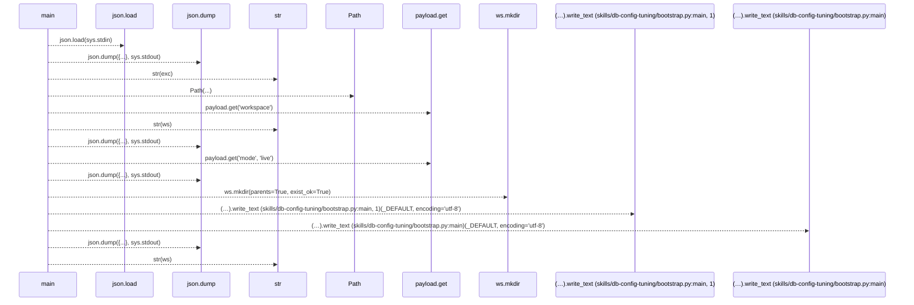
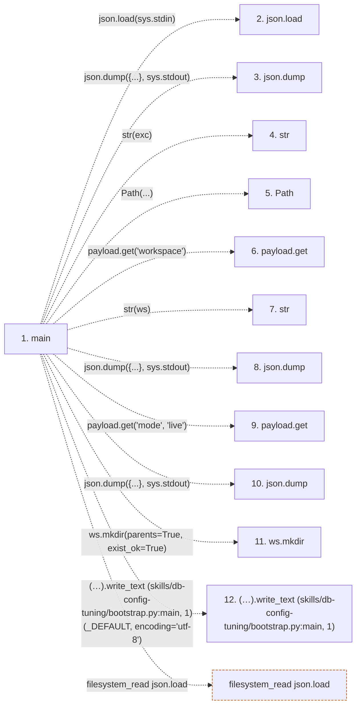

# bootstrap

**Entry point:** `main` (`process`)
**Source:** [db-config-tuning_bootstrap](../modules/db-config-tuning_bootstrap.md)
**Modules touched:** [db-config-tuning_bootstrap](../modules/db-config-tuning_bootstrap.md)

## Call sequence

> Static overview in presentation order, not runtime execution order. Arrows retain captured callers; representative internal continuations and boundary examples precede repeated helper detail.

<!-- Auto-generated from static call edges. Dashed arrows are external or unresolved calls. Reviewed runtime conditions and side effects belong in Behavior. -->

> Call sequence diagram shows 14 of 14 interactions; 0 omitted to keep the visualization within the 30-interaction and generated-diagram limits, with uncertain identities omitted rather than inferred.

> Captured boundary calls: external 9 of 9 (0 omitted); unresolved 5 of 5 (0 omitted). These counts cover the captured static trace.
> Detailed flow queries retain their own coverage and limits; omitted paths may execute at runtime.

## Data flow

<!-- Auto-generated static analysis. Treat values and boundaries as best-effort hints, not runtime proof. -->

### Step data

| Step | Inputs | Reads | Writes | Returns |
|---|---|---|---|---|
| `main` | - | `sys`, `json`, `sys`, `sys`, `_RENDERED`, `sys`, `_DEFAULT`, `_DEFAULT` | - | `2`, `2`, `0`, `0` |
| `json.load` | - | - | - | - |
| `json.dump` | - | - | - | - |
| `str` | - | - | - | - |
| `Path` | - | - | - | - |
| `payload.get` | - | - | - | - |
| `str` | - | - | - | - |
| `json.dump` | - | - | - | - |
| `payload.get` | - | - | - | - |
| `json.dump` | - | - | - | - |
| `ws.mkdir` | - | - | - | - |
| `(…).write_text (skills/db-config-tuning/bootstrap.py:main, 1)` | - | - | - | - |

### Call data

| From | To | Line | Call |
|---|---|---:|---|
| main | json.load | 15 | `json.load(sys.stdin)` |
| main | json.dump | 17 | `json.dump({...}, sys.stdout)` |
| main | str | 17 | `str(exc)` |
| main | Path | 19 | `Path(...)` |
| main | payload.get | 19 | `payload.get('workspace')` |
| main | str | 20 | `str(ws)` |
| main | json.dump | 21 | `json.dump({...}, sys.stdout)` |
| main | payload.get | 23 | `payload.get('mode', 'live')` |
| main | json.dump | 24 | `json.dump({...}, sys.stdout)` |
| main | ws.mkdir | 26 | `ws.mkdir(parents=True, exist_ok=True)` |
| main | (…).write_text (skills/db-config-tuning/bootstrap.py:main, 1) | 27 | `(ws / 'db_config.yaml').write_text(_DEFAULT, encoding='utf-8')` |

### Boundary effects

| Kind | Target | Step | Line |
|---|---|---|---:|
| filesystem_read | `json.load` | `main` | 15 |

### Static analysis gaps

| Kind | Step | Target | Line |
|---|---|---|---:|
| external_call | `main` | `json.dump` | 17 |
| unresolved_call | `main` | `payload.get` | 19 |
| external_call | `main` | `json.dump` | 21 |
| unresolved_call | `main` | `payload.get` | 23 |
| external_call | `main` | `json.dump` | 24 |
| unresolved_call | `main` | `ws.mkdir` | 26 |
| unresolved_call | `main` | `(ws / 'db_config.yaml').write_text` | 27 |
| step_limit | `main` | `first 12 steps` | 0 |

## Behavior

This flow starts at `main` and is classified as `process`. The generated call and data-flow sections are bounded static projections; runtime conditions and side effects require source-level confirmation.
