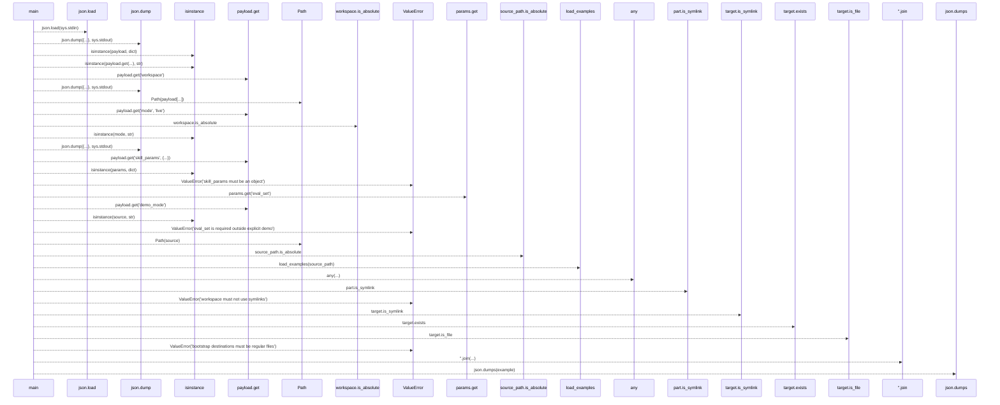
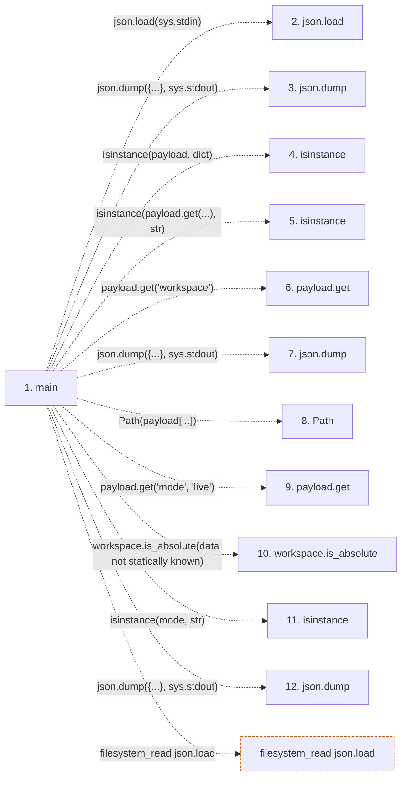

# bootstrap

**Entry point:** `main` (`process`)
**Source:** [prompt-engineering_bootstrap](../modules/prompt-engineering_bootstrap.md)
**Modules touched:** [prompt-engineering_bootstrap](../modules/prompt-engineering_bootstrap.md)

## Call sequence

> Static overview in presentation order, not runtime execution order. Arrows retain captured callers; representative internal continuations and boundary examples precede repeated helper detail.

<!-- Auto-generated from static call edges. Dashed arrows are external or unresolved calls. Reviewed runtime conditions and side effects belong in Behavior. -->

> Call sequence diagram shows 30 of 43 interactions; 13 omitted to keep the visualization within the 30-interaction and generated-diagram limits, with uncertain identities omitted rather than inferred.

> Captured boundary calls: external 18 of 24 (6 omitted); unresolved 12 of 19 (7 omitted). These counts cover the captured static trace.

Omitted captured detail, grouped by actual caller occurrence and target module:

| Caller | Parent step | Target module | Kind | Omitted interactions |
| --- | --- | --- | --- | --- |
| `skills/prompt-engineering/bootstrap.py:main` | 1 | - | unresolved | 7 |
| `skills/prompt-engineering/bootstrap.py:main` | 1 | - | external | 6 |
> Detailed flow queries retain their own coverage and limits; omitted paths may execute at runtime.

## Data flow

<!-- Auto-generated static analysis. Treat values and boundaries as best-effort hints, not runtime proof. -->

### Step data

| Step | Inputs | Reads | Writes | Returns |
|---|---|---|---|---|
| `main` | - | `sys`, `json`, `sys`, `sys`, `sys`, `_DEFAULT_EVAL_SET`, `_RENDERED`, `sys` | - | `2`, `2`, `2`, `2`, `0`, `0` |
| `json.load` | - | - | - | - |
| `json.dump` | - | - | - | - |
| `isinstance` | - | - | - | - |
| `isinstance` | - | - | - | - |
| `payload.get` | - | - | - | - |
| `json.dump` | - | - | - | - |
| `Path` | - | - | - | - |
| `payload.get` | - | - | - | - |
| `workspace.is_absolute` | - | - | - | - |
| `isinstance` | - | - | - | - |
| `json.dump` | - | - | - | - |

### Call data

| From | To | Line | Call |
|---|---|---:|---|
| main | json.load | 43 | `json.load(sys.stdin)` |
| main | json.dump | 45 | `json.dump({...}, sys.stdout)` |
| main | isinstance | 49 | `isinstance(payload, dict)` |
| main | isinstance | 50 | `isinstance(payload.get(...), str)` |
| main | payload.get | 50 | `payload.get('workspace')` |
| main | json.dump | 53 | `json.dump({...}, sys.stdout)` |
| main | Path | 55 | `Path(payload[...])` |
| main | payload.get | 56 | `payload.get('mode', 'live')` |
| main | workspace.is_absolute | 57 | `workspace.is_absolute(data not statically known)` |
| main | isinstance | 57 | `isinstance(mode, str)` |
| main | json.dump | 58 | `json.dump({...}, sys.stdout)` |

### Boundary effects

| Kind | Target | Step | Line |
|---|---|---|---:|
| filesystem_read | `json.load` | `main` | 43 |

### Static analysis gaps

| Kind | Step | Target | Line |
|---|---|---|---:|
| external_call | `main` | `json.dump` | 45 |
| external_call | `main` | `isinstance` | 49 |
| external_call | `main` | `isinstance` | 50 |
| unresolved_call | `main` | `payload.get` | 50 |
| external_call | `main` | `json.dump` | 53 |
| unresolved_call | `main` | `payload.get` | 56 |
| unresolved_call | `main` | `workspace.is_absolute` | 57 |
| external_call | `main` | `isinstance` | 57 |
| external_call | `main` | `json.dump` | 58 |
| step_limit | `main` | `first 12 steps` | 0 |

## Behavior

This flow starts at `main` and is classified as `process`. The generated call and data-flow sections are bounded static projections; runtime conditions and side effects require source-level confirmation.
