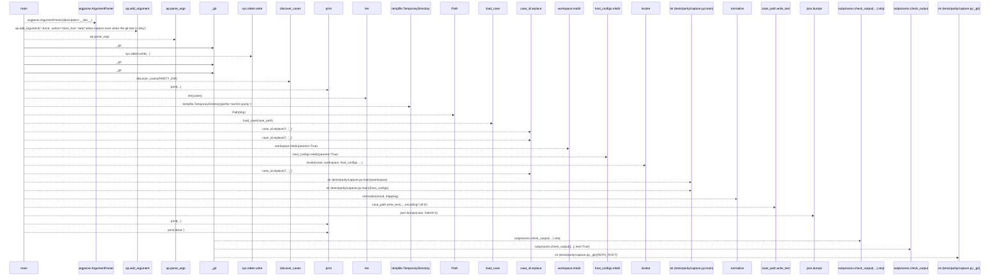
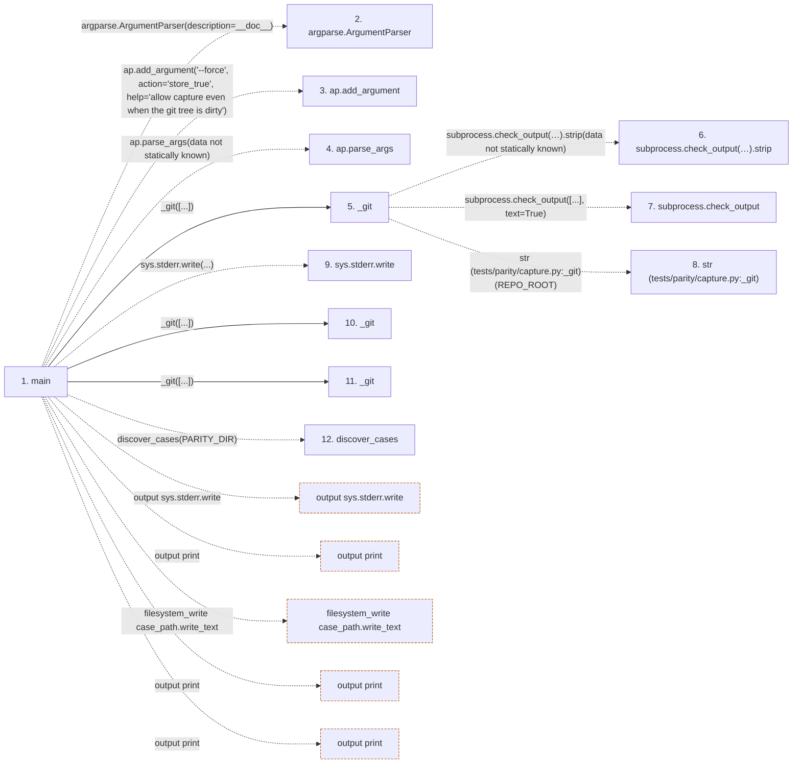

# capture

**Entry point:** `main` (`process`)
**Source:** [capture](../modules/capture.md)
**Modules touched:** [capture](../modules/capture.md)

## Call sequence

> Static overview in presentation order, not runtime execution order. Arrows retain captured callers; representative internal continuations and boundary examples precede repeated helper detail.

<!-- Auto-generated from static call edges. Dashed arrows are external or unresolved calls. Reviewed runtime conditions and side effects belong in Behavior. -->

> Call sequence diagram shows 29 of 29 interactions; 0 omitted to keep the visualization within the 30-interaction and generated-diagram limits, with uncertain identities omitted rather than inferred.

> Captured boundary calls: external 17 of 17 (0 omitted); unresolved 9 of 9 (0 omitted). These counts cover the captured static trace.
> Detailed flow queries retain their own coverage and limits; omitted paths may execute at runtime.

## Data flow

<!-- Auto-generated static analysis. Treat values and boundaries as best-effort hints, not runtime proof. -->

### Step data

| Step | Inputs | Reads | Writes | Returns |
|---|---|---|---|---|
| `main` | - | `PARITY_DIR`, `WORKSPACE_TOKEN`, `HOST_CONFIGS_TOKEN` | `case[...]`, `case[...]` | `2`, `0` |
| `argparse.ArgumentParser` | - | - | - | - |
| `ap.add_argument` | - | - | - | - |
| `ap.parse_args` | - | - | - | - |
| `_git` | `args: list[str]` | - | - | `...` |
| `subprocess.check_output(…).strip` | - | - | - | - |
| `subprocess.check_output` | - | - | - | - |
| `str (tests/parity/capture.py:_git)` | - | - | - | - |
| `sys.stderr.write` | - | - | - | - |
| `_git` | `args: list[str]` | - | - | `...` |
| `_git` | `args: list[str]` | - | - | `...` |
| `discover_cases` | - | - | - | - |

### Call data

| From | To | Line | Call |
|---|---|---:|---|
| main | argparse.ArgumentParser | 48 | `argparse.ArgumentParser(description=__doc__)` |
| main | ap.add_argument | 49 | `ap.add_argument('--force', action='store_true', help='allow capture even when the git tree is dirty')` |
| main | ap.parse_args | 54 | `ap.parse_args(data not statically known)` |
| main | _git | 56 | `_git([...])` |
| _git | subprocess.check_output(…).strip | 42 | `subprocess.check_output(['git', '-C', str(REPO_ROOT), *args], text=True).strip(data not statically known)` |
| _git | subprocess.check_output | 42 | `subprocess.check_output([...], text=True)` |
| _git | str (tests/parity/capture.py:_git) | 43 | `str(REPO_ROOT)` |
| main | sys.stderr.write | 58 | `sys.stderr.write(...)` |
| main | _git | 65 | `_git([...])` |
| main | _git | 66 | `_git([...])` |
| main | discover_cases | 67 | `discover_cases(PARITY_DIR)` |

### Boundary effects

| Kind | Target | Step | Line |
|---|---|---|---:|
| output | `sys.stderr.write` | `main` | 58 |
| output | `print` | `main` | 68 |
| filesystem_write | `case_path.write_text` | `main` | 86 |
| output | `print` | `main` | 87 |
| output | `print` | `main` | 89 |

### Static analysis gaps

| Kind | Step | Target | Line |
|---|---|---|---:|
| external_call | `main` | `argparse.ArgumentParser` | 48 |
| unresolved_call | `main` | `ap.add_argument` | 49 |
| unresolved_call | `main` | `ap.parse_args` | 54 |
| unresolved_call | `_git` | `subprocess.check_output(['git', '-C', str(REPO_ROOT), *args], text=True).strip` | 42 |
| external_call | `_git` | `subprocess.check_output` | 42 |
| external_call | `main` | `discover_cases` | 67 |
| step_limit | `main` | `first 12 steps` | 0 |

## Behavior

This flow starts at `main` and is classified as `process`. The generated call and data-flow sections are bounded static projections; runtime conditions and side effects require source-level confirmation.
