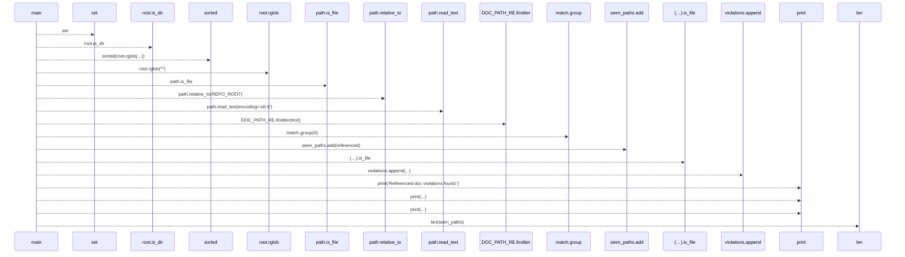
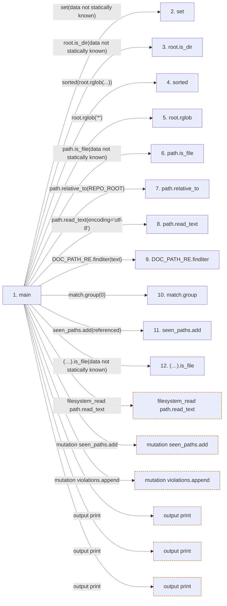

# check_doc_references

**Entry point:** `main` (`process`)
**Source:** [check_doc_references](../modules/check_doc_references.md)
**Modules touched:** [check_doc_references](../modules/check_doc_references.md)

## Call sequence

> Static overview in presentation order, not runtime execution order. Arrows retain captured callers; representative internal continuations and boundary examples precede repeated helper detail.

<!-- Auto-generated from static call edges. Dashed arrows are external or unresolved calls. Reviewed runtime conditions and side effects belong in Behavior. -->

> Call sequence diagram shows 16 of 16 interactions; 0 omitted to keep the visualization within the 30-interaction and generated-diagram limits, with uncertain identities omitted rather than inferred.

> Captured boundary calls: external 6 of 6 (0 omitted); unresolved 10 of 10 (0 omitted). These counts cover the captured static trace.
> Detailed flow queries retain their own coverage and limits; omitted paths may execute at runtime.

## Data flow

<!-- Auto-generated static analysis. Treat values and boundaries as best-effort hints, not runtime proof. -->

### Step data

| Step | Inputs | Reads | Writes | Returns |
|---|---|---|---|---|
| `main` | - | `SCAN_ROOTS`, `REPO_ROOT`, `REPO_ROOT` | - | `1`, `0` |
| `set` | - | - | - | - |
| `root.is_dir` | - | - | - | - |
| `sorted` | - | - | - | - |
| `root.rglob` | - | - | - | - |
| `path.is_file` | - | - | - | - |
| `path.relative_to` | - | - | - | - |
| `path.read_text` | - | - | - | - |
| `DOC_PATH_RE.finditer` | - | - | - | - |
| `match.group` | - | - | - | - |
| `seen_paths.add` | - | - | - | - |
| `(…).is_file` | - | - | - | - |

### Call data

| From | To | Line | Call |
|---|---|---:|---|
| main | set | 28 | `set(data not statically known)` |
| main | root.is_dir | 31 | `root.is_dir(data not statically known)` |
| main | sorted | 33 | `sorted(root.rglob(...))` |
| main | root.rglob | 33 | `root.rglob('*')` |
| main | path.is_file | 34 | `path.is_file(data not statically known)` |
| main | path.relative_to | 38 | `path.relative_to(REPO_ROOT)` |
| main | path.read_text | 40 | `path.read_text(encoding='utf-8')` |
| main | DOC_PATH_RE.finditer | 43 | `DOC_PATH_RE.finditer(text)` |
| main | match.group | 44 | `match.group(0)` |
| main | seen_paths.add | 45 | `seen_paths.add(referenced)` |
| main | (…).is_file | 46 | `(REPO_ROOT / referenced).is_file(data not statically known)` |

### Boundary effects

| Kind | Target | Step | Line |
|---|---|---|---:|
| filesystem_read | `path.read_text` | `main` | 40 |
| mutation | `seen_paths.add` | `main` | 45 |
| mutation | `violations.append` | `main` | 47 |
| output | `print` | `main` | 49 |
| output | `print` | `main` | 51 |
| output | `print` | `main` | 53 |

### Static analysis gaps

| Kind | Step | Target | Line |
|---|---|---|---:|
| unresolved_call | `main` | `root.is_dir` | 31 |
| external_call | `main` | `sorted` | 33 |
| unresolved_call | `main` | `root.rglob` | 33 |
| unresolved_call | `main` | `path.is_file` | 34 |
| unresolved_call | `main` | `path.relative_to` | 38 |
| unresolved_call | `main` | `DOC_PATH_RE.finditer` | 43 |
| unresolved_call | `main` | `match.group` | 44 |
| unresolved_call | `main` | `(REPO_ROOT / referenced).is_file` | 46 |
| step_limit | `main` | `first 12 steps` | 0 |

## Behavior

This flow starts at `main` and is classified as `process`. The generated call and data-flow sections are bounded static projections; runtime conditions and side effects require source-level confirmation.
