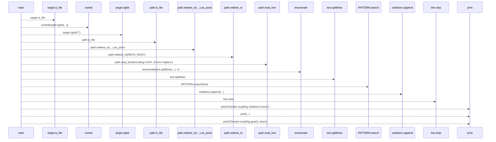
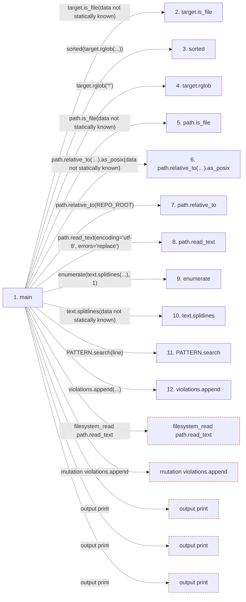

# check_domain_coupling

**Entry point:** `main` (`process`)
**Source:** [check_domain_coupling](../modules/check_domain_coupling.md)
**Modules touched:** [check_domain_coupling](../modules/check_domain_coupling.md)

## Call sequence

> Static overview in presentation order, not runtime execution order. Arrows retain captured callers; representative internal continuations and boundary examples precede repeated helper detail.

<!-- Auto-generated from static call edges. Dashed arrows are external or unresolved calls. Reviewed runtime conditions and side effects belong in Behavior. -->

> Call sequence diagram shows 15 of 15 interactions; 0 omitted to keep the visualization within the 30-interaction and generated-diagram limits, with uncertain identities omitted rather than inferred.

> Captured boundary calls: external 5 of 5 (0 omitted); unresolved 10 of 10 (0 omitted). These counts cover the captured static trace.
> Detailed flow queries retain their own coverage and limits; omitted paths may execute at runtime.

## Data flow

<!-- Auto-generated static analysis. Treat values and boundaries as best-effort hints, not runtime proof. -->

### Step data

| Step | Inputs | Reads | Writes | Returns |
|---|---|---|---|---|
| `main` | - | `TARGETS`, `EXEMPT_PATHS` | - | `1`, `0` |
| `target.is_file` | - | - | - | - |
| `sorted` | - | - | - | - |
| `target.rglob` | - | - | - | - |
| `path.is_file` | - | - | - | - |
| `path.relative_to(…).as_posix` | - | - | - | - |
| `path.relative_to` | - | - | - | - |
| `path.read_text` | - | - | - | - |
| `enumerate` | - | - | - | - |
| `text.splitlines` | - | - | - | - |
| `PATTERN.search` | - | - | - | - |
| `violations.append` | - | - | - | - |

### Call data

| From | To | Line | Call |
|---|---|---:|---|
| main | target.is_file | 61 | `target.is_file(data not statically known)` |
| main | sorted | 61 | `sorted(target.rglob(...))` |
| main | target.rglob | 61 | `target.rglob('*')` |
| main | path.is_file | 63 | `path.is_file(data not statically known)` |
| main | path.relative_to(…).as_posix | 65 | `path.relative_to(REPO_ROOT).as_posix(data not statically known)` |
| main | path.relative_to | 65 | `path.relative_to(REPO_ROOT)` |
| main | path.read_text | 68 | `path.read_text(encoding='utf-8', errors='replace')` |
| main | enumerate | 69 | `enumerate(text.splitlines(...), 1)` |
| main | text.splitlines | 69 | `text.splitlines(data not statically known)` |
| main | PATTERN.search | 78 | `PATTERN.search(line)` |
| main | violations.append | 79 | `violations.append(...)` |

### Boundary effects

| Kind | Target | Step | Line |
|---|---|---|---:|
| filesystem_read | `path.read_text` | `main` | 68 |
| mutation | `violations.append` | `main` | 79 |
| output | `print` | `main` | 81 |
| output | `print` | `main` | 83 |
| output | `print` | `main` | 85 |

### Static analysis gaps

| Kind | Step | Target | Line |
|---|---|---|---:|
| unresolved_call | `main` | `target.is_file` | 61 |
| external_call | `main` | `sorted` | 61 |
| unresolved_call | `main` | `target.rglob` | 61 |
| unresolved_call | `main` | `path.is_file` | 63 |
| unresolved_call | `main` | `path.relative_to(REPO_ROOT).as_posix` | 65 |
| unresolved_call | `main` | `path.relative_to` | 65 |
| external_call | `main` | `enumerate` | 69 |
| unresolved_call | `main` | `text.splitlines` | 69 |
| unresolved_call | `main` | `PATTERN.search` | 78 |
| step_limit | `main` | `first 12 steps` | 0 |

## Behavior

This flow starts at `main` and is classified as `process`. The generated call and data-flow sections are bounded static projections; runtime conditions and side effects require source-level confirmation.
