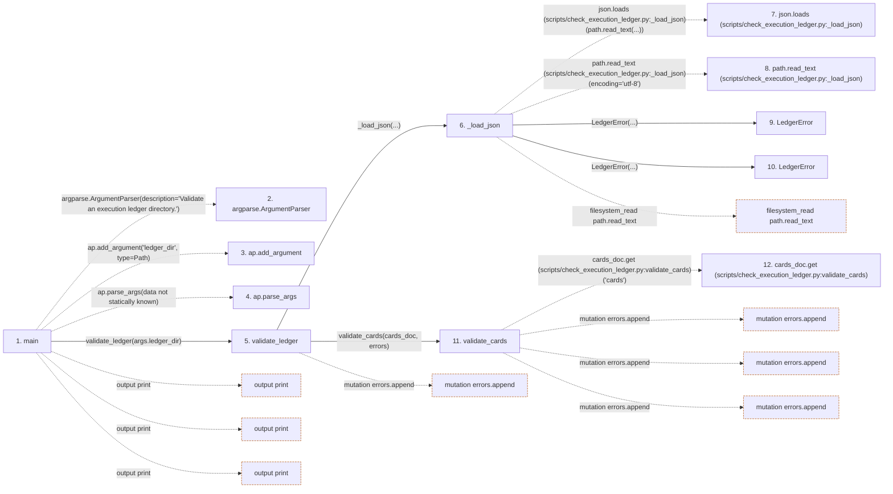

# check_execution_ledger

**Entry point:** `main` (`process`)
**Source:** [check_execution_ledger](../modules/check_execution_ledger.md)
**Modules touched:** [check_execution_ledger](../modules/check_execution_ledger.md)

## Call sequence

> Static overview in presentation order, not runtime execution order. Arrows retain captured callers; representative internal continuations and boundary examples precede repeated helper detail.

```mermaid
sequenceDiagram
    participant p0 as main
    participant p1 as validate_ledger
    participant p2 as _load_json
    participant p3 as validate_cards
    participant p4 as validate_side_files
    participant p5 as _load_jsonl
    participant p6 as validate_dependencies
    participant p7 as validate_closure
    participant p8 as LedgerError
    participant p9 as _validate_acceptance
    participant p10 as argparse.ArgumentParser
    participant p11 as ap.add_argument
    participant p12 as ap.parse_args
    participant p13 as print
    participant p14 as len
    participant p15 as errors.append (scripts/check_execution_ledger.py:validate_ledger)
    participant p16 as str
    participant p17 as json.loads (scripts/check_execution_ledger.py:_load_json)
    participant p18 as cards_doc.get (scripts/check_execution_ledger.py:validate_cards)
    participant p19 as cards_doc.get (scripts/check_execution_l….py:validate_dependencies)
    participant p20 as cards_doc.get (scripts/check_execution_ledger.py:validate_closure)
    participant p21 as path.read_text (scripts/check_execution_ledger.py:_load_json)
    participant p22 as isinstance (scripts/check_execution_ledger.py:validate_cards)
    participant p23 as rec.get (scripts/check_execution_l….py:validate_dependencies)
    participant p24 as c.get
    participant p25 as run.get
    participant p26 as errors.append (scripts/check_execution_ledger.py:validate_cards)
    p0->>p1: validate_ledger
    p1->>p2: _load_json
    p1->>p3: validate_cards
    p1->>p4: validate_side_files
    p4->>p5: _load_jsonl
    p1->>p6: validate_dependencies
    p1->>p7: validate_closure
    p2->>p8: LedgerError
    p3->>p9: _validate_acceptance
    p0-->>p10: argparse.ArgumentParser(description='Validate an execution ledger directory.')
    p0-->>p11: ap.add_argument('ledger_dir', type=Path)
    p0-->>p12: ap.parse_args
    p0-->>p13: print(...)
    p0-->>p14: len(errors)
    p0-->>p13: print(...)
    p0-->>p13: print('ledger OK')
    p1-->>p15: errors.append (scripts/check_execution_ledger.py:validate_ledger)(str(...))
    p1-->>p16: str(exc)
    p2-->>p17: json.loads (scripts/check_execution_ledger.py:_load_json)(path.read_text(...))
    p3-->>p18: cards_doc.get (scripts/check_execution_ledger.py:validate_cards)('cards')
    p6-->>p19: cards_doc.get (scripts/check_execution_l….py:validate_dependencies)('cards')
    p7-->>p20: cards_doc.get (scripts/check_execution_ledger.py:validate_closure)('cards')
    p2-->>p21: path.read_text (scripts/check_execution_ledger.py:_load_json)(encoding='utf-8')
    p3-->>p22: isinstance (scripts/check_execution_ledger.py:validate_cards)(cards, list)
    p6-->>p23: rec.get (scripts/check_execution_l….py:validate_dependencies)('card_id')
    p7-->>p24: c.get('card_id')
    p4-->>p25: run.get(field)
    p3-->>p26: errors.append (scripts/check_execution_ledger.py:validate_cards)("cards.json: 'cards' must be a non-empty list")
    p6-->>p23: rec.get (scripts/check_execution_l….py:validate_dependencies)('depends_on')
    p7-->>p24: c.get('status')
```

<!-- Auto-generated from static call edges. Dashed arrows are external or unresolved calls. Reviewed runtime conditions and side effects belong in Behavior. -->

> Call sequence diagram shows 30 of 147 interactions; 117 omitted to keep the visualization within the 30-interaction and generated-diagram limits, with uncertain identities omitted rather than inferred.

> Captured boundary calls: external 8 of 26 (18 omitted); unresolved 13 of 106 (93 omitted). These counts cover the captured static trace.

Omitted captured detail, grouped by actual caller occurrence and target module:

| Caller | Parent step | Target module | Kind | Omitted interactions |
| --- | --- | --- | --- | --- |
| `scripts/check_execution_ledger.py:_load_json` | 6 | [scripts/check_execution_ledger.py](../modules/check_execution_ledger.md) | internal | 1 |
| `scripts/check_execution_ledger.py:validate_cards` | 11 | - | external | 5 |
| `scripts/check_execution_ledger.py:validate_cards` | 11 | - | unresolved | 14 |
| `scripts/check_execution_ledger.py:_validate_acceptance` | 34 | - | unresolved | 19 |
| `scripts/check_execution_ledger.py:_validate_acceptance` | 34 | - | external | 5 |
| `scripts/check_execution_ledger.py:validate_dependencies` | 59 | - | unresolved | 7 |
| `scripts/check_execution_ledger.py:validate_dependencies` | 59 | - | external | 2 |
| `scripts/check_execution_ledger.py:validate_closure` | 72 | - | unresolved | 29 |
> Omission summary shows 8 of 14 groups; 6 further groups are not expanded here. Counts above include all omitted interactions.
> Detailed flow queries retain their own coverage and limits; omitted paths may execute at runtime.

## Data flow

<!-- Auto-generated static analysis. Treat values and boundaries as best-effort hints, not runtime proof. -->

### Step data

| Step | Inputs | Reads | Writes | Returns |
|---|---|---|---|---|
| `main` | - | `Path` | - | `1`, `0` |
| `argparse.ArgumentParser` | - | - | - | - |
| `ap.add_argument` | - | - | - | - |
| `ap.parse_args` | - | - | - | - |
| `validate_ledger` | `ledger_dir: Path` | `LedgerError` | - | `errors` |
| `_load_json` | `path: Path` | `json` | - | `json.loads(...)` |
| `json.loads (scripts/check_execution_ledger.py:_load_json)` | - | - | - | - |
| `path.read_text (scripts/check_execution_ledger.py:_load_json)` | - | - | - | - |
| `LedgerError` | - | - | - | - |
| `LedgerError` | - | - | - | - |
| `validate_cards` | `cards_doc: dict`, `errors: list[str]` | `REQUIRED_RECORD_FIELDS`, `STATES`, `STATES`, `TRANSITIONS` | - | `set(...)`, `known` |
| `cards_doc.get (scripts/check_execution_ledger.py:validate_cards)` | - | - | - | - |

### Call data

| From | To | Line | Call |
|---|---|---:|---|
| main | argparse.ArgumentParser | 286 | `argparse.ArgumentParser(description='Validate an execution ledger directory.')` |
| main | ap.add_argument | 287 | `ap.add_argument('ledger_dir', type=Path)` |
| main | ap.parse_args | 288 | `ap.parse_args(data not statically known)` |
| main | validate_ledger | 289 | `validate_ledger(args.ledger_dir)` |
| validate_ledger | _load_json | 274 | `_load_json(...)` |
| _load_json | json.loads (scripts/check_execution_ledger.py:_load_json) | 56 | `json.loads(path.read_text(...))` |
| _load_json | path.read_text (scripts/check_execution_ledger.py:_load_json) | 56 | `path.read_text(encoding='utf-8')` |
| _load_json | LedgerError | 58 | `LedgerError(...)` |
| _load_json | LedgerError | 60 | `LedgerError(...)` |
| validate_ledger | validate_cards | 275 | `validate_cards(cards_doc, errors)` |
| validate_cards | cards_doc.get (scripts/check_execution_ledger.py:validate_cards) | 81 | `cards_doc.get('cards')` |

### Boundary effects

| Kind | Target | Step | Line |
|---|---|---|---:|
| output | `print` | `main` | 291 |
| output | `print` | `main` | 293 |
| output | `print` | `main` | 295 |
| mutation | `errors.append` | `validate_ledger` | 281 |
| filesystem_read | `path.read_text` | `_load_json` | 56 |
| mutation | `errors.append` | `validate_cards` | 83 |
| mutation | `errors.append` | `validate_cards` | 90 |
| mutation | `errors.append` | `validate_cards` | 94 |

### Static analysis gaps

| Kind | Step | Target | Line |
|---|---|---|---:|
| external_call | `main` | `argparse.ArgumentParser` | 286 |
| unresolved_call | `main` | `ap.add_argument` | 287 |
| unresolved_call | `main` | `ap.parse_args` | 288 |
| unresolved_call | `validate_cards` | `cards_doc.get` | 81 |
| step_limit | `main` | `first 12 steps` | 0 |

## Behavior

This flow starts at `main` and is classified as `process`. The generated call and data-flow sections are bounded static projections; runtime conditions and side effects require source-level confirmation.
