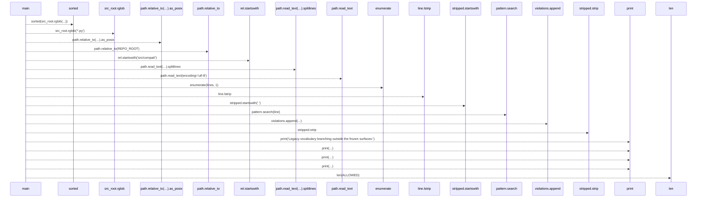
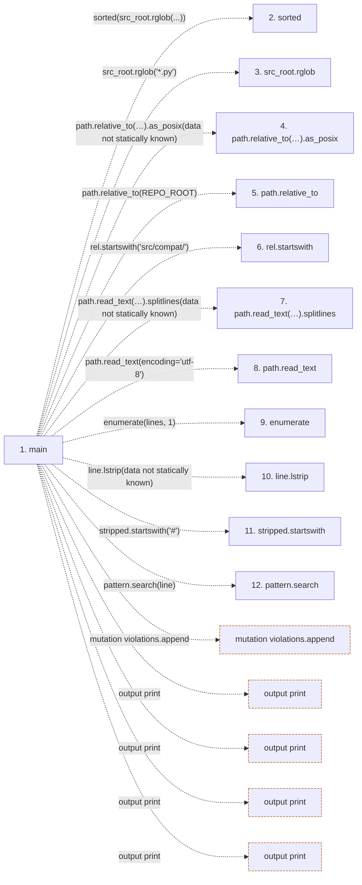

# check_legacy_vocab_branching

**Entry point:** `main` (`process`)
**Source:** [check_legacy_vocab_branching](../modules/check_legacy_vocab_branching.md)
**Modules touched:** [check_legacy_vocab_branching](../modules/check_legacy_vocab_branching.md)

## Call sequence

> Static overview in presentation order, not runtime execution order. Arrows retain captured callers; representative internal continuations and boundary examples precede repeated helper detail.

<!-- Auto-generated from static call edges. Dashed arrows are external or unresolved calls. Reviewed runtime conditions and side effects belong in Behavior. -->

> Call sequence diagram shows 18 of 18 interactions; 0 omitted to keep the visualization within the 30-interaction and generated-diagram limits, with uncertain identities omitted rather than inferred.

> Captured boundary calls: external 7 of 7 (0 omitted); unresolved 11 of 11 (0 omitted). These counts cover the captured static trace.
> Detailed flow queries retain their own coverage and limits; omitted paths may execute at runtime.

## Data flow

<!-- Auto-generated static analysis. Treat values and boundaries as best-effort hints, not runtime proof. -->

### Step data

| Step | Inputs | Reads | Writes | Returns |
|---|---|---|---|---|
| `main` | - | `REPO_ROOT`, `ALLOWED`, `PATTERNS`, `ALLOWED` | - | `1`, `0` |
| `sorted` | - | - | - | - |
| `src_root.rglob` | - | - | - | - |
| `path.relative_to(…).as_posix` | - | - | - | - |
| `path.relative_to` | - | - | - | - |
| `rel.startswith` | - | - | - | - |
| `path.read_text(…).splitlines` | - | - | - | - |
| `path.read_text` | - | - | - | - |
| `enumerate` | - | - | - | - |
| `line.lstrip` | - | - | - | - |
| `stripped.startswith` | - | - | - | - |
| `pattern.search` | - | - | - | - |

### Call data

| From | To | Line | Call |
|---|---|---:|---|
| main | sorted | 56 | `sorted(src_root.rglob(...))` |
| main | src_root.rglob | 56 | `src_root.rglob('*.py')` |
| main | path.relative_to(…).as_posix | 57 | `path.relative_to(REPO_ROOT).as_posix(data not statically known)` |
| main | path.relative_to | 57 | `path.relative_to(REPO_ROOT)` |
| main | rel.startswith | 58 | `rel.startswith('src/compat/')` |
| main | path.read_text(…).splitlines | 63 | `path.read_text(encoding='utf-8').splitlines(data not statically known)` |
| main | path.read_text | 63 | `path.read_text(encoding='utf-8')` |
| main | enumerate | 66 | `enumerate(lines, 1)` |
| main | line.lstrip | 67 | `line.lstrip(data not statically known)` |
| main | stripped.startswith | 68 | `stripped.startswith('#')` |
| main | pattern.search | 71 | `pattern.search(line)` |

### Boundary effects

| Kind | Target | Step | Line |
|---|---|---|---:|
| mutation | `violations.append` | `main` | 72 |
| output | `print` | `main` | 77 |
| output | `print` | `main` | 79 |
| output | `print` | `main` | 80 |
| output | `print` | `main` | 86 |

### Static analysis gaps

| Kind | Step | Target | Line |
|---|---|---|---:|
| external_call | `main` | `sorted` | 56 |
| unresolved_call | `main` | `src_root.rglob` | 56 |
| unresolved_call | `main` | `path.relative_to(REPO_ROOT).as_posix` | 57 |
| unresolved_call | `main` | `path.relative_to` | 57 |
| unresolved_call | `main` | `rel.startswith` | 58 |
| unresolved_call | `main` | `path.read_text(encoding='utf-8').splitlines` | 63 |
| unresolved_call | `main` | `path.read_text` | 63 |
| external_call | `main` | `enumerate` | 66 |
| unresolved_call | `main` | `line.lstrip` | 67 |
| unresolved_call | `main` | `stripped.startswith` | 68 |
| unresolved_call | `main` | `pattern.search` | 71 |
| step_limit | `main` | `first 12 steps` | 0 |

## Behavior

This flow starts at `main` and is classified as `process`. The generated call and data-flow sections are bounded static projections; runtime conditions and side effects require source-level confirmation.
