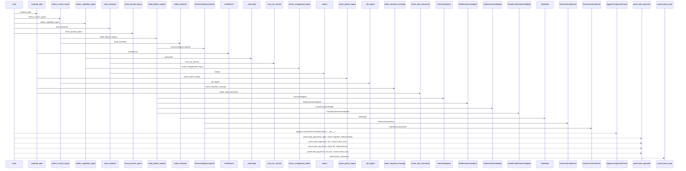
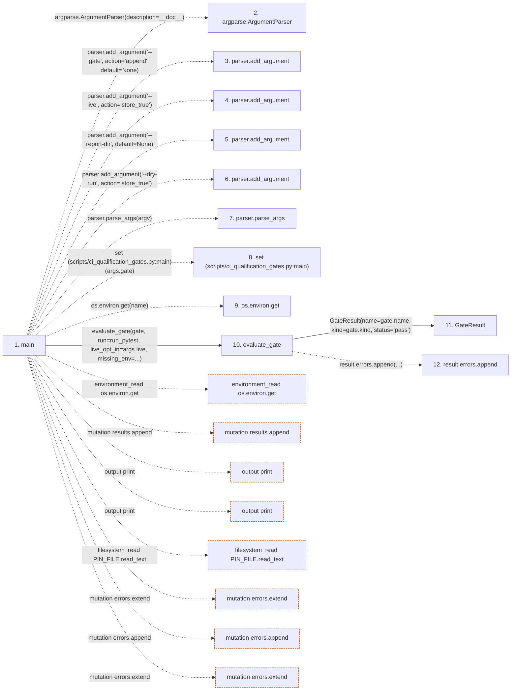

# ci_qualification_gates

**Entry point:** `main` (`process`)
**Source:** [ci_qualification_gates](../modules/ci_qualification_gates.md)
**Modules touched:** [builtin_harness](../modules/builtin_harness.md), [ci_qualification_gates](../modules/ci_qualification_gates.md), [claude_code_harness](../modules/claude_code_harness.md), and 5 more

**Complete modules touched:**

- [builtin_harness](../modules/builtin_harness.md)
- [ci_qualification_gates](../modules/ci_qualification_gates.md)
- [claude_code_harness](../modules/claude_code_harness.md)
- [codex_harness](../modules/codex_harness.md)
- [harness_adapter](../modules/harness_adapter.md)
- [harness_contract](../modules/harness_contract.md)
- [harnesses](../modules/harnesses.md)
- [latency_benchmark](../modules/latency_benchmark.md)

**Related modules:** [harness_contract](../modules/harness_contract.md), [harnesses](../modules/harnesses.md), [latency_benchmark](../modules/latency_benchmark.md)

## Call sequence

> Static overview in presentation order, not runtime execution order. Arrows retain captured callers; representative internal continuations and boundary examples precede repeated helper detail.

<!-- Auto-generated from static call edges. Dashed arrows are external or unresolved calls. Reviewed runtime conditions and side effects belong in Behavior. -->

> Call sequence diagram shows 30 of 175 interactions; 145 omitted to keep the visualization within the 30-interaction and generated-diagram limits, with uncertain identities omitted rather than inferred.

> Captured boundary calls: external 1 of 58 (57 omitted); unresolved 5 of 86 (81 omitted). These counts cover the captured static trace.

Omitted captured detail, grouped by actual caller occurrence and target module:

| Caller | Parent step | Target module | Kind | Omitted interactions |
| --- | --- | --- | --- | --- |
| `scripts/ci_qualification_gates.py:main` | 1 | - | external | 16 |
| `scripts/ci_qualification_gates.py:evaluate_gate` | 10 | - | unresolved | 7 |
| `scripts/ci_qualification_gates.py:evaluate_gate` | 10 | - | external | 4 |
| `scripts/ci_qualification_gates.py:parse_pytest_output` | 19 | - | unresolved | 4 |
| `scripts/ci_qualification_gates.py:evaluate_gate` | 10 | [scripts/ci_qualification_gates.py](../modules/ci_qualification_gates.md) | internal | 1 |
| `scripts/ci_qualification_gates.py:redact` | 24 | - | unresolved | 2 |
| `scripts/ci_qualification_gates.py:check_required_coverage` | 30 | - | external | 1 |
| `scripts/ci_qualification_gates.py:check_required_coverage` | 30 | - | unresolved | 1 |
> Omission summary shows 8 of 34 groups; 26 further groups are not expanded here. Counts above include all omitted interactions.
> Detailed flow queries retain their own coverage and limits; omitted paths may execute at runtime.

## Data flow

<!-- Auto-generated static analysis. Treat values and boundaries as best-effort hints, not runtime proof. -->

### Step data

| Step | Inputs | Reads | Writes | Returns |
|---|---|---|---|---|
| `main` | `argv: Optional[Sequence[str]]` | `GATES`, `run_pytest`, `PIN_FILE`, `REPO_ROOT` | - | `...` |
| `argparse.ArgumentParser` | - | - | - | - |
| `parser.add_argument` | - | - | - | - |
| `parser.add_argument` | - | - | - | - |
| `parser.add_argument` | - | - | - | - |
| `parser.add_argument` | - | - | - | - |
| `parser.parse_args` | - | - | - | - |
| `set (scripts/ci_qualification_gates.py:main)` | - | - | - | - |
| `os.environ.get` | - | - | - | - |
| `evaluate_gate` | `gate: Gate`, `run: Callable[[Sequence[str], int], tuple[int, str]]`, `owners: Sequence[SkipOwner]`, `live_opt_in: bool`, `missing_env: Sequence[str]` | `LIVE_OPT_IN_ENV`, `BUDGET_ENV`, `subprocess` | `result.status`, `result.status`, `result.status`, `result.duration_s`, `result.passed`, `result.failed`, `result.skipped`, `result.log` | `result`, `result`, `result`, `result` |
| `GateResult` | - | - | - | - |
| `result.errors.append` | - | - | - | - |

### Call data

| From | To | Line | Call |
|---|---|---:|---|
| main | argparse.ArgumentParser | 464 | `argparse.ArgumentParser(description=__doc__)` |
| main | parser.add_argument | 465 | `parser.add_argument('--gate', action='append', default=None)` |
| main | parser.add_argument | 466 | `parser.add_argument('--live', action='store_true')` |
| main | parser.add_argument | 467 | `parser.add_argument('--report-dir', default=None)` |
| main | parser.add_argument | 468 | `parser.add_argument('--dry-run', action='store_true')` |
| main | parser.parse_args | 469 | `parser.parse_args(argv)` |
| main | set (scripts/ci_qualification_gates.py:main) | 473 | `set(args.gate)` |
| main | os.environ.get | 478 | `os.environ.get(name)` |
| main | evaluate_gate | 484 | `evaluate_gate(gate, run=run_pytest, live_opt_in=args.live, missing_env=...)` |
| evaluate_gate | GateResult | 400 | `GateResult(name=gate.name, kind=gate.kind, status='pass')` |
| evaluate_gate | result.errors.append | 404 | `result.errors.append(...)` |

### Boundary effects

| Kind | Target | Step | Line |
|---|---|---|---:|
| environment_read | `os.environ.get` | `main` | 478 |
| mutation | `results.append` | `main` | 490 |
| output | `print` | `main` | 494 |
| output | `print` | `main` | 496 |
| filesystem_read | `PIN_FILE.read_text` | `main` | 501 |
| mutation | `errors.extend` | `main` | 503 |
| mutation | `errors.append` | `main` | 505 |
| mutation | `errors.extend` | `main` | 511 |

### Static analysis gaps

| Kind | Step | Target | Line |
|---|---|---|---:|
| external_call | `main` | `argparse.ArgumentParser` | 464 |
| unresolved_call | `main` | `parser.add_argument` | 465 |
| unresolved_call | `main` | `parser.add_argument` | 466 |
| unresolved_call | `main` | `parser.add_argument` | 467 |
| unresolved_call | `main` | `parser.add_argument` | 468 |
| unresolved_call | `main` | `parser.parse_args` | 469 |
| unresolved_call | `evaluate_gate` | `result.errors.append` | 404 |
| step_limit | `main` | `first 12 steps` | 0 |

## Behavior

This flow starts at `main` and is classified as `process`. The generated call and data-flow sections are bounded static projections; runtime conditions and side effects require source-level confirmation.
