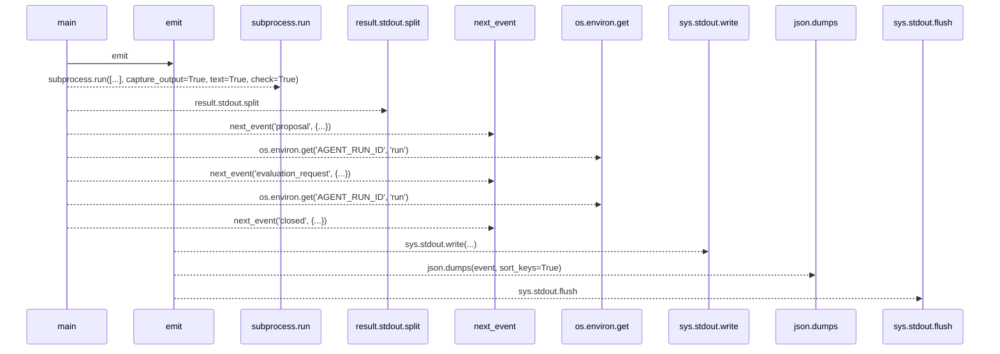
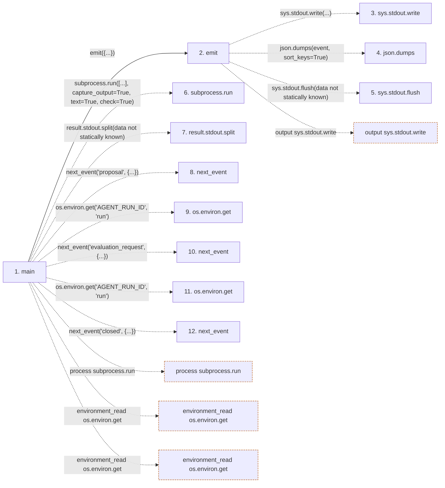

# jsonl_driver

**Entry point:** `main` (`process`)
**Source:** [jsonl_driver](../modules/jsonl_driver.md)
**Modules touched:** [jsonl_driver](../modules/jsonl_driver.md)

## Call sequence

> Static overview in presentation order, not runtime execution order. Arrows retain captured callers; representative internal continuations and boundary examples precede repeated helper detail.

<!-- Auto-generated from static call edges. Dashed arrows are external or unresolved calls. Reviewed runtime conditions and side effects belong in Behavior. -->

> Call sequence diagram shows 11 of 11 interactions; 0 omitted to keep the visualization within the 30-interaction and generated-diagram limits, with uncertain identities omitted rather than inferred.

> Captured boundary calls: external 6 of 6 (0 omitted); unresolved 4 of 4 (0 omitted). These counts cover the captured static trace.
> Detailed flow queries retain their own coverage and limits; omitted paths may execute at runtime.

## Data flow

<!-- Auto-generated static analysis. Treat values and boundaries as best-effort hints, not runtime proof. -->

### Step data

| Step | Inputs | Reads | Writes | Returns |
|---|---|---|---|---|
| `main` | - | `CONTRACT_VERSION` | - | `0` |
| `emit` | `event: dict` | - | - | - |
| `sys.stdout.write` | - | - | - | - |
| `json.dumps` | - | - | - | - |
| `sys.stdout.flush` | - | - | - | - |
| `subprocess.run` | - | - | - | - |
| `result.stdout.split` | - | - | - | - |
| `next_event` | - | - | - | - |
| `os.environ.get` | - | - | - | - |
| `next_event` | - | - | - | - |
| `os.environ.get` | - | - | - | - |
| `next_event` | - | - | - | - |

### Call data

| From | To | Line | Call |
|---|---|---:|---|
| main | emit | 42 | `emit({...})` |
| emit | sys.stdout.write | 22 | `sys.stdout.write(...)` |
| emit | json.dumps | 22 | `json.dumps(event, sort_keys=True)` |
| emit | sys.stdout.flush | 23 | `sys.stdout.flush(data not statically known)` |
| main | subprocess.run | 54 | `subprocess.run([...], capture_output=True, text=True, check=True)` |
| main | result.stdout.split | 60 | `result.stdout.split(data not statically known)` |
| main | next_event | 63 | `next_event('proposal', {...})` |
| main | os.environ.get | 68 | `os.environ.get('AGENT_RUN_ID', 'run')` |
| main | next_event | 74 | `next_event('evaluation_request', {...})` |
| main | os.environ.get | 76 | `os.environ.get('AGENT_RUN_ID', 'run')` |
| main | next_event | 80 | `next_event('closed', {...})` |

### Boundary effects

| Kind | Target | Step | Line |
|---|---|---|---:|
| process | `subprocess.run` | `main` | 54 |
| environment_read | `os.environ.get` | `main` | 68 |
| environment_read | `os.environ.get` | `main` | 76 |
| output | `sys.stdout.write` | `emit` | 22 |

### Static analysis gaps

| Kind | Step | Target | Line |
|---|---|---|---:|
| external_call | `emit` | `sys.stdout.flush` | 23 |
| unresolved_call | `main` | `result.stdout.split` | 60 |
| unresolved_call | `main` | `next_event` | 63 |
| unresolved_call | `main` | `next_event` | 74 |
| unresolved_call | `main` | `next_event` | 80 |

## Behavior

This flow starts at `main` and is classified as `process`. The generated call and data-flow sections are bounded static projections; runtime conditions and side effects require source-level confirmation.
