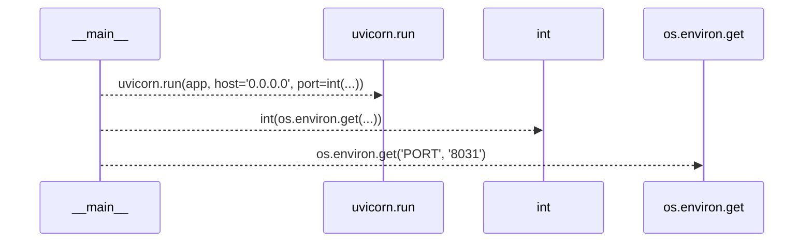
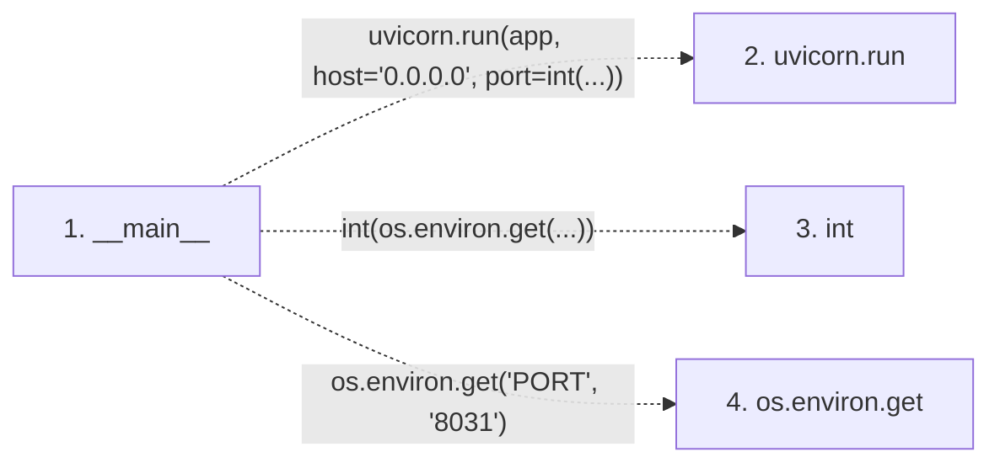

# main

**Entry point:** `__main__` (`process`)
**Source:** [examples_prompt-registry_main](../modules/examples_prompt-registry_main.md)
**Modules touched:** [examples_prompt-registry_main](../modules/examples_prompt-registry_main.md)

## Call sequence

> Static overview in presentation order, not runtime execution order. Arrows retain captured callers; representative internal continuations and boundary examples precede repeated helper detail.

<!-- Auto-generated from static call edges. Dashed arrows are external or unresolved calls. Reviewed runtime conditions and side effects belong in Behavior. -->

> Call sequence diagram shows 3 of 3 interactions; 0 omitted to keep the visualization within the 30-interaction and generated-diagram limits, with uncertain identities omitted rather than inferred.

> Captured boundary calls: external 3 of 3 (0 omitted); unresolved 0 of 0 (0 omitted). These counts cover the captured static trace.
> Detailed flow queries retain their own coverage and limits; omitted paths may execute at runtime.

## Data flow

<!-- Auto-generated static analysis. Treat values and boundaries as best-effort hints, not runtime proof. -->

### Step data

| Step | Inputs | Reads | Writes | Returns |
|---|---|---|---|---|
| `__main__` | - | - | - | - |
| `uvicorn.run` | - | - | - | - |
| `int` | - | - | - | - |
| `os.environ.get` | - | - | - | - |

### Call data

| From | To | Line | Call |
|---|---|---:|---|
| __main__ | uvicorn.run | 127 | `uvicorn.run(app, host='0.0.0.0', port=int(...))` |
| __main__ | int | 127 | `int(os.environ.get(...))` |
| __main__ | os.environ.get | 127 | `os.environ.get('PORT', '8031')` |

### Boundary effects

*No boundary effects detected.*

### Static analysis gaps

| Kind | Step | Target | Line |
|---|---|---|---:|
| external_call | `__main__` | `uvicorn.run` | 127 |
| external_call | `__main__` | `os.environ.get` | 127 |

## Behavior

This flow starts at `__main__` and is classified as `process`. The generated call and data-flow sections are bounded static projections; runtime conditions and side effects require source-level confirmation.
