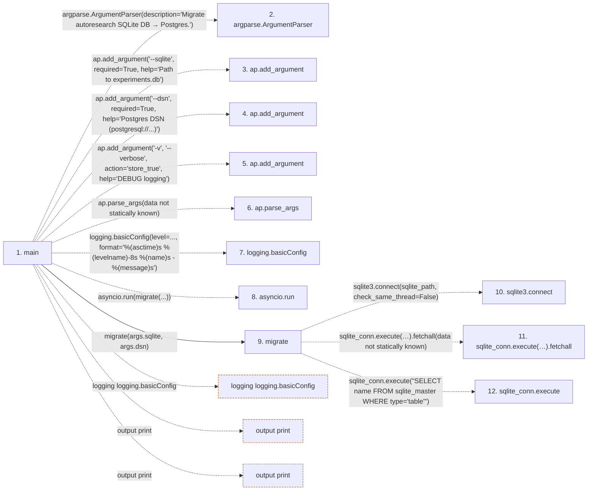

# migrate_sqlite_to_postgres

**Entry point:** `main` (`process`)
**Source:** [migrate_sqlite_to_postgres](../modules/migrate_sqlite_to_postgres.md)
**Modules touched:** [migrate_sqlite_to_postgres](../modules/migrate_sqlite_to_postgres.md), [postgres_state_store](../modules/postgres_state_store.md)

**Related modules:** [postgres_state_store](../modules/postgres_state_store.md)

## Call sequence

> Static overview in presentation order, not runtime execution order. Arrows retain captured callers; representative internal continuations and boundary examples precede repeated helper detail.

```mermaid
sequenceDiagram
    participant p0 as main
    participant p1 as migrate
    participant p2 as _ensure_pg_schema
    participant p3 as _migrate_table
    participant p4 as PostgresStateStore.initialize
    participant p5 as PostgresStateStore
    participant p6 as _sqlite_columns
    participant p7 as PostgresStateStore.close
    participant p8 as argparse.ArgumentParser
    participant p9 as ap.add_argument
    participant p10 as ap.parse_args
    participant p11 as logging.basicConfig
    participant p12 as asyncio.run
    participant p13 as sum
    participant p14 as counts.values
    participant p15 as print
    participant p16 as counts.items
    participant p17 as sqlite3.connect
    participant p18 as sqlite_conn.execute(…).fetchall
    participant p19 as sqlite_conn.execute
    participant p20 as logger.info (scripts/migrate_sqlite_to_postgres.py:migrate)
    participant p21 as pg.close
    participant p22 as sqlite_conn.close
    participant p23 as logger.warning
    participant p24 as ', '.join
    participant p25 as asyncpg.connect
    p0->>p1: migrate
    p1->>p2: _ensure_pg_schema
    p1->>p3: _migrate_table
    p2->>p4: PostgresStateStore.initialize
    p2->>p5: PostgresStateStore
    p3->>p6: _sqlite_columns
    p2->>p7: PostgresStateStore.close
    p0-->>p8: argparse.ArgumentParser(description='Migrate autoresearch SQLite DB → Postgres.')
    p0-->>p9: ap.add_argument('--sqlite', required=True, help='Path to experiments.db')
    p0-->>p9: ap.add_argument('--dsn', required=True, help='Postgres DSN (postgresql://...)')
    p0-->>p9: ap.add_argument('-v', '--verbose', action='store_true', help='DEBUG logging')
    p0-->>p10: ap.parse_args
    p0-->>p11: logging.basicConfig(level=..., format=' (asctime)s (levelname)-8s (name)s - (message)s')
    p0-->>p12: asyncio.run(migrate(...))
    p0-->>p13: sum(counts.values(...))
    p0-->>p14: counts.values
    p0-->>p15: print(...)
    p0-->>p16: counts.items
    p0-->>p15: print(...)
    p1-->>p17: sqlite3.connect(sqlite_path, check_same_thread=False)
    p1-->>p18: sqlite_conn.execute(…).fetchall
    p1-->>p19: sqlite_conn.execute("SELECT name FROM sqlite_master WHERE type='table'")
    p1-->>p20: logger.info (scripts/migrate_sqlite_to_postgres.py:migrate)('table s absent in source SQLite skipping', table)
    p1-->>p20: logger.info (scripts/migrate_sqlite_to_postgres.py:migrate)('migration complete: s', counts)
    p1-->>p21: pg.close
    p1-->>p22: sqlite_conn.close
    p3-->>p23: logger.warning('table s has no columns in SQLite skipping', table)
    p3-->>p24: ', '.join(...)
    p2-->>p25: asyncpg.connect(dsn.replace(...))
    p3-->>p24: ', '.join(...)
```

<!-- Auto-generated from static call edges. Dashed arrows are external or unresolved calls. Reviewed runtime conditions and side effects belong in Behavior. -->

> Call sequence diagram shows 30 of 53 interactions; 23 omitted to keep the visualization within the 30-interaction and generated-diagram limits, with uncertain identities omitted rather than inferred.

> Captured boundary calls: external 8 of 14 (6 omitted); unresolved 15 of 31 (16 omitted). These counts cover the captured static trace.

Omitted captured detail, grouped by actual caller occurrence and target module:

| Caller | Parent step | Target module | Kind | Omitted interactions |
| --- | --- | --- | --- | --- |
| `src/core/postgres_state_store.py:PostgresStateStore.initialize` | 15 | [src/core/postgres_state_store.py](../modules/postgres_state_store.md) | internal | 1 |
| `src/core/postgres_state_store.py:PostgresStateStore.close` | 16 | - | unresolved | 1 |
| `src/core/postgres_state_store.py:PostgresStateStore.initialize` | 15 | - | external | 2 |
| `src/core/postgres_state_store.py:PostgresStateStore.initialize` | 15 | - | unresolved | 6 |
| `scripts/migrate_sqlite_to_postgres.py:_ensure_pg_schema` | 13 | - | unresolved | 2 |
| `scripts/migrate_sqlite_to_postgres.py:_sqlite_columns` | 32 | - | unresolved | 2 |
| `scripts/migrate_sqlite_to_postgres.py:_migrate_table` | 31 | - | external | 4 |
| `scripts/migrate_sqlite_to_postgres.py:_migrate_table` | 31 | - | unresolved | 5 |
> Detailed flow queries retain their own coverage and limits; omitted paths may execute at runtime.

## Data flow

<!-- Auto-generated static analysis. Treat values and boundaries as best-effort hints, not runtime proof. -->

### Step data

| Step | Inputs | Reads | Writes | Returns |
|---|---|---|---|---|
| `main` | - | `logging` | - | `0` |
| `argparse.ArgumentParser` | - | - | - | - |
| `ap.add_argument` | - | - | - | - |
| `ap.add_argument` | - | - | - | - |
| `ap.add_argument` | - | - | - | - |
| `ap.parse_args` | - | - | - | - |
| `logging.basicConfig` | - | - | - | - |
| `asyncio.run` | - | - | - | - |
| `migrate` | `sqlite_path: str`, `pg_dsn: str` | `_TABLES` | `sqlite_conn.row_factory`, `counts[...]` | `counts` |
| `sqlite3.connect` | - | - | - | - |
| `sqlite_conn.execute(…).fetchall` | - | - | - | - |
| `sqlite_conn.execute` | - | - | - | - |

### Call data

| From | To | Line | Call |
|---|---|---:|---|
| main | argparse.ArgumentParser | 247 | `argparse.ArgumentParser(description='Migrate autoresearch SQLite DB → Postgres.')` |
| main | ap.add_argument | 248 | `ap.add_argument('--sqlite', required=True, help='Path to experiments.db')` |
| main | ap.add_argument | 249 | `ap.add_argument('--dsn', required=True, help='Postgres DSN (postgresql://...)')` |
| main | ap.add_argument | 250 | `ap.add_argument('-v', '--verbose', action='store_true', help='DEBUG logging')` |
| main | ap.parse_args | 253 | `ap.parse_args(data not statically known)` |
| main | logging.basicConfig | 254 | `logging.basicConfig(level=..., format='%(asctime)s %(levelname)-8s %(name)s - %(message)s')` |
| main | asyncio.run | 258 | `asyncio.run(migrate(...))` |
| main | migrate | 258 | `migrate(args.sqlite, args.dsn)` |
| migrate | sqlite3.connect | 220 | `sqlite3.connect(sqlite_path, check_same_thread=False)` |
| migrate | sqlite_conn.execute(…).fetchall | 226 | `sqlite_conn.execute("SELECT name FROM sqlite_master WHERE type='table'").fetchall(data not statically known)` |
| migrate | sqlite_conn.execute | 226 | `sqlite_conn.execute("SELECT name FROM sqlite_master WHERE type='table'")` |

### Boundary effects

| Kind | Target | Step | Line |
|---|---|---|---:|
| logging | `logging.basicConfig` | `main` | 254 |
| output | `print` | `main` | 260 |
| output | `print` | `main` | 262 |

### Static analysis gaps

| Kind | Step | Target | Line |
|---|---|---|---:|
| external_call | `main` | `argparse.ArgumentParser` | 247 |
| unresolved_call | `main` | `ap.add_argument` | 248 |
| unresolved_call | `main` | `ap.add_argument` | 249 |
| unresolved_call | `main` | `ap.add_argument` | 250 |
| unresolved_call | `main` | `ap.parse_args` | 253 |
| external_call | `main` | `asyncio.run` | 258 |
| external_call | `migrate` | `sqlite3.connect` | 220 |
| unresolved_call | `migrate` | `sqlite_conn.execute("SELECT name FROM sqlite_master WHERE type='table'").fetchall` | 226 |
| unresolved_call | `migrate` | `sqlite_conn.execute` | 226 |
| step_limit | `main` | `first 12 steps` | 0 |

## Behavior

This flow starts at `main` and is classified as `process`. The generated call and data-flow sections are bounded static projections; runtime conditions and side effects require source-level confirmation.
