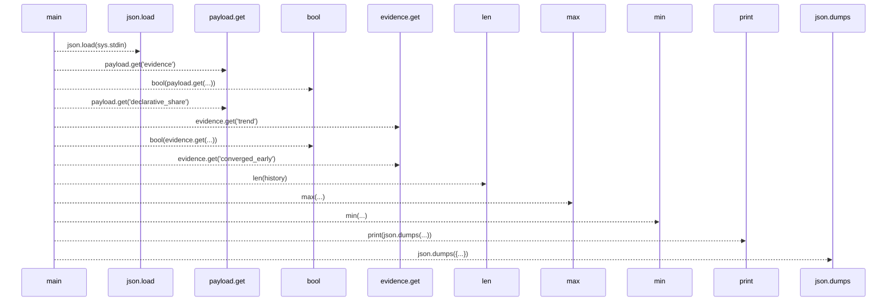
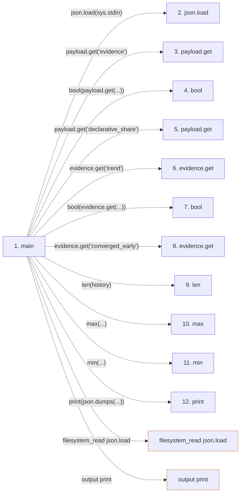

# phases

**Entry point:** `main` (`process`)
**Source:** [phases](../modules/phases.md)
**Modules touched:** [phases](../modules/phases.md)

## Call sequence

> Static overview in presentation order, not runtime execution order. Arrows retain captured callers; representative internal continuations and boundary examples precede repeated helper detail.

<!-- Auto-generated from static call edges. Dashed arrows are external or unresolved calls. Reviewed runtime conditions and side effects belong in Behavior. -->

> Call sequence diagram shows 12 of 12 interactions; 0 omitted to keep the visualization within the 30-interaction and generated-diagram limits, with uncertain identities omitted rather than inferred.

> Captured boundary calls: external 8 of 8 (0 omitted); unresolved 4 of 4 (0 omitted). These counts cover the captured static trace.
> Detailed flow queries retain their own coverage and limits; omitted paths may execute at runtime.

## Data flow

<!-- Auto-generated static analysis. Treat values and boundaries as best-effort hints, not runtime proof. -->

### Step data

| Step | Inputs | Reads | Writes | Returns |
|---|---|---|---|---|
| `main` | - | `sys`, `SCHEMA` | - | - |
| `json.load` | - | - | - | - |
| `payload.get` | - | - | - | - |
| `bool` | - | - | - | - |
| `payload.get` | - | - | - | - |
| `evidence.get` | - | - | - | - |
| `bool` | - | - | - | - |
| `evidence.get` | - | - | - | - |
| `len` | - | - | - | - |
| `max` | - | - | - | - |
| `min` | - | - | - | - |
| `print` | - | - | - | - |

### Call data

| From | To | Line | Call |
|---|---|---:|---|
| main | json.load | 16 | `json.load(sys.stdin)` |
| main | payload.get | 17 | `payload.get('evidence')` |
| main | bool | 18 | `bool(payload.get(...))` |
| main | payload.get | 18 | `payload.get('declarative_share')` |
| main | evidence.get | 19 | `evidence.get('trend')` |
| main | bool | 21 | `bool(evidence.get(...))` |
| main | evidence.get | 21 | `evidence.get('converged_early')` |
| main | len | 22 | `len(history)` |
| main | max | 22 | `max(...)` |
| main | min | 22 | `min(...)` |
| main | print | 28 | `print(json.dumps(...))` |

### Boundary effects

| Kind | Target | Step | Line |
|---|---|---|---:|
| filesystem_read | `json.load` | `main` | 16 |
| output | `print` | `main` | 28 |

### Static analysis gaps

| Kind | Step | Target | Line |
|---|---|---|---:|
| unresolved_call | `main` | `payload.get` | 17 |
| unresolved_call | `main` | `payload.get` | 18 |
| unresolved_call | `main` | `evidence.get` | 19 |
| unresolved_call | `main` | `evidence.get` | 21 |
| external_call | `main` | `max` | 22 |
| external_call | `main` | `min` | 22 |
| step_limit | `main` | `first 12 steps` | 0 |

## Behavior

This flow starts at `main` and is classified as `process`. The generated call and data-flow sections are bounded static projections; runtime conditions and side effects require source-level confirmation.
