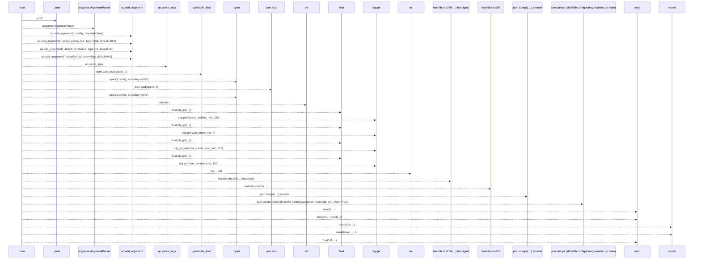
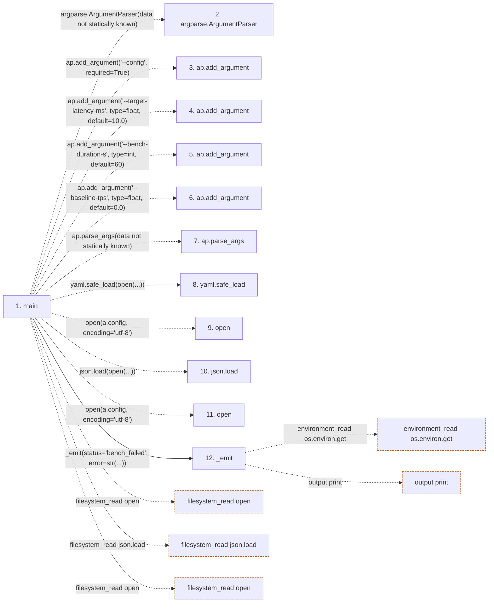

# run

**Entry point:** `main` (`process`)
**Source:** [db-config-tuning_eval_run](../modules/db-config-tuning_eval_run.md)
**Modules touched:** [db-config-tuning_eval_run](../modules/db-config-tuning_eval_run.md)

## Call sequence

> Static overview in presentation order, not runtime execution order. Arrows retain captured callers; representative internal continuations and boundary examples precede repeated helper detail.

<!-- Auto-generated from static call edges. Dashed arrows are external or unresolved calls. Reviewed runtime conditions and side effects belong in Behavior. -->

> Call sequence diagram shows 30 of 42 interactions; 12 omitted to keep the visualization within the 30-interaction and generated-diagram limits, with uncertain identities omitted rather than inferred.

> Captured boundary calls: external 18 of 25 (7 omitted); unresolved 11 of 15 (4 omitted). These counts cover the captured static trace.

Omitted captured detail, grouped by actual caller occurrence and target module:

| Caller | Parent step | Target module | Kind | Omitted interactions |
| --- | --- | --- | --- | --- |
| `skills/db-config-tuning/eval/run.py:_emit` | 12 | - | external | 4 |
| `skills/db-config-tuning/eval/run.py:_emit` | 12 | - | unresolved | 3 |
| `skills/db-config-tuning/eval/run.py:main` | 1 | - | external | 3 |
| `skills/db-config-tuning/eval/run.py:main` | 1 | - | unresolved | 1 |
| `skills/db-config-tuning/eval/run.py:main` | 1 | [skills/db-config-tuning/eval/run.py](../modules/db-config-tuning_eval_run.md) | internal | 1 |
> Detailed flow queries retain their own coverage and limits; omitted paths may execute at runtime.

## Data flow

<!-- Auto-generated static analysis. Treat values and boundaries as best-effort hints, not runtime proof. -->

### Step data

| Step | Inputs | Reads | Writes | Returns |
|---|---|---|---|---|
| `main` | - | - | - | `1`, `0` |
| `argparse.ArgumentParser` | - | - | - | - |
| `ap.add_argument` | - | - | - | - |
| `ap.add_argument` | - | - | - | - |
| `ap.add_argument` | - | - | - | - |
| `ap.add_argument` | - | - | - | - |
| `ap.parse_args` | - | - | - | - |
| `yaml.safe_load` | - | - | - | - |
| `open` | - | - | - | - |
| `json.load` | - | - | - | - |
| `open` | - | - | - | - |
| `_emit` | `fields` | - | `p[...]` | - |

### Call data

| From | To | Line | Call |
|---|---|---:|---|
| main | argparse.ArgumentParser | 10 | `argparse.ArgumentParser(data not statically known)` |
| main | ap.add_argument | 11 | `ap.add_argument('--config', required=True)` |
| main | ap.add_argument | 12 | `ap.add_argument('--target-latency-ms', type=float, default=10.0)` |
| main | ap.add_argument | 13 | `ap.add_argument('--bench-duration-s', type=int, default=60)` |
| main | ap.add_argument | 14 | `ap.add_argument('--baseline-tps', type=float, default=0.0)` |
| main | ap.parse_args | 15 | `ap.parse_args(data not statically known)` |
| main | yaml.safe_load | 18 | `yaml.safe_load(open(...))` |
| main | open | 18 | `open(a.config, encoding='utf-8')` |
| main | json.load | 21 | `json.load(open(...))` |
| main | open | 21 | `open(a.config, encoding='utf-8')` |
| main | _emit | 23 | `_emit(status='bench_failed', error=str(...))` |

### Boundary effects

| Kind | Target | Step | Line |
|---|---|---|---:|
| filesystem_read | `open` | `main` | 18 |
| filesystem_read | `json.load` | `main` | 21 |
| filesystem_read | `open` | `main` | 21 |
| environment_read | `os.environ.get` | `_emit` | 6 |
| output | `print` | `_emit` | 8 |

### Static analysis gaps

| Kind | Step | Target | Line |
|---|---|---|---:|
| external_call | `main` | `argparse.ArgumentParser` | 10 |
| unresolved_call | `main` | `ap.add_argument` | 11 |
| unresolved_call | `main` | `ap.add_argument` | 12 |
| unresolved_call | `main` | `ap.add_argument` | 13 |
| unresolved_call | `main` | `ap.add_argument` | 14 |
| unresolved_call | `main` | `ap.parse_args` | 15 |
| step_limit | `main` | `first 12 steps` | 0 |

## Behavior

This flow starts at `main` and is classified as `process`. The generated call and data-flow sections are bounded static projections; runtime conditions and side effects require source-level confirmation.
