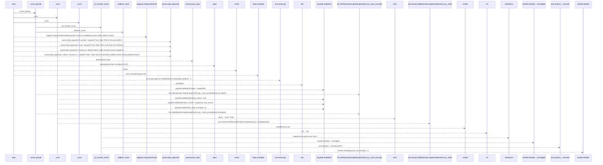

# run

**Entry point:** `main` (`process`)
**Source:** [prompt-engineering_eval_run](../modules/prompt-engineering_eval_run.md)
**Modules touched:** [prompt-engineering_eval_run](../modules/prompt-engineering_eval_run.md)

## Call sequence

> Static overview in presentation order, not runtime execution order. Arrows retain captured callers; representative internal continuations and boundary examples precede repeated helper detail.

<!-- Auto-generated from static call edges. Dashed arrows are external or unresolved calls. Reviewed runtime conditions and side effects belong in Behavior. -->

> Call sequence diagram shows 30 of 64 interactions; 34 omitted to keep the visualization within the 30-interaction and generated-diagram limits, with uncertain identities omitted rather than inferred.

> Captured boundary calls: external 13 of 34 (21 omitted); unresolved 12 of 20 (8 omitted). These counts cover the captured static trace.

Omitted captured detail, grouped by actual caller occurrence and target module:

| Caller | Parent step | Target module | Kind | Omitted interactions |
| --- | --- | --- | --- | --- |
| `skills/prompt-engineering/eval/run.py:main` | 1 | [skills/prompt-engineering/eval/run.py](../modules/prompt-engineering_eval_run.md) | internal | 3 |
| `skills/prompt-engineering/eval/run.py:_try_remote_scorer` | 24 | - | external | 16 |
| `skills/prompt-engineering/eval/run.py:_try_remote_scorer` | 24 | - | unresolved | 7 |
| `skills/prompt-engineering/eval/run.py:_score_prompt` | 23 | [skills/prompt-engineering/eval/run.py](../modules/prompt-engineering_eval_run.md) | internal | 2 |
| `skills/prompt-engineering/eval/run.py:_fallback_score` | 53 | - | unresolved | 1 |
| `skills/prompt-engineering/eval/run.py:_fallback_score` | 53 | - | external | 5 |
> Detailed flow queries retain their own coverage and limits; omitted paths may execute at runtime.

## Data flow

```mermaid
flowchart LR
    s1["1. main"]
    s2["2. argparse.ArgumentParser"]
    s3["3. parser.add_argument"]
    s4["4. parser.add_argument"]
    s5["5. parser.add_argument"]
    s6["6. parser.add_argument"]
    s7["7. parser.parse_args"]
    s8["8. open"]
    s9["9. f.read"]
    s10["10. _emit"]
    s11["11. os.environ.get"]
    s12["12. dict"]
    s1 -. "argparse.ArgumentParser(description='Score a candidate prompt', allow_abbrev=False)" .-> s2
    s1 -. "parser.add_argument('--prompt', required=True, help='Path to the prompt file')" .-> s3
    s1 -. "parser.add_argument('--eval', required=True, help='Path to the eval set (JSONL)')" .-> s4
    s1 -. "parser.add_argument('--scorer-url', default=None, help='External scorer endpoint')" .-> s5
    s1 -. "parser.add_argument('--demo', choices=(...), default='false', help='Server-controlled synthetic demo scoring (default false)')" .-> s6
    s1 -. "parser.parse_args(data not statically known)" .-> s7
    s1 -. "open(args.prompt, encoding='utf-8')" .-> s8
    s1 -. "f.read(data not statically known)" .-> s9
    s1 -->|"_emit(**=_error(...))"| s10
    s10 -. "os.environ.get('AUTORESEARCH_SESSION_NONCE', '')" .-> s11
    s10 -. "dict(fields)" .-> s12
    b0["filesystem_read open"]
    s1 -. "filesystem_read open" .-> b0
    b1["environment_read os.environ.get"]
    s10 -. "environment_read os.environ.get" .-> b1
    b2["output print"]
    s10 -. "output print" .-> b2
    click s1 "../modules/prompt-engineering_eval_run.md"
    click s10 "../modules/prompt-engineering_eval_run.md"
    classDef boundary stroke:#b45309,stroke-dasharray: 4 2
    class b0 boundary
    class b1 boundary
    class b2 boundary
```

<!-- Auto-generated static analysis. Treat values and boundaries as best-effort hints, not runtime proof. -->

### Step data

| Step | Inputs | Reads | Writes | Returns |
|---|---|---|---|---|
| `main` | - | - | - | `1`, `1`, `...` |
| `argparse.ArgumentParser` | - | - | - | - |
| `parser.add_argument` | - | - | - | - |
| `parser.add_argument` | - | - | - | - |
| `parser.add_argument` | - | - | - | - |
| `parser.add_argument` | - | - | - | - |
| `parser.parse_args` | - | - | - | - |
| `open` | - | - | - | - |
| `f.read` | - | - | - | - |
| `_emit` | `fields: object` | - | `payload[...]` | - |
| `os.environ.get` | - | - | - | - |
| `dict` | - | - | - | - |

### Call data

| From | To | Line | Call |
|---|---|---:|---|
| main | argparse.ArgumentParser | 135 | `argparse.ArgumentParser(description='Score a candidate prompt', allow_abbrev=False)` |
| main | parser.add_argument | 136 | `parser.add_argument('--prompt', required=True, help='Path to the prompt file')` |
| main | parser.add_argument | 137 | `parser.add_argument('--eval', required=True, help='Path to the eval set (JSONL)')` |
| main | parser.add_argument | 138 | `parser.add_argument('--scorer-url', default=None, help='External scorer endpoint')` |
| main | parser.add_argument | 139 | `parser.add_argument('--demo', choices=(...), default='false', help='Server-controlled synthetic demo scoring (default false)')` |
| main | parser.parse_args | 141 | `parser.parse_args(data not statically known)` |
| main | open | 145 | `open(args.prompt, encoding='utf-8')` |
| main | f.read | 146 | `f.read(data not statically known)` |
| main | _emit | 148 | `_emit(**=_error(...))` |
| _emit | os.environ.get | 165 | `os.environ.get('AUTORESEARCH_SESSION_NONCE', '')` |
| _emit | dict | 166 | `dict(fields)` |

### Boundary effects

| Kind | Target | Step | Line |
|---|---|---|---:|
| filesystem_read | `open` | `main` | 145 |
| environment_read | `os.environ.get` | `_emit` | 165 |
| output | `print` | `_emit` | 173 |

### Static analysis gaps

| Kind | Step | Target | Line |
|---|---|---|---:|
| external_call | `main` | `argparse.ArgumentParser` | 135 |
| unresolved_call | `main` | `parser.add_argument` | 136 |
| unresolved_call | `main` | `parser.add_argument` | 137 |
| unresolved_call | `main` | `parser.add_argument` | 138 |
| unresolved_call | `main` | `parser.add_argument` | 139 |
| unresolved_call | `main` | `parser.parse_args` | 141 |
| unresolved_call | `main` | `f.read` | 146 |
| step_limit | `main` | `first 12 steps` | 0 |

## Behavior

This flow starts at `main` and is classified as `process`. The generated call and data-flow sections are bounded static projections; runtime conditions and side effects require source-level confirmation.
