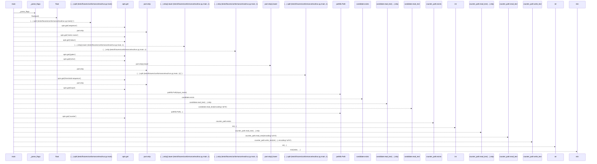
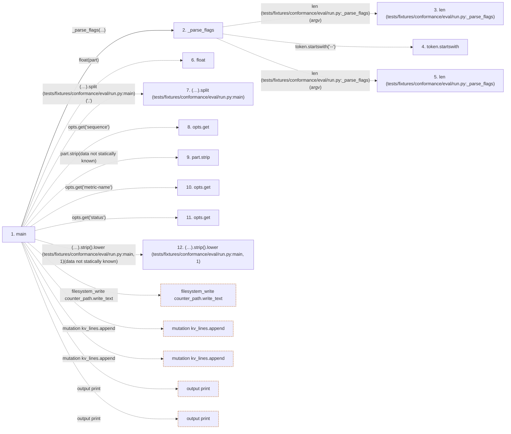

# run

**Entry point:** `main` (`process`)
**Source:** [conformance_eval_run](../modules/conformance_eval_run.md)
**Modules touched:** [conformance_eval_run](../modules/conformance_eval_run.md)

## Call sequence

> Static overview in presentation order, not runtime execution order. Arrows retain captured callers; representative internal continuations and boundary examples precede repeated helper detail.

<!-- Auto-generated from static call edges. Dashed arrows are external or unresolved calls. Reviewed runtime conditions and side effects belong in Behavior. -->

> Call sequence diagram shows 30 of 61 interactions; 31 omitted to keep the visualization within the 30-interaction and generated-diagram limits, with uncertain identities omitted rather than inferred.

> Captured boundary calls: external 6 of 20 (14 omitted); unresolved 23 of 40 (17 omitted). These counts cover the captured static trace.

Omitted captured detail, grouped by actual caller occurrence and target module:

| Caller | Parent step | Target module | Kind | Omitted interactions |
| --- | --- | --- | --- | --- |
| `tests/fixtures/conformance/eval/run.py:_parse_flags` | 2 | - | external | 2 |
| `tests/fixtures/conformance/eval/run.py:_parse_flags` | 2 | - | unresolved | 1 |
| `tests/fixtures/conformance/eval/run.py:main` | 1 | - | external | 12 |
| `tests/fixtures/conformance/eval/run.py:main` | 1 | - | unresolved | 16 |
> Detailed flow queries retain their own coverage and limits; omitted paths may execute at runtime.

## Data flow

<!-- Auto-generated static analysis. Treat values and boundaries as best-effort hints, not runtime proof. -->

### Step data

| Step | Inputs | Reads | Writes | Returns |
|---|---|---|---|---|
| `main` | - | `sys` | `payload[...]`, `payload[...]` | `0` |
| `_parse_flags` | `argv: list[str]` | - | - | `opts` |
| `len (tests/fixtures/conformance/eval/run.py:_parse_flags)` | - | - | - | - |
| `token.startswith` | - | - | - | - |
| `len (tests/fixtures/conformance/eval/run.py:_parse_flags)` | - | - | - | - |
| `float` | - | - | - | - |
| `(…).split (tests/fixtures/conformance/eval/run.py:main)` | - | - | - | - |
| `opts.get` | - | - | - | - |
| `part.strip` | - | - | - | - |
| `opts.get` | - | - | - | - |
| `opts.get` | - | - | - | - |
| `(…).strip().lower (tests/fixtures/conformance/eval/run.py:main, 1)` | - | - | - | - |

### Call data

| From | To | Line | Call |
|---|---|---:|---|
| main | _parse_flags | 35 | `_parse_flags(...)` |
| _parse_flags | len (tests/fixtures/conformance/eval/run.py:_parse_flags) | 24 | `len(argv)` |
| _parse_flags | token.startswith | 26 | `token.startswith('--')` |
| _parse_flags | len (tests/fixtures/conformance/eval/run.py:_parse_flags) | 26 | `len(argv)` |
| main | float | 37 | `float(part)` |
| main | (…).split (tests/fixtures/conformance/eval/run.py:main) | 38 | `(opts.get('sequence') or '').split(',')` |
| main | opts.get | 38 | `opts.get('sequence')` |
| main | part.strip | 39 | `part.strip(data not statically known)` |
| main | opts.get | 41 | `opts.get('metric-name')` |
| main | opts.get | 42 | `opts.get('status')` |
| main | (…).strip().lower (tests/fixtures/conformance/eval/run.py:main, 1) | 43 | `(opts.get('gates') or 'pass').strip().lower(data not statically known)` |

### Boundary effects

| Kind | Target | Step | Line |
|---|---|---|---:|
| filesystem_write | `counter_path.write_text` | `main` | 66 |
| mutation | `kv_lines.append` | `main` | 114 |
| mutation | `kv_lines.append` | `main` | 115 |
| output | `print` | `main` | 118 |
| output | `print` | `main` | 120 |

### Static analysis gaps

| Kind | Step | Target | Line |
|---|---|---|---:|
| unresolved_call | `_parse_flags` | `token.startswith` | 26 |
| unresolved_call | `main` | `(opts.get('sequence') or '').split` | 38 |
| unresolved_call | `main` | `opts.get` | 38 |
| unresolved_call | `main` | `part.strip` | 39 |
| unresolved_call | `main` | `opts.get` | 41 |
| unresolved_call | `main` | `opts.get` | 42 |
| unresolved_call | `main` | `(opts.get('gates') or 'pass').strip().lower` | 43 |
| step_limit | `main` | `first 12 steps` | 0 |

## Behavior

This flow starts at `main` and is classified as `process`. The generated call and data-flow sections are bounded static projections; runtime conditions and side effects require source-level confirmation.
