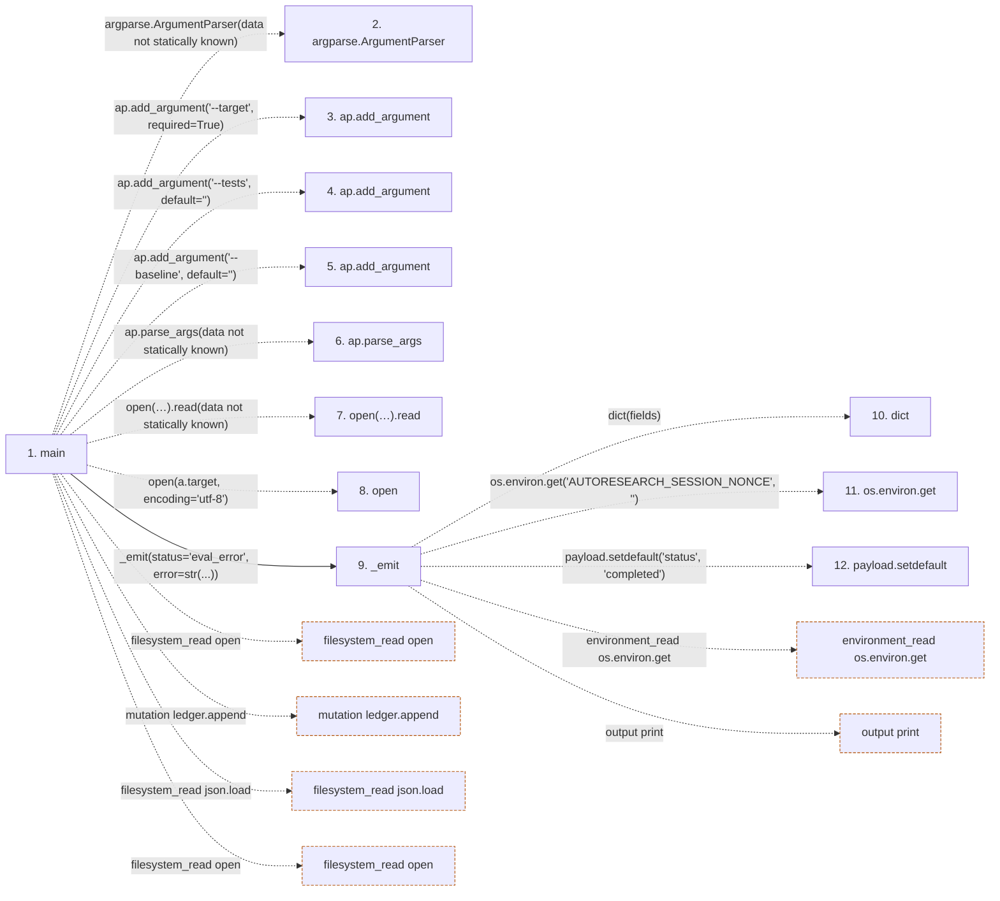

# run

**Entry point:** `main` (`process`)
**Source:** [code-refactor_eval_run](../modules/code-refactor_eval_run.md)
**Modules touched:** [code-refactor_eval_run](../modules/code-refactor_eval_run.md)

## Call sequence

> Static overview in presentation order, not runtime execution order. Arrows retain captured callers; representative internal continuations and boundary examples precede repeated helper detail.

```mermaid
sequenceDiagram
    participant p0 as main
    participant p1 as _emit
    participant p2 as _lint_score
    participant p3 as _pass_rate
    participant p4 as argparse.ArgumentParser
    participant p5 as ap.add_argument
    participant p6 as ap.parse_args
    participant p7 as open(…).read
    participant p8 as open
    participant p9 as str (skills/code-refactor/eval/run.py:main)
    participant p10 as ast.parse
    participant p11 as line.strip
    participant p12 as ledger.append
    participant p13 as json.loads
    participant p14 as int
    participant p15 as hashlib.sha256(…).hexdigest
    participant p16 as hashlib.sha256
    participant p17 as text.encode
    participant p18 as sum (skills/code-refactor/eval/run.py:main)
    participant p19 as ast.walk (skills/code-refactor/eval/run.py:main)
    participant p20 as isinstance (skills/code-refactor/eval/run.py:main)
    participant p21 as max (skills/code-refactor/eval/run.py:main)
    participant p22 as len (skills/code-refactor/eval/run.py:main)
    participant p23 as text.splitlines
    participant p24 as float
    participant p25 as json.load
    p0->>p1: _emit
    p0->>p2: _lint_score
    p0->>p3: _pass_rate
    p0-->>p4: argparse.ArgumentParser
    p0-->>p5: ap.add_argument('--target', required=True)
    p0-->>p5: ap.add_argument('--tests', default='')
    p0-->>p5: ap.add_argument('--baseline', default='')
    p0-->>p6: ap.parse_args
    p0-->>p7: open(…).read
    p0-->>p8: open(a.target, encoding='utf-8')
    p0-->>p9: str (skills/code-refactor/eval/run.py:main)(exc)
    p0-->>p10: ast.parse(text)
    p0-->>p9: str (skills/code-refactor/eval/run.py:main)(exc)
    p0-->>p8: open(a.tests, encoding='utf-8')
    p0-->>p11: line.strip
    p0-->>p12: ledger.append(json.loads(...))
    p0-->>p13: json.loads(line)
    p0-->>p9: str (skills/code-refactor/eval/run.py:main)(exc)
    p0-->>p14: int(..., 16)
    p0-->>p15: hashlib.sha256(…).hexdigest
    p0-->>p16: hashlib.sha256(text.encode(...))
    p0-->>p17: text.encode
    p0-->>p18: sum (skills/code-refactor/eval/run.py:main)(...)
    p0-->>p19: ast.walk (skills/code-refactor/eval/run.py:main)(tree)
    p0-->>p20: isinstance (skills/code-refactor/eval/run.py:main)(n, ast.FunctionDef)
    p0-->>p21: max (skills/code-refactor/eval/run.py:main)(1, len(...))
    p0-->>p22: len (skills/code-refactor/eval/run.py:main)(text.splitlines(...))
    p0-->>p23: text.splitlines
    p0-->>p24: float(...)
    p0-->>p25: json.load(open(...))
```

<!-- Auto-generated from static call edges. Dashed arrows are external or unresolved calls. Reviewed runtime conditions and side effects belong in Behavior. -->

> Call sequence diagram shows 30 of 80 interactions; 50 omitted to keep the visualization within the 30-interaction and generated-diagram limits, with uncertain identities omitted rather than inferred.

> Captured boundary calls: external 17 of 52 (35 omitted); unresolved 10 of 22 (12 omitted). These counts cover the captured static trace.

Omitted captured detail, grouped by actual caller occurrence and target module:

| Caller | Parent step | Target module | Kind | Omitted interactions |
| --- | --- | --- | --- | --- |
| `skills/code-refactor/eval/run.py:_emit` | 9 | - | external | 4 |
| `skills/code-refactor/eval/run.py:_emit` | 9 | - | unresolved | 3 |
| `skills/code-refactor/eval/run.py:main` | 1 | [skills/code-refactor/eval/run.py](../modules/code-refactor_eval_run.md) | internal | 3 |
| `skills/code-refactor/eval/run.py:_lint_score` | 27 | - | external | 15 |
| `skills/code-refactor/eval/run.py:_lint_score` | 27 | - | unresolved | 5 |
| `skills/code-refactor/eval/run.py:_pass_rate` | 48 | - | external | 4 |
| `skills/code-refactor/eval/run.py:_pass_rate` | 48 | - | unresolved | 2 |
| `skills/code-refactor/eval/run.py:main` | 1 | - | external | 12 |
> Omission summary shows 8 of 9 groups; 1 further groups are not expanded here. Counts above include all omitted interactions.
> Detailed flow queries retain their own coverage and limits; omitted paths may execute at runtime.

## Data flow

<!-- Auto-generated static analysis. Treat values and boundaries as best-effort hints, not runtime proof. -->

### Step data

| Step | Inputs | Reads | Writes | Returns |
|---|---|---|---|---|
| `main` | - | `json`, `ast` | - | `1`, `1`, `1`, `0` |
| `argparse.ArgumentParser` | - | - | - | - |
| `ap.add_argument` | - | - | - | - |
| `ap.add_argument` | - | - | - | - |
| `ap.add_argument` | - | - | - | - |
| `ap.parse_args` | - | - | - | - |
| `open(…).read` | - | - | - | - |
| `open` | - | - | - | - |
| `_emit` | `fields` | - | `payload[...]` | - |
| `dict` | - | - | - | - |
| `os.environ.get` | - | - | - | - |
| `payload.setdefault` | - | - | - | - |

### Call data

| From | To | Line | Call |
|---|---|---:|---|
| main | argparse.ArgumentParser | 51 | `argparse.ArgumentParser(data not statically known)` |
| main | ap.add_argument | 52 | `ap.add_argument('--target', required=True)` |
| main | ap.add_argument | 53 | `ap.add_argument('--tests', default='')` |
| main | ap.add_argument | 54 | `ap.add_argument('--baseline', default='')` |
| main | ap.parse_args | 55 | `ap.parse_args(data not statically known)` |
| main | open(…).read | 57 | `open(a.target, encoding='utf-8').read(data not statically known)` |
| main | open | 57 | `open(a.target, encoding='utf-8')` |
| main | _emit | 59 | `_emit(status='eval_error', error=str(...))` |
| _emit | dict | 43 | `dict(fields)` |
| _emit | os.environ.get | 44 | `os.environ.get('AUTORESEARCH_SESSION_NONCE', '')` |
| _emit | payload.setdefault | 45 | `payload.setdefault('status', 'completed')` |

### Boundary effects

| Kind | Target | Step | Line |
|---|---|---|---:|
| filesystem_read | `open` | `main` | 69 |
| mutation | `ledger.append` | `main` | 72 |
| filesystem_read | `json.load` | `main` | 84 |
| filesystem_read | `open` | `main` | 84 |
| environment_read | `os.environ.get` | `_emit` | 44 |
| output | `print` | `_emit` | 48 |

### Static analysis gaps

| Kind | Step | Target | Line |
|---|---|---|---:|
| external_call | `main` | `argparse.ArgumentParser` | 51 |
| unresolved_call | `main` | `ap.add_argument` | 52 |
| unresolved_call | `main` | `ap.add_argument` | 53 |
| unresolved_call | `main` | `ap.add_argument` | 54 |
| unresolved_call | `main` | `ap.parse_args` | 55 |
| unresolved_call | `main` | `open(a.target, encoding='utf-8').read` | 57 |
| external_call | `main` | `open` | 57 |
| unresolved_call | `_emit` | `payload.setdefault` | 45 |
| step_limit | `main` | `first 12 steps` | 0 |

## Behavior

This flow starts at `main` and is classified as `process`. The generated call and data-flow sections are bounded static projections; runtime conditions and side effects require source-level confirmation.
