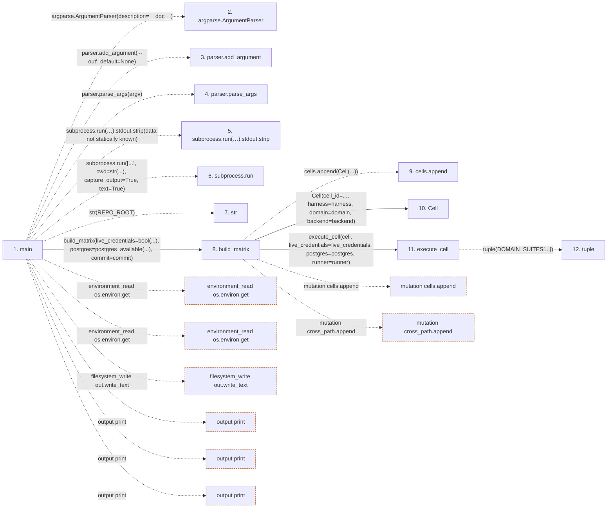

# run_compatibility_matrix

**Entry point:** `main` (`process`)
**Source:** [run_compatibility_matrix](../modules/run_compatibility_matrix.md)
**Modules touched:** [run_compatibility_matrix](../modules/run_compatibility_matrix.md)

## Call sequence

> Static overview in presentation order, not runtime execution order. Arrows retain captured callers; representative internal continuations and boundary examples precede repeated helper detail.

```mermaid
sequenceDiagram
    participant p0 as main
    participant p1 as build_matrix
    participant p2 as postgres_available
    participant p3 as Cell
    participant p4 as execute_cell
    participant p5 as asdict_cell
    participant p6 as argparse.ArgumentParser
    participant p7 as parser.add_argument
    participant p8 as parser.parse_args
    participant p9 as subprocess.run(…).stdout.strip
    participant p10 as subprocess.run
    participant p11 as str
    participant p12 as bool (scripts/run_compatibility_matrix.py:main)
    participant p13 as os.environ.get (scripts/run_compatibility_matrix.py:main)
    participant p14 as Path
    participant p15 as out.parent.mkdir
    participant p16 as out.write_text
    participant p17 as json.dumps
    participant p18 as print
    participant p19 as cells.append
    participant p20 as os.environ.get (scripts/run_compatibility…trix.py:postgres_available)
    participant p21 as bool (scripts/run_compatibility…trix.py:postgres_available)
    participant p22 as CROSS_PATH_SUITES.items
    participant p23 as dsn.startswith
    participant p24 as runner (scripts/run_compatibility_matrix.py:build_matrix)
    participant p25 as cross_path.append
    participant p26 as all
    p0->>p1: build_matrix
    p0->>p2: postgres_available
    p1->>p3: Cell
    p1->>p4: execute_cell
    p1->>p5: asdict_cell
    p0-->>p6: argparse.ArgumentParser(description=__doc__)
    p0-->>p7: parser.add_argument('--out', default=None)
    p0-->>p8: parser.parse_args(argv)
    p0-->>p9: subprocess.run(…).stdout.strip
    p0-->>p10: subprocess.run([...], cwd=str(...), capture_output=True, text=True)
    p0-->>p11: str(REPO_ROOT)
    p0-->>p12: bool (scripts/run_compatibility_matrix.py:main)(...)
    p0-->>p13: os.environ.get (scripts/run_compatibility_matrix.py:main)('AUTORESEARCH_CODEX_LIVE')
    p0-->>p13: os.environ.get (scripts/run_compatibility_matrix.py:main)('AUTORESEARCH_CLAUDE_LIVE')
    p0-->>p14: Path(...)
    p0-->>p15: out.parent.mkdir(parents=True, exist_ok=True)
    p0-->>p16: out.write_text(json.dumps(...))
    p0-->>p17: json.dumps(matrix, indent=2, sort_keys=True)
    p0-->>p18: print(...)
    p0-->>p18: print(...)
    p0-->>p18: print(...)
    p1-->>p19: cells.append(Cell(...))
    p2-->>p20: os.environ.get (scripts/run_compatibility…trix.py:postgres_available)('AUTORESEARCH_DATABASE_URL')
    p2-->>p20: os.environ.get (scripts/run_compatibility…trix.py:postgres_available)('DATABASE_URL')
    p2-->>p21: bool (scripts/run_compatibility…trix.py:postgres_available)(...)
    p1-->>p22: CROSS_PATH_SUITES.items
    p2-->>p23: dsn.startswith('postgresql')
    p1-->>p24: runner (scripts/run_compatibility_matrix.py:build_matrix)(suites, 900)
    p1-->>p25: cross_path.append(entry)
    p1-->>p26: all(...)
```

<!-- Auto-generated from static call edges. Dashed arrows are external or unresolved calls. Reviewed runtime conditions and side effects belong in Behavior. -->

> Call sequence diagram shows 30 of 51 interactions; 21 omitted to keep the visualization within the 30-interaction and generated-diagram limits, with uncertain identities omitted rather than inferred.

> Captured boundary calls: external 15 of 25 (10 omitted); unresolved 10 of 21 (11 omitted). These counts cover the captured static trace.

Omitted captured detail, grouped by actual caller occurrence and target module:

| Caller | Parent step | Target module | Kind | Omitted interactions |
| --- | --- | --- | --- | --- |
| `scripts/run_compatibility_matrix.py:execute_cell` | 11 | - | external | 4 |
| `scripts/run_compatibility_matrix.py:execute_cell` | 11 | - | unresolved | 3 |
| `scripts/run_compatibility_matrix.py:build_matrix` | 8 | - | unresolved | 8 |
| `scripts/run_compatibility_matrix.py:build_matrix` | 8 | - | external | 5 |
| `scripts/run_compatibility_matrix.py:asdict_cell` | 31 | - | external | 1 |
> Detailed flow queries retain their own coverage and limits; omitted paths may execute at runtime.

## Data flow

<!-- Auto-generated static analysis. Treat values and boundaries as best-effort hints, not runtime proof. -->

### Step data

| Step | Inputs | Reads | Writes | Returns |
|---|---|---|---|---|
| `main` | `argv: Optional[Sequence[str]]` | `REPO_ROOT` | - | `...` |
| `argparse.ArgumentParser` | - | - | - | - |
| `parser.add_argument` | - | - | - | - |
| `parser.parse_args` | - | - | - | - |
| `subprocess.run(…).stdout.strip` | - | - | - | - |
| `subprocess.run` | - | - | - | - |
| `str` | - | - | - | - |
| `build_matrix` | `live_credentials: bool`, `postgres: bool`, `runner`, `commit: str` | `HARNESSES`, `DOMAINS`, `BACKENDS`, `SCENARIOS` | `entry[...]`, `entry[...]` | `{...}` |
| `cells.append` | - | - | - | - |
| `Cell` | - | - | - | - |
| `execute_cell` | `cell: Cell`, `live_credentials: bool`, `postgres: bool`, `runner` | `LIVE_HARNESSES`, `POSTGRES_CELL_COMMAND`, `DOMAIN_SUITES`, `HARNESS_SUITES` | `cell.status`, `cell.reason`, `cell.command`, `cell.status`, `cell.reason`, `cell.command`, `cell.command`, `cell.duration_s` | `cell`, `cell`, `cell` |
| `tuple` | - | - | - | - |

### Call data

| From | To | Line | Call |
|---|---|---:|---|
| main | argparse.ArgumentParser | 399 | `argparse.ArgumentParser(description=__doc__)` |
| main | parser.add_argument | 400 | `parser.add_argument('--out', default=None)` |
| main | parser.parse_args | 401 | `parser.parse_args(argv)` |
| main | subprocess.run(…).stdout.strip | 403 | `subprocess.run(['git', 'rev-parse', 'HEAD'], cwd=str(REPO_ROOT), capture_output=True, text=True).stdout.strip(data not statically known)` |
| main | subprocess.run | 403 | `subprocess.run([...], cwd=str(...), capture_output=True, text=True)` |
| main | str | 405 | `str(REPO_ROOT)` |
| main | build_matrix | 409 | `build_matrix(live_credentials=bool(...), postgres=postgres_available(...), commit=commit)` |
| build_matrix | cells.append | 313 | `cells.append(Cell(...))` |
| build_matrix | Cell | 314 | `Cell(cell_id=..., harness=harness, domain=domain, backend=backend)` |
| build_matrix | execute_cell | 322 | `execute_cell(cell, live_credentials=live_credentials, postgres=postgres, runner=runner)` |
| execute_cell | tuple | 274 | `tuple(DOMAIN_SUITES[...])` |

### Boundary effects

| Kind | Target | Step | Line |
|---|---|---|---:|
| environment_read | `os.environ.get` | `main` | 411 |
| environment_read | `os.environ.get` | `main` | 412 |
| filesystem_write | `out.write_text` | `main` | 422 |
| output | `print` | `main` | 424 |
| output | `print` | `main` | 430 |
| output | `print` | `main` | 431 |
| mutation | `cells.append` | `build_matrix` | 313 |
| mutation | `cross_path.append` | `build_matrix` | 342 |

### Static analysis gaps

| Kind | Step | Target | Line |
|---|---|---|---:|
| external_call | `main` | `argparse.ArgumentParser` | 399 |
| unresolved_call | `main` | `parser.add_argument` | 400 |
| unresolved_call | `main` | `parser.parse_args` | 401 |
| unresolved_call | `main` | `subprocess.run(['git', 'rev-parse', 'HEAD'], cwd=str(REPO_ROOT), capture_output=True, text=True).stdout.strip` | 403 |
| external_call | `main` | `subprocess.run` | 403 |
| step_limit | `main` | `first 12 steps` | 0 |

## Behavior

This flow starts at `main` and is classified as `process`. The generated call and data-flow sections are bounded static projections; runtime conditions and side effects require source-level confirmation.
