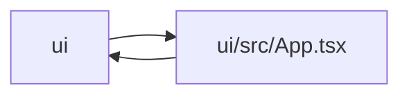

# App Module

**Path:** `ui/src/App.tsx`

## Description

_Auto-generated from `ui/src/App.tsx`._

## Imports

| Source | Symbols |
|--------|---------|
| `./api/client` | `getAutoresearchApiToken`, `hasBuildTimeAutoresearchApiToken`, `setAutoresearchApiToken` |
| `./components/hifi/Topbar` | `Topbar`, `useDesignPrefs` |
| `./components/hifi/primitives` | `Icon` |
| `./hooks/useResearch` | `ResearchRealtimeBridge` |
| `./hooks/useWebSocket` | `WebSocketProvider` |
| `./pages/Dashboard` | `Dashboard` |
| `./pages/History` | `History` |
| `./pages/Leaderboard` | `Leaderboard` |
| `./pages/NewResearch` | `NewResearch` |
| `./pages/Promote` | `Promote` |
| `./pages/ResearchDetail` | `ResearchDetail` |
| `./pages/Settings` | `Settings` |
| `./pages/Skills` | `Skills` |
| `react` | `FormEvent`, `useState` |
| `react-router-dom` | `Routes`, `Route` |

## Module Signals

| Signal | Values |
|--------|--------|
| Exports | `default` |

## Local dependency map

<!-- Auto-generated local dependency summary. Do not edit by hand. -->

> Module-level dependencies exceed the generated-diagram limits, so the diagram and table below group them by top-level package. Counts report the number of module neighbors in each package.

### Internal neighbors

| Direction | Module |
|---|---|
| Inbound | `ui` (1) |
| Outbound | `ui` (13) |

### External packages

| Language | Used packages | Undeclared packages |
|---|---:|---:|
| typescript | 2 | 0 |

> All 14 module neighbor(s) are summarized by package because the module-level view exceeds the 12-node limit.

## Functions

| Function | Signature | Decorators | Description |
|----------|-----------|------------|-------------|
| `App` | `()` | — | — |
