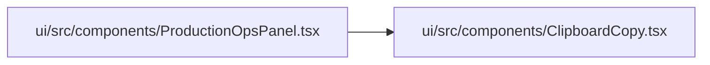

# ClipboardCopy Module

**Path:** `ui/src/components/ClipboardCopy.tsx`

## Description

_Auto-generated from `ui/src/components/ClipboardCopy.tsx`._

## Imports

| Source | Symbols |
|--------|---------|
| `react` | `useState` |

## Module Signals

| Signal | Values |
|--------|--------|
| Exports | `default` |

## Local dependency map

<!-- Auto-generated local dependency summary. Do not edit by hand. -->

### Internal neighbors

| Direction | Module |
|---|---|
| Inbound | [ProductionOpsPanel](../modules/ProductionOpsPanel.md) |

### External packages

| Language | Used packages | Undeclared packages |
|---|---:|---:|
| typescript | 1 | 0 |

## Classes

| Class | Kind | Line | Bases / Target | Description |
|-------|------|------|----------------|-------------|
| [Props](../entities/ClipboardCopy_Props.md) | Class | 3 | — | — |

## Functions

| Function | Signature | Decorators | Description |
|----------|-----------|------------|-------------|
| `ClipboardCopy` | `({ value, truncate = true, maxLength = 12 }: Props)` | — | — |
