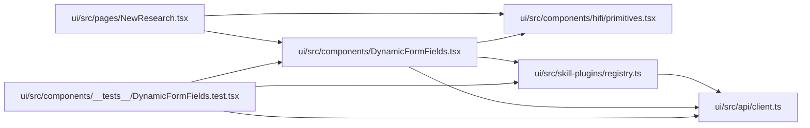

# DynamicFormFields Module

**Path:** `ui/src/components/DynamicFormFields.tsx`

## Description

_Auto-generated from `ui/src/components/DynamicFormFields.tsx`._

## Imports

| Source | Symbols |
|--------|---------|
| `../api/client` | `FormField`, `api` |
| `../skill-plugins/registry` | `resolve` |
| `./hifi/primitives` | `Field` |
| `react` | `useEffect`, `useState` |

## Module Signals

| Signal | Values |
|--------|--------|
| Exports | `default` |
| Constants | `KNOWN_TYPES` |
| Module calls | `KNOWN_TYPES = Set` |

## Local dependency map

<!-- Auto-generated local dependency summary. Do not edit by hand. -->

### Internal neighbors

| Direction | Module |
|---|---|
| Inbound | [DynamicFormFields.test](../modules/DynamicFormFields.test.md) |
| Inbound | [NewResearch](../modules/NewResearch.md) |
| Outbound | [client](../modules/client.md) |
| Outbound | [primitives](../modules/primitives.md) |
| Outbound | [registry](../modules/registry.md) |

### External packages

| Language | Used packages | Undeclared packages |
|---|---:|---:|
| typescript | 1 | 0 |

## Classes

| Class | Kind | Line | Bases / Target | Description |
|-------|------|------|----------------|-------------|
| [Props](../entities/DynamicFormFields_Props.md) | Class | 14 | — | — |

## Functions

| Function | Signature | Decorators | Description |
|----------|-----------|------------|-------------|
| `DynamicFormFields` | `({ fields, values, onChange, skillId }: Props)` | — | — |
