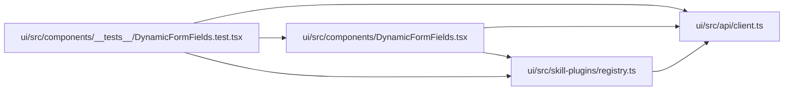

# DynamicFormFields.test Module

**Path:** `ui/src/components/__tests__/DynamicFormFields.test.tsx`

## Description

_Auto-generated from `ui/src/components/__tests__/DynamicFormFields.test.tsx`._

## Imports

| Source | Symbols |
|--------|---------|
| `../../api/client` | `apiModule`, `FormField` |
| `../../skill-plugins/registry` | `reset`, `register` |
| `../DynamicFormFields` | `DynamicFormFields` |
| `@testing-library/react` | `render`, `screen` |
| `@testing-library/user-event` | `userEvent` |
| `vitest` | `describe`, `it`, `expect`, `beforeEach`, `afterEach`, `vi` |

## Module Signals

| Signal | Values |
|--------|--------|
| Module calls | `describe` |

## Local dependency map

<!-- Auto-generated local dependency summary. Do not edit by hand. -->

### Internal neighbors

| Direction | Module |
|---|---|
| Outbound | [client](../modules/client.md) |
| Outbound | [DynamicFormFields](../modules/DynamicFormFields.md) |
| Outbound | [registry](../modules/registry.md) |

### External packages

| Language | Used packages | Undeclared packages |
|---|---:|---:|
| typescript | 3 | 0 |
