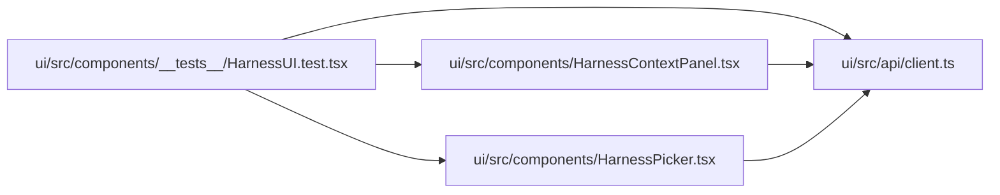

# HarnessUI.test Module

**Path:** `ui/src/components/__tests__/HarnessUI.test.tsx`

## Description

_Auto-generated from `ui/src/components/__tests__/HarnessUI.test.tsx`._

## Imports

| Source | Symbols |
|--------|---------|
| `../../api/client` | `HarnessContext`, `HarnessDescriptor` |
| `../HarnessContextPanel` | `HarnessContextPanel` |
| `../HarnessPicker` | `HarnessPicker` |
| `@testing-library/react` | `fireEvent`, `render`, `screen` |
| `vitest` | `describe`, `it`, `expect`, `vi`, `beforeEach`, `afterEach` |
| Unresolved `dynamic-import` | — (line 193; deferred) |
| Unresolved `dynamic-import` | — (line 194; deferred) |
| Unresolved `dynamic-import` | — (line 195; deferred) |
| Unresolved `dynamic-import` | — (line 235; deferred) |
| Unresolved `dynamic-import` | — (line 236; deferred) |
| Unresolved `dynamic-import` | — (line 237; deferred) |

## Module Signals

| Signal | Values |
|--------|--------|
| Module calls | `describe`, `describe`, `describe` |

## Local dependency map

<!-- Auto-generated local dependency summary. Do not edit by hand. -->

### Internal neighbors

| Direction | Module |
|---|---|
| Outbound | [client](../modules/client.md) |
| Outbound | [HarnessContextPanel](../modules/HarnessContextPanel.md) |
| Outbound | [HarnessPicker](../modules/HarnessPicker.md) |

### External packages

| Language | Used packages | Undeclared packages |
|---|---:|---:|
| typescript | 2 | 0 |

## Classes

| Class | Line | Bases | Description |
|-------|------|-------|-------------|
| [MockWebSocket](../entities/MockWebSocket.md) | 167 | — | — |
