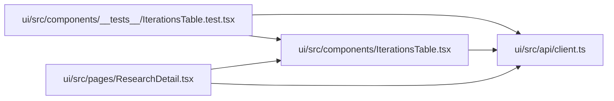

# IterationsTable Module

**Path:** `ui/src/components/IterationsTable.tsx`

## Description

_Auto-generated from `ui/src/components/IterationsTable.tsx`._

## Imports

| Source | Symbols |
|--------|---------|
| `../api/client` | `Iteration`, `MetricColumn` |
| `react` | `useState` |

## Module Signals

| Signal | Values |
|--------|--------|
| Exports | `default` |

## Local dependency map

<!-- Auto-generated local dependency summary. Do not edit by hand. -->

### Internal neighbors

| Direction | Module |
|---|---|
| Inbound | [IterationsTable.test](../modules/IterationsTable.test.md) |
| Inbound | [ResearchDetail](../modules/ResearchDetail.md) |
| Outbound | [client](../modules/client.md) |

### External packages

| Language | Used packages | Undeclared packages |
|---|---:|---:|
| typescript | 1 | 0 |

## Classes

| Class | Kind | Line | Bases / Target | Description |
|-------|------|------|----------------|-------------|
| [Props](../entities/IterationsTable_Props.md) | Class | 4 | — | — |

## Functions

| Function | Signature | Decorators | Description |
|----------|-----------|------------|-------------|
| `IterationsTable` | `({ iterations, bestIteration, tableColumns }: Props)` | — | — |
