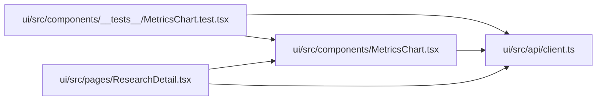

# MetricsChart Module

**Path:** `ui/src/components/MetricsChart.tsx`

## Description

_Auto-generated from `ui/src/components/MetricsChart.tsx`._

## Imports

| Source | Symbols |
|--------|---------|
| `../api/client` | `Iteration`, `MetricColumn` |
| `react` | `useState` |
| `recharts` | `LineChart`, `Line`, `XAxis`, `YAxis`, `Tooltip`, `CartesianGrid`, `ResponsiveContainer`, `Legend` |

## Module Signals

| Signal | Values |
|--------|--------|
| Exports | `default` |
| Constants | `DEFAULT_COLORS` |

## Local dependency map

<!-- Auto-generated local dependency summary. Do not edit by hand. -->

### Internal neighbors

| Direction | Module |
|---|---|
| Inbound | [MetricsChart.test](../modules/MetricsChart.test.md) |
| Inbound | [ResearchDetail](../modules/ResearchDetail.md) |
| Outbound | [client](../modules/client.md) |

### External packages

| Language | Used packages | Undeclared packages |
|---|---:|---:|
| typescript | 2 | 0 |

## Classes

| Class | Kind | Line | Bases / Target | Description |
|-------|------|------|----------------|-------------|
| [Props](../entities/MetricsChart_Props.md) | Class | 5 | — | — |

## Functions

| Function | Signature | Decorators | Description |
|----------|-----------|------------|-------------|
| `MetricsChart` | `({ iterations, selectedIteration = null, onSelectIteration, chartSeries }: Props)` | — | — |
