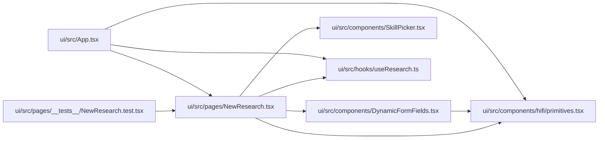

# NewResearch Module

**Path:** `ui/src/pages/NewResearch.tsx`

## Description

_Auto-generated from `ui/src/pages/NewResearch.tsx`._

## Imports

| Source | Symbols |
|--------|---------|
| `../components/DynamicFormFields` | `DynamicFormFields` |
| `../components/SkillPicker` | `SkillPicker` |
| `../components/hifi/primitives` | `Field`, `Icon` |
| `../hooks/useResearch` | `useModels`, `useStartResearch`, `useSkills`, `useSkillFormFields`, `useCostEstimate` |
| `react` | `useEffect`, `useMemo`, `useState` |
| `react-router-dom` | `Link`, `useNavigate` |

## Module Signals

| Signal | Values |
|--------|--------|
| Exports | `default` |
| Constants | `FOCUS_EXAMPLES` |

## Local dependency map

<!-- Auto-generated local dependency summary. Do not edit by hand. -->

### Internal neighbors

| Direction | Module |
|---|---|
| Inbound | [App](../modules/App.md) |
| Inbound | [NewResearch.test](../modules/NewResearch.test.md) |
| Outbound | [DynamicFormFields](../modules/DynamicFormFields.md) |
| Outbound | [primitives](../modules/primitives.md) |
| Outbound | [SkillPicker](../modules/SkillPicker.md) |
| Outbound | [useResearch](../modules/useResearch.md) |

### External packages

| Language | Used packages | Undeclared packages |
|---|---:|---:|
| typescript | 2 | 0 |

## Functions

| Function | Signature | Decorators | Description |
|----------|-----------|------------|-------------|
| `NewResearch` | `()` | — | — |
