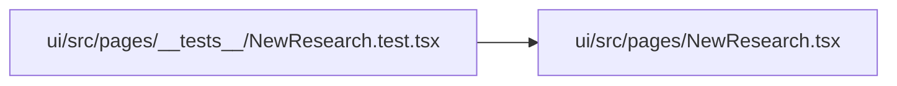

# NewResearch.test Module

**Path:** `ui/src/pages/__tests__/NewResearch.test.tsx`

## Description

_Auto-generated from `ui/src/pages/__tests__/NewResearch.test.tsx`._

## Imports

| Source | Symbols |
|--------|---------|
| `../NewResearch` | `NewResearch` |
| `@testing-library/react` | `fireEvent`, `render`, `screen` |
| `react-router-dom` | `MemoryRouter` |
| `vitest` | `describe`, `it`, `expect`, `vi`, `beforeEach` |

## Module Signals

| Signal | Values |
|--------|--------|
| Constants | `_startSeen` |
| Module calls | `mock`, `describe` |

## Local dependency map

<!-- Auto-generated local dependency summary. Do not edit by hand. -->

### Internal neighbors

| Direction | Module |
|---|---|
| Outbound | [NewResearch](../modules/NewResearch.md) |

### External packages

| Language | Used packages | Undeclared packages |
|---|---:|---:|
| typescript | 3 | 0 |
