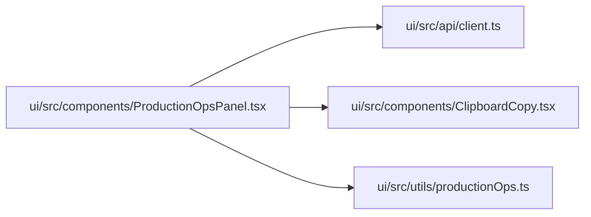

# ProductionOpsPanel Module

**Path:** `ui/src/components/ProductionOpsPanel.tsx`

## Description

_Auto-generated from `ui/src/components/ProductionOpsPanel.tsx`._

## Imports

| Source | Symbols |
|--------|---------|
| `../api/client` | `FeatureReadinessChannel`, `ProductionOperations`, `ResearchState` |
| `../utils/productionOps` | `blockerLabels`, `formatMetric`, `productionReady`, `scopeSummary`, `toneClasses`, `toneForStatus`, `warningTone` |
| `./ClipboardCopy` | `ClipboardCopy` |
| `react` | `useState` |

## Module Signals

| Signal | Values |
|--------|--------|
| Exports | `default` |

## Local dependency map

<!-- Auto-generated local dependency summary. Do not edit by hand. -->

### Internal neighbors

| Direction | Module |
|---|---|
| Outbound | [client](../modules/client.md) |
| Outbound | [ClipboardCopy](../modules/ClipboardCopy.md) |
| Outbound | [productionOps](../modules/productionOps.md) |

### External packages

| Language | Used packages | Undeclared packages |
|---|---:|---:|
| typescript | 1 | 0 |

## Classes

| Class | Kind | Line | Bases / Target | Description |
|-------|------|------|----------------|-------------|
| [Props](../entities/ProductionOpsPanel_Props.md) | Class | 14 | — | — |

## Functions

| Function | Signature | Decorators | Description |
|----------|-----------|------------|-------------|
| `ProductionOpsPanel` | `({ state }: Props)` | — | — |
