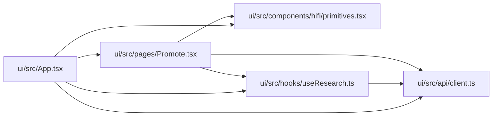

# Promote Module

**Path:** `ui/src/pages/Promote.tsx`

## Description

_Auto-generated from `ui/src/pages/Promote.tsx`._

## Imports

| Source | Symbols |
|--------|---------|
| `../api/client` | `PromotionGateCheck`, `PromotionPreview`, `PromotionScope` |
| `../components/hifi/primitives` | `Icon`, `Stat`, `StatusBadge` |
| `../hooks/useResearch` | `useConfirmPromotion`, `usePreviewPromotion`, `useSession` |
| `react` | `useEffect`, `useMemo`, `useState` |
| `react-router-dom` | `Link`, `useNavigate`, `useParams` |

## Module Signals

| Signal | Values |
|--------|--------|
| Exports | `default` |
| Constants | `SCOPES` |

## Local dependency map

<!-- Auto-generated local dependency summary. Do not edit by hand. -->

### Internal neighbors

| Direction | Module |
|---|---|
| Inbound | [App](../modules/App.md) |
| Outbound | [client](../modules/client.md) |
| Outbound | [primitives](../modules/primitives.md) |
| Outbound | [useResearch](../modules/useResearch.md) |

### External packages

| Language | Used packages | Undeclared packages |
|---|---:|---:|
| typescript | 2 | 0 |

## Classes

| Class | Kind | Line | Bases / Target | Description |
|-------|------|------|----------------|-------------|
| [ScopeOption](../entities/ScopeOption.md) | Class | 17 | — | — |
| [DiffLine](../entities/DiffLine.md) | Class | 453 | — | — |

## Functions

| Function | Signature | Decorators | Description |
|----------|-----------|------------|-------------|
| `Promote` | `()` | — | — |
