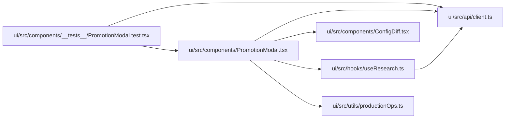

# PromotionModal Module

**Path:** `ui/src/components/PromotionModal.tsx`

## Description

_Auto-generated from `ui/src/components/PromotionModal.tsx`._

## Imports

| Source | Symbols |
|--------|---------|
| `../api/client` | `ProductionOperations`, `PromotionApproval`, `PromotionPreview`, `PromotionPreviewRequest`, `PromotionScope`, `PromotionScopeRequest` |
| `../hooks/useResearch` | `usePreviewPromotion`, `useConfirmPromotion` |
| `../utils/productionOps` | `blockerLabels`, `scopeLabel`, `scopeSummary`, `toneClasses`, `toneForStatus` |
| `./ConfigDiff` | `ConfigDiff` |
| `react` | `useState` |

## Module Signals

| Signal | Values |
|--------|--------|
| Exports | `default` |
| Constants | `SCOPES` |

## Local dependency map

<!-- Auto-generated local dependency summary. Do not edit by hand. -->

### Internal neighbors

| Direction | Module |
|---|---|
| Inbound | [PromotionModal.test](../modules/PromotionModal.test.md) |
| Outbound | [client](../modules/client.md) |
| Outbound | [ConfigDiff](../modules/ConfigDiff.md) |
| Outbound | [useResearch](../modules/useResearch.md) |
| Outbound | [productionOps](../modules/productionOps.md) |

### External packages

| Language | Used packages | Undeclared packages |
|---|---:|---:|
| typescript | 1 | 0 |

## Classes

| Class | Kind | Line | Bases / Target | Description |
|-------|------|------|----------------|-------------|
| [Props](../entities/PromotionModal_Props.md) | Class | 20 | — | — |

## Functions

| Function | Signature | Decorators | Description |
|----------|-----------|------------|-------------|
| `PromotionModal` | `({ researchId, operations, onClose }: Props)` | — | — |
