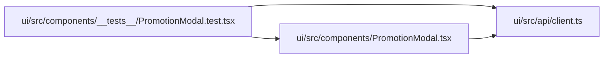

# PromotionModal.test Module

**Path:** `ui/src/components/__tests__/PromotionModal.test.tsx`

## Description

_Auto-generated from `ui/src/components/__tests__/PromotionModal.test.tsx`._

## Imports

| Source | Symbols |
|--------|---------|
| `../../api/client` | `PromotionPreview`, `ProductionOperations` |
| `../PromotionModal` | `PromotionModal` |
| `@testing-library/react` | `fireEvent`, `render`, `screen` |
| `@testing-library/user-event` | `userEvent` |
| `vitest` | `describe`, `it`, `expect`, `vi`, `beforeEach` |

## Module Signals

| Signal | Values |
|--------|--------|
| Constants | `_previewStore`, `_confirmSeen` |
| Module calls | `mock`, `describe` |

## Local dependency map

<!-- Auto-generated local dependency summary. Do not edit by hand. -->

### Internal neighbors

| Direction | Module |
|---|---|
| Outbound | [client](../modules/client.md) |
| Outbound | [PromotionModal](../modules/PromotionModal.md) |

### External packages

| Language | Used packages | Undeclared packages |
|---|---:|---:|
| typescript | 3 | 0 |
