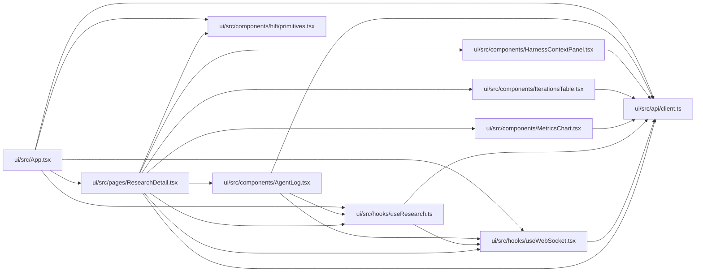

# ResearchDetail Module

**Path:** `ui/src/pages/ResearchDetail.tsx`

## Description

_Auto-generated from `ui/src/pages/ResearchDetail.tsx`._

## Imports

| Source | Symbols |
|--------|---------|
| `../api/client` | `api`, `Iteration`, `MetricColumn`, `ResearchState` |
| `../components/AgentLog` | `AgentLog` |
| `../components/HarnessContextPanel` | `HarnessContextPanel` |
| `../components/IterationsTable` | `IterationsTable` |
| `../components/MetricsChart` | `MetricsTrendChart` |
| `../components/hifi/primitives` | `Icon`, `PhaseBar`, `Stat`, `StatusBadge` |
| `../hooks/useResearch` | `useIterations`, `useAgentLog`, `useHarnessContext`, `usePauseSession`, `useResearchState`, `useResumeSession`, `useSession`, `useSkillMetricSchema`, `useStopSession` |
| `../hooks/useWebSocket` | `useWebSocket` |
| `react` | `useEffect`, `useMemo`, `useState`, `ReactNode` |
| `react-router-dom` | `Link`, `useNavigate`, `useParams` |

## Module Signals

| Signal | Values |
|--------|--------|
| Exports | `default` |

## Local dependency map

<!-- Auto-generated local dependency summary. Do not edit by hand. -->

### Internal neighbors

| Direction | Module |
|---|---|
| Inbound | [App](../modules/App.md) |
| Outbound | [client](../modules/client.md) |
| Outbound | [AgentLog](../modules/AgentLog.md) |
| Outbound | [HarnessContextPanel](../modules/HarnessContextPanel.md) |
| Outbound | [primitives](../modules/primitives.md) |
| Outbound | [IterationsTable](../modules/IterationsTable.md) |
| Outbound | [MetricsChart](../modules/MetricsChart.md) |
| Outbound | [useResearch](../modules/useResearch.md) |
| Outbound | [useWebSocket](../modules/useWebSocket.md) |

### External packages

| Language | Used packages | Undeclared packages |
|---|---:|---:|
| typescript | 2 | 0 |

## Classes

| Class | Kind | Line | Bases / Target | Description |
|-------|------|------|----------------|-------------|
| [Tab](../entities/Tab.md) | Type alias | 31 | — | — |
| [MetricDef](../entities/MetricDef.md) | Type alias | 637 | — | — |
| [MetricDiagnostic](../entities/MetricDiagnostic.md) | Type alias | 638 | — | — |
| [DetailEntry](../entities/DetailEntry.md) | Type alias | 642 | — | — |

## Functions

| Function | Signature | Decorators | Description |
|----------|-----------|------------|-------------|
| `ResearchDetail` | `()` | — | — |
