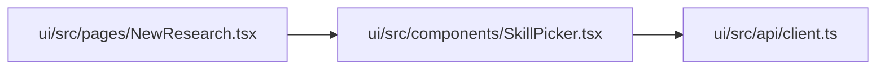

# SkillPicker Module

**Path:** `ui/src/components/SkillPicker.tsx`

## Description

_Auto-generated from `ui/src/components/SkillPicker.tsx`._

## Imports

| Source | Symbols |
|--------|---------|
| `../api/client` | `SkillSummary` |

## Module Signals

| Signal | Values |
|--------|--------|
| Exports | `default` |
| Constants | `CATEGORY_ICONS` |

## Local dependency map

<!-- Auto-generated local dependency summary. Do not edit by hand. -->

### Internal neighbors

| Direction | Module |
|---|---|
| Inbound | [NewResearch](../modules/NewResearch.md) |
| Outbound | [client](../modules/client.md) |

## Classes

| Class | Kind | Line | Bases / Target | Description |
|-------|------|------|----------------|-------------|
| [Props](../entities/SkillPicker_Props.md) | Class | 6 | — | — |

## Functions

| Function | Signature | Decorators | Description |
|----------|-----------|------------|-------------|
| `SkillPicker` | `({ skills, selected, onSelect }: Props)` | — | — |
