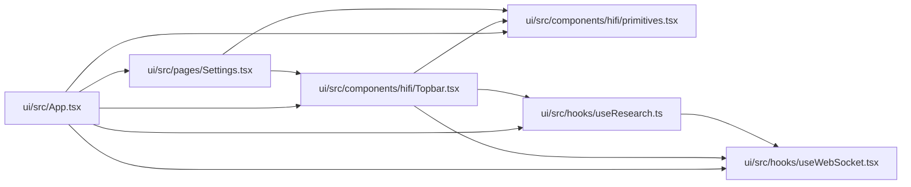

# Topbar Module

**Path:** `ui/src/components/hifi/Topbar.tsx`

## Description

_Auto-generated from `ui/src/components/hifi/Topbar.tsx`._

## Imports

| Source | Symbols |
|--------|---------|
| `../../hooks/useResearch` | `useStatus` |
| `../../hooks/useWebSocket` | `useWebSocket` |
| `./primitives` | `Icon` |
| `react` | `useEffect`, `useState` |
| `react-router-dom` | `NavLink`, `useLocation` |

## Module Signals

| Signal | Values |
|--------|--------|
| Exports | `AccentName`, `DensityName`, `ThemeName`, `Topbar`, `TopbarProps`, `useDesignPrefs` |
| Constants | `THEME_KEY`, `DENSITY_KEY`, `ACCENT_KEY` |

## Local dependency map

<!-- Auto-generated local dependency summary. Do not edit by hand. -->

### Internal neighbors

| Direction | Module |
|---|---|
| Inbound | [App](../modules/App.md) |
| Inbound | [Settings](../modules/Settings.md) |
| Outbound | [primitives](../modules/primitives.md) |
| Outbound | [useResearch](../modules/useResearch.md) |
| Outbound | [useWebSocket](../modules/useWebSocket.md) |

### External packages

| Language | Used packages | Undeclared packages |
|---|---:|---:|
| typescript | 2 | 0 |

## Classes

| Class | Kind | Line | Bases / Target | Description |
|-------|------|------|----------------|-------------|
| [TopbarProps](../entities/TopbarProps.md) | Class | 62 | — | — |
| [ThemeName](../entities/ThemeName.md) | Type alias | 8 | — | — |
| [DensityName](../entities/DensityName.md) | Type alias | 9 | — | — |
| [AccentName](../entities/AccentName.md) | Type alias | 10 | — | — |

## Functions

| Function | Signature | Decorators | Description |
|----------|-----------|------------|-------------|
| `useDesignPrefs` | `()` | — | — |
| `Topbar` | `({ onToggleTheme, theme }: TopbarProps)` | — | — |
