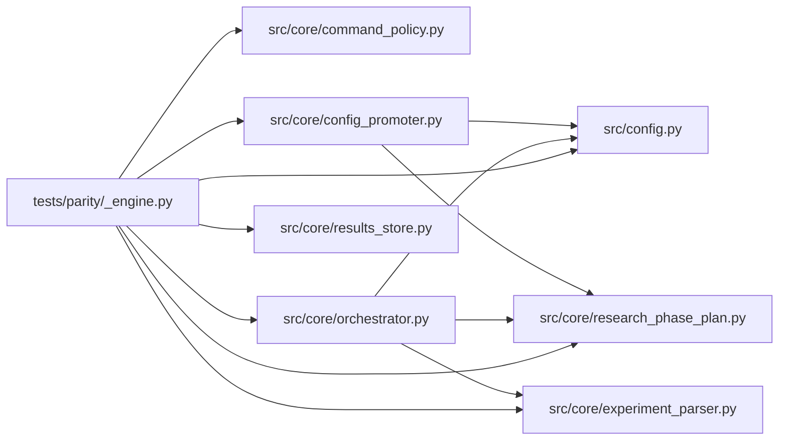

# _engine Module

**Path:** `tests/parity/_engine.py`

## Description

ARC-011 X-002 parity engine.

Shared by ``tests/parity/test_parity.py`` (verify) and
``tests/parity/capture.py`` (record) so the two paths invoke the target
functions with identical logic. The engine:

  1. materializes a per-case workspace (token substitution + file creation),
  2. dispatches to the real source function named by the fixture's
     ``function`` field,
  3. converts the result to a plain dict, and
  4. normalizes volatile fields (paths → tokens, hashes/timestamps redacted)
     so golden ``expected`` blocks are stable across machines and runs.

## Imports

| Source | Symbols |
|--------|---------|
| `__future__` | `annotations` |
| `asyncio` | `asyncio` |
| `dataclasses` | `dataclasses` |
| `json` | `json` |
| `os` | `os` |
| `pathlib` | `Path` |
| `re` | `re` |
| `src` | `config` |
| `src.core.command_policy` | `evaluate_command_policy` |
| `src.core.config_promoter` | `ConfigPromoter` |
| `src.core.experiment_parser` | `parse_prepare_output`, `parse_iteration_marker` |
| `src.core.orchestrator` | `ResearchConfig` |
| `src.core.research_phase_plan` | `build_phase_state` |
| `src.core.results_store` | `ResultsStore` |
| `sys` | `sys` |
| `typing` | `Any` |

## Local dependency map

<!-- Auto-generated local dependency summary. Do not edit by hand. -->

### Internal neighbors

| Direction | Module |
|---|---|
| Outbound | [config](../modules/config.md) |
| Outbound | [command_policy](../modules/command_policy.md) |
| Outbound | [config_promoter](../modules/config_promoter.md) |
| Outbound | [experiment_parser](../modules/experiment_parser.md) |
| Outbound | [orchestrator](../modules/orchestrator.md) |
| Outbound | [research_phase_plan](../modules/research_phase_plan.md) |
| Outbound | [results_store](../modules/results_store.md) |

## Functions

| Function | Signature | Decorators | Description |
|----------|-----------|------------|-------------|
| `discover_cases` | `(base: Path) -> list[tuple[str, Path]]` | — | Return ``[(case_id, path), ...]`` for every ``*.json`` under ``base``. |
| `load_case` | `(path: Path) -> dict[str, Any]` | — | — |
| `_substitute` | `(obj: Any, mapping: dict[str, str]) -> Any` | — | Replace token strings with real paths (input direction). |
| `_detokenize` | `(obj: Any, mapping: dict[str, str]) -> Any` | — | Replace real paths with tokens (output direction, for stable expected). |
| `_redact` | `(obj: Any) -> Any` | — | Redact values of volatile keys (hashes, timestamps, run ids) and drop |
| `normalize` | `(obj: Any, mapping: dict[str, str]) -> Any` | — | Full output normalization: detokenize then redact. |
| `materialize_files` | `(workspace: Path, create_files: dict[str, str] \| None) -> None` | — | — |
| `invoke` | `(case: dict[str, Any], workspace: Path, host_configs: Path, tmp_path: Path) -> Any` | — | Materialize inputs, call the target function, return its raw (dict) result. |
| `_build_store` | *(async)* `(fixture_name: str, db_path: Path)` | — | Replicate tests/conftest.py replay_iterations seeding, standalone. |
| `_invoke_preview` | *(async)* `(case: dict, workspace: Path, host_configs: Path, tmp_path: Path)` | — | — |
