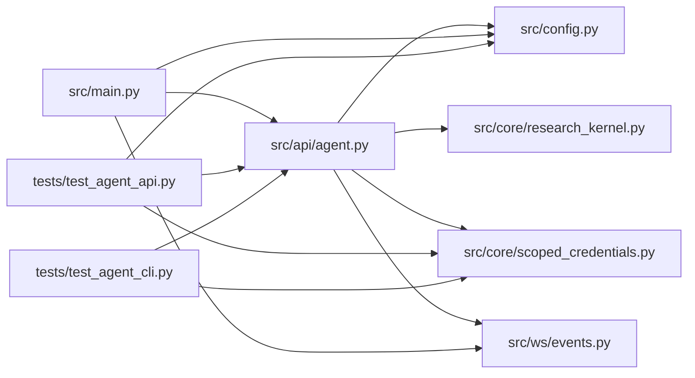

# agent Module

**Path:** `src/api/agent.py`

## Description

Scoped research operations for attached agents.

Attached agents authenticate with run-scoped credentials (never the global
operator token) and can only touch their own run. They may submit
candidates, request evaluations, inspect verified results, control their
run's lifecycle, and preview promotion eligibility — they can never declare
their own results verified nor approve production promotion. Storage paths
are derived server-side; submissions are digest-validated, idempotent, and
rate/size-limited.

## Imports

| Source | Symbols |
|--------|---------|
| `__future__` | `annotations` |
| `fastapi` | `APIRouter`, `Header`, `HTTPException`, `Request` |
| `fastapi.security` | `HTTPAuthorizationCredentials`, `HTTPBearer` |
| `hashlib` | `hashlib` |
| `json` | `json` |
| `pydantic` | `BaseModel`, `ConfigDict`, `Field` |
| `src.config` | `secret_value`, `settings`, `settings` |
| `src.core` | `scoped_credentials` |
| `src.core.research_kernel` | `decide_promotion` |
| `src.core.scoped_credentials` | `PERM_EVALUATE`, `PERM_LIFECYCLE`, `PERM_READ`, `PERM_SUBMIT`, `ScopedAuthError`, `ScopedPrincipal` |
| `src.ws.events` | `poll_events` |
| `time` | `time` |
| `typing` | `Any`, `Optional` |

## Local dependency map

<!-- Auto-generated local dependency summary. Do not edit by hand. -->

### Internal neighbors

| Direction | Module |
|---|---|
| Inbound | [src_main](../modules/src_main.md) |
| Inbound | [test_agent_api](../modules/test_agent_api.md) |
| Inbound | [test_agent_cli](../modules/test_agent_cli.md) |
| Outbound | [config](../modules/config.md) |
| Outbound | [research_kernel](../modules/research_kernel.md) |
| Outbound | [scoped_credentials](../modules/scoped_credentials.md) |
| Outbound | [events](../modules/events.md) |

### External packages

| Language | Used packages | Undeclared packages |
|---|---:|---:|
| python | 2 | 1 |

## Classes

| Class | Line | Bases | Description |
|-------|------|-------|-------------|
| [AgentRunRequest](../entities/AgentRunRequest.md) | 101 | `BaseModel` | — |
| [CandidateSubmission](../entities/CandidateSubmission.md) | 178 | `BaseModel` | — |
| [LifecycleRequest](../entities/LifecycleRequest.md) | 307 | `BaseModel` | — |

## Functions

| Function | Signature | Decorators | Description |
|----------|-----------|------------|-------------|
| `init` | `(store, orchestrator = None, credential_key: Optional[str] = None)` | — | Wire the agent routes to the store and lifecycle controls. |
| `_key` | `() -> str` | — | — |
| `_check_rate_limit` | `(token_id: str) -> None` | — | — |
| `_require_agent` | *(async)* `(request: Request, run_id: Optional[str], permission: str) -> ScopedPrincipal` | — | — |
| `create_or_attach_run` | *(async)* `(request: Request, body: AgentRunRequest) -> dict[str, Any]` | `@router.post('/agent/runs', status_code=201)` | Create (or attach to) this credential's run. Paths are server-side. |
| `run_constraints` | *(async)* `(run_id: str, request: Request) -> dict[str, Any]` | `@router.get('/agent/runs/{run_id}/constraints')` | The run's declared budgets and the submission limits. |
| `submit_candidate` | *(async)* `(run_id: str, body: CandidateSubmission, request: Request, idempotency_key: Optional[str] = Header(None, alias='Idempotency-Key')) -> dict[str, Any]` | `@router.post('/agent/runs/{run_id}/candidates', status_code=201)` | Submit one candidate. Digest-validated, idempotent, size-limited. |
| `request_evaluation` | *(async)* `(run_id: str, request: Request) -> dict[str, Any]` | `@router.post('/agent/runs/{run_id}/evaluations', status_code=202)` | Request evaluation. The trusted channel produces verified results. |
| `inspect_results` | *(async)* `(run_id: str, request: Request) -> dict[str, Any]` | `@router.get('/agent/runs/{run_id}/results')` | Inspect results with their recorded authority labels. |
| `lifecycle_control` | *(async)* `(run_id: str, body: LifecycleRequest, request: Request) -> dict[str, Any]` | `@router.post('/agent/runs/{run_id}/lifecycle')` | Control this run's lifecycle through the bound harness. |
| `promotion_preview` | *(async)* `(run_id: str, request: Request) -> dict[str, Any]` | `@router.get('/agent/runs/{run_id}/promotion-preview')` | Preview promotion eligibility. Approval is never available here. |
| `run_events` | *(async)* `(run_id: str, request: Request, cursor: int = 0, limit: int = 100) -> dict[str, Any]` | `@router.get('/agent/runs/{run_id}/events')` | Bounded event replay from a cursor (for reconnect). |
