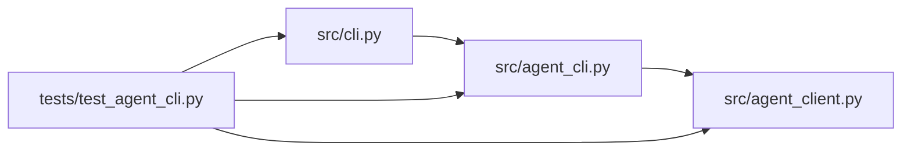

# agent_cli Module

**Path:** `src/agent_cli.py`

## Description

Attached-agent CLI: machine-readable commands over the agent API.

Every command prints one JSON object on stdout and uses a stable exit
code. Credentials are referenced (an environment variable or a file),
never passed as arguments, and error output is redacted. Bounded waits
and a persisted event cursor make the workflow safe to interrupt and
reconnect.

Exit codes (stable, published):
    0  success
    1  generic error
    2  usage or validation refusal (nothing was written)
    3  authentication/authorization refused
    4  idempotency conflict
    5  size or rate limit refused
    6  bounded wait timed out
    7  transport or API failure

## Imports

| Source | Symbols |
|--------|---------|
| `__future__` | `annotations` |
| `argparse` | `argparse` |
| `json` | `json` |
| `os` | `os` |
| `pathlib` | `Path` |
| `src.agent_client` | `DEFAULT_CREDENTIAL_ENV`, `DEFAULT_TIMEOUT_S`, `AgentAuthError`, `AgentClient`, `AgentClientError`, `AgentConflictError`, `AgentLimitError`, `resolve_credential` |
| `sys` | `sys` |
| `time` | `time` |
| `typing` | `Any`, `Callable`, `Optional` |

## Local dependency map

<!-- Auto-generated local dependency summary. Do not edit by hand. -->

### Internal neighbors

| Direction | Module |
|---|---|
| Inbound | [cli](../modules/cli.md) |
| Inbound | [test_agent_cli](../modules/test_agent_cli.md) |
| Outbound | [agent_client](../modules/agent_client.md) |

## Functions

| Function | Signature | Decorators | Description |
|----------|-----------|------------|-------------|
| `_emit` | `(payload: dict[str, Any]) -> None` | — | — |
| `_ok` | `(data: dict[str, Any]) -> int` | — | — |
| `_fail` | `(code: str, message: str, status: Optional[int] = None) -> int` | — | — |
| `build_agent_parser` | `(sub: Any) -> None` | — | Register the ``agent`` command group on the CLI's subparsers. |
| `_client` | `(args: argparse.Namespace) -> AgentClient` | — | — |
| `set_transport` | `(transport: Any) -> None` | — | Inject an httpx transport (tests and the conformance fixture). |
| `_load_cursor` | `(path: Optional[str]) -> int` | — | — |
| `_save_cursor` | `(path: Optional[str], cursor: int) -> None` | — | — |
| `cmd_agent` | *(async)* `(args: argparse.Namespace) -> int` | — | — |
| `_dispatch` | *(async)* `(client: AgentClient, args: argparse.Namespace) -> int` | — | — |
| `_wait_for_results` | *(async)* `(client: AgentClient, run_id: str, timeout_s: float) -> int` | — | Bounded wait: poll for a result until the deadline, never forever. |
