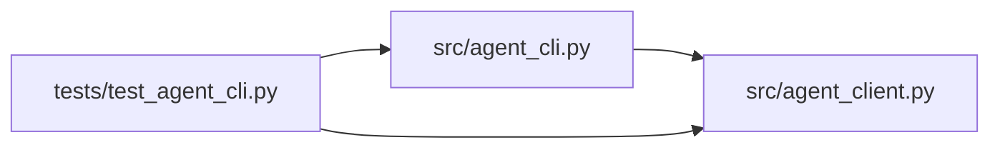

# agent_client Module

**Path:** `src/agent_client.py`

## Description

HTTP client for the attached-agent API.

The CLI drives the API through this client only — no internal Python
classes cross the boundary. Credentials arrive by reference (an
environment variable or a file), never as command-line arguments, and
error surfaces are redacted so a credential can never leak into logs.

## Imports

| Source | Symbols |
|--------|---------|
| `__future__` | `annotations` |
| `hashlib` | `hashlib` |
| `httpx` | `httpx` |
| `json` | `json` |
| `os` | `os` |
| `pathlib` | `Path` |
| `typing` | `Any`, `Mapping`, `Optional` |

## Local dependency map

<!-- Auto-generated local dependency summary. Do not edit by hand. -->

### Internal neighbors

| Direction | Module |
|---|---|
| Inbound | [agent_cli](../modules/agent_cli.md) |
| Inbound | [test_agent_cli](../modules/test_agent_cli.md) |

### External packages

| Language | Used packages | Undeclared packages |
|---|---:|---:|
| python | 1 | 0 |

## Classes

| Class | Line | Bases | Description |
|-------|------|-------|-------------|
| [AgentClientError](../entities/AgentClientError.md) | 23 | `Exception` | An API or transport failure with a stable, redacted message. |
| [AgentAuthError](../entities/AgentAuthError.md) | 31 | `AgentClientError` | The scoped credential was refused (or missing). |
| [AgentConflictError](../entities/AgentConflictError.md) | 35 | `AgentClientError` | The request conflicts with an earlier one (idempotency). |
| [AgentLimitError](../entities/AgentLimitError.md) | 39 | `AgentClientError` | A size or rate limit refused the request. |
| [AgentClient](../entities/AgentClient.md) | 66 | — | The attached-agent API client with bounded waits. |

## Functions

| Function | Signature | Decorators | Description |
|----------|-----------|------------|-------------|
| `resolve_credential` | `(*, credential_env: str = DEFAULT_CREDENTIAL_ENV, credential_file: Optional[str] = None) -> str` | — | Load the scoped credential by reference, never from argv. |
| `redact` | `(text: str, secret: Optional[str]) -> str` | — | Never let a credential surface in output or logs. |
