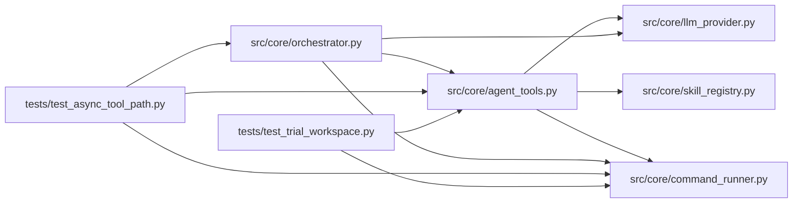

# agent_tools Module

**Path:** `src/core/agent_tools.py`

## Description

Agent tool surface — the 5 sandboxed tools + path safety (P1-1 split).

Extracted verbatim from ``orchestrator.py`` (behavior-identical): the
``ToolExecutionResult`` value type, the ``AGENT_TOOLS`` definitions handed to
the LLM provider, the workspace path-safety helpers, the five tool
implementations (``bash`` / ``read_file`` / ``write_file`` / ``glob`` /
``grep``), the packaged-skill primer loader, and the W11 nonce-env narrowing
helper. ``orchestrator.py`` re-exports all of these for back-compat; new code
should import from here.

## Imports

| Source | Symbols |
|--------|---------|
| `__future__` | `annotations` |
| `dataclasses` | `dataclass`, `field` |
| `glob` | `glob_mod` |
| `logging` | `logging` |
| `math` | `math` |
| `os` | `os` |
| `pathlib` | `Path` |
| `re` | `re` |
| `shlex` | `shlex` |
| `src.core.command_runner` | `CommandProcessRegistry`, `GovernedCommandRunner`, `OutputCallback`, `_build_child_env`, `_collect_process_output`, `_SessionOutputLog` |
| `src.core.llm_provider` | `ToolDef` |
| `src.core.skill_registry` | `DEFAULT_SKILLS_ROOT` |
| `subprocess` | `subprocess` |
| `time` | `time` |
| `typing` | `Any`, `Dict`, `Mapping`, `Optional` |

## Local dependency map

<!-- Auto-generated local dependency summary. Do not edit by hand. -->

### Internal neighbors

| Direction | Module |
|---|---|
| Inbound | [orchestrator](../modules/orchestrator.md) |
| Inbound | [test_async_tool_path](../modules/test_async_tool_path.md) |
| Inbound | [test_trial_workspace](../modules/test_trial_workspace.md) |
| Outbound | [command_runner](../modules/command_runner.md) |
| Outbound | [llm_provider](../modules/llm_provider.md) |
| Outbound | [skill_registry](../modules/skill_registry.md) |

## Classes

| Class | Line | Bases | Description |
|-------|------|-------|-------------|
| [ToolExecutionResult](../entities/ToolExecutionResult.md) | 40 | — | — |

## Functions

| Function | Signature | Decorators | Description |
|----------|-----------|------------|-------------|
| `_safe_path` | `(raw: str, workspace: str) -> str` | — | Resolve a path and ensure it stays within the workspace. |
| `_safe_write_path` | `(raw: str, workspace: str) -> str` | — | Resolve a writable path and ensure existing parents stay in workspace. |
| `_normalize_command_for_plan` | `(command: str) -> str` | — | — |
| `_config_snapshot_path_from_command` | `(command: str, workspace_root: str, session_workspace: str, base_dir: str \| None = None, config_flag: str = '--config') -> Optional[str]` | — | Resolve the config artifact a command references. |
| `_execute_tool` | `(name: str, input_data: Dict[str, Any], workspace: str, session_workspace: str \| None = None, output_callback: OutputCallback \| None = None, *, command_deadline_mono: float \| None = None, proc_registry: CommandProcessRegistry \| None = None, research_id: str \| None = None, extra_env: Mapping[str, str] \| None = None, policy_extension: Mapping[str, Any] \| None = None, cwd: str \| None = None) -> ToolExecutionResult` | — | Execute a tool call and return the text result. |
| `_tool_bash` | `(input_data: Dict[str, Any], workspace: str, session_workspace: str \| None = None, output_callback: OutputCallback \| None = None, *, command_deadline_mono: float \| None = None, proc_registry: CommandProcessRegistry \| None = None, research_id: str \| None = None, extra_env: Mapping[str, str] \| None = None, policy_extension: Mapping[str, Any] \| None = None, cwd: str \| None = None) -> ToolExecutionResult` | — | — |
| `_tool_read_file` | `(input_data: Dict[str, Any], workspace: str) -> str` | — | Read at most 100,001 characters, never materializing a whole large file. |
| `_tool_write_file` | `(input_data: Dict[str, Any], workspace: str) -> str` | — | — |
| `_tool_glob` | `(input_data: Dict[str, Any], workspace: str) -> str` | — | — |
| `_tool_grep` | `(input_data: Dict[str, Any], workspace: str, session_workspace: str \| None = None) -> str` | — | Incremental grep capture, excluding its own active log. |
| `_load_packaged_skill_md` | `(skill_id: str, primer: str = 'SKILL.md') -> str` | — | Read the packaged ``skills/<skill_id>/<primer>`` domain primer (C2-2). |
| `_nonce_env_for_command` | `(nonce_env: Optional[Mapping[str, str]], command: object, policy_extension: Optional[Mapping[str, Any]]) -> Optional[Mapping[str, str]]` | — | Narrow the W11 nonce env delivery to the skill's declared scripts (C3). |
