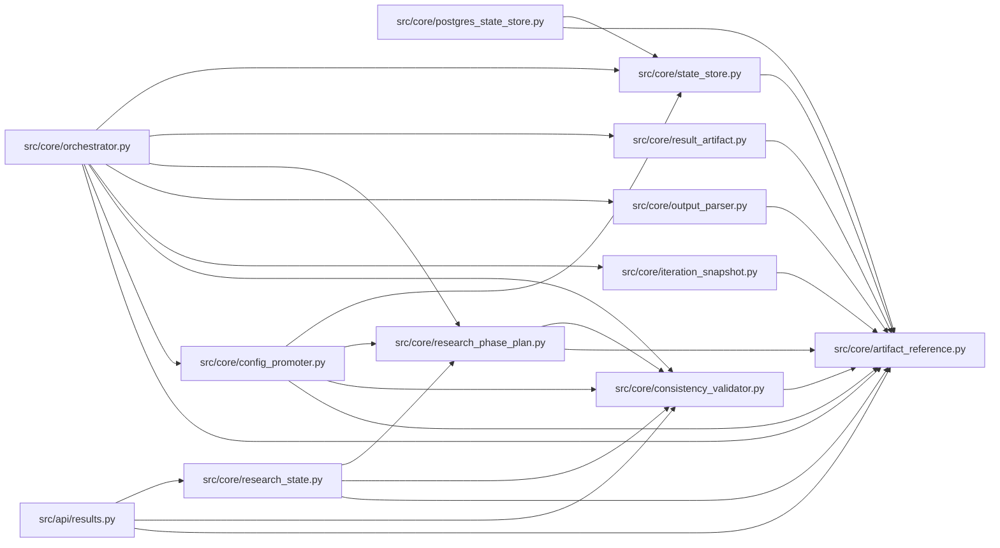

# artifact_reference Module

**Path:** `src/core/artifact_reference.py`

## Description

Artifact reference normalization for autoresearch metadata.

## Imports

| Source | Symbols |
|--------|---------|
| `__future__` | `annotations` |
| `collections.abc` | `MutableMapping` |
| `typing` | `Any` |

## Local dependency map

<!-- Auto-generated local dependency summary. Do not edit by hand. -->

### Internal neighbors

| Direction | Module |
|---|---|
| Inbound | [results](../modules/results.md) |
| Inbound | [config_promoter](../modules/config_promoter.md) |
| Inbound | [consistency_validator](../modules/consistency_validator.md) |
| Inbound | [iteration_snapshot](../modules/iteration_snapshot.md) |
| Inbound | [orchestrator](../modules/orchestrator.md) |
| Inbound | [output_parser](../modules/output_parser.md) |
| Inbound | [postgres_state_store](../modules/postgres_state_store.md) |
| Inbound | [research_phase_plan](../modules/research_phase_plan.md) |
| Inbound | [research_state](../modules/research_state.md) |
| Inbound | [result_artifact](../modules/result_artifact.md) |
| Inbound | [state_store](../modules/state_store.md) |

## Functions

| Function | Signature | Decorators | Description |
|----------|-----------|------------|-------------|
| `normalize_optional_artifact_ref` | `(value: Any) -> str \| None` | — | Return a real artifact reference string or None for sentinel values. |
| `is_sentinel_artifact_ref` | `(value: Any) -> bool` | — | Return True when an explicit artifact reference value is a sentinel. |
| `first_valid_artifact_ref` | `(*values: Any) -> str \| None` | — | Return the first normalized artifact reference from candidates. |
| `normalize_artifact_references_in_mapping` | `(payload: MutableMapping[str, Any], *, keys: frozenset[str] = ARTIFACT_REFERENCE_KEYS) -> bool` | — | Normalize known artifact-reference fields in a nested mapping. |
