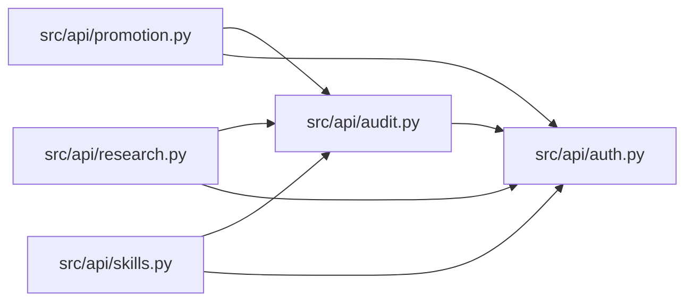

# audit Module

**Path:** `src/api/audit.py`

## Description

Audit helpers for protected autoresearch API endpoints.

## Imports

| Source | Symbols |
|--------|---------|
| `__future__` | `annotations` |
| `fastapi` | `Request` |
| `src.api.auth` | `AuthenticatedActor` |
| `typing` | `Any` |

## Local dependency map

<!-- Auto-generated local dependency summary. Do not edit by hand. -->

### Internal neighbors

| Direction | Module |
|---|---|
| Inbound | [promotion](../modules/promotion.md) |
| Inbound | [research](../modules/research.md) |
| Inbound | [src_api_skills](../modules/src_api_skills.md) |
| Outbound | [auth](../modules/auth.md) |

### External packages

| Language | Used packages | Undeclared packages |
|---|---:|---:|
| python | 1 | 1 |

## Functions

| Function | Signature | Decorators | Description |
|----------|-----------|------------|-------------|
| `_request_actor` | `(request: Request) -> AuthenticatedActor \| None` | — | — |
| `request_metadata` | `(request: Request, extra: dict[str, Any] \| None = None) -> dict[str, Any]` | — | Build sanitized request metadata without credentials. |
| `record_api_audit_event` | *(async)* `(request: Request, store, *, action: str, outcome: str, research_id: str \| None = None, pipeline_id: str \| None = None, metadata: dict[str, Any] \| None = None, error_message: str \| None = None) -> dict[str, Any] \| None` | — | Record one audit event for a state-changing API request. |
